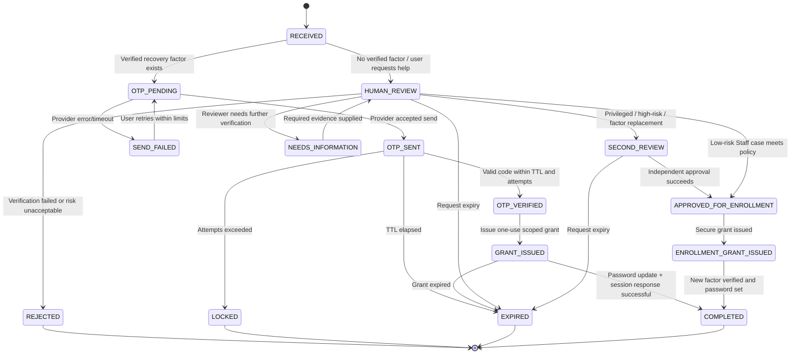

# KUVENTORY — Complete Authentication, Account Security, Recovery, and RBAC Master Plan

```text
Document type:           Implementation blueprint and acceptance specification
Repository:              OwnerTest-byte/kuventory
Branch reviewed:         main / feat/master-audit-remediation-and-safety-hardening
Status:                  Authoritative Master Architecture Specification
Primary goal:            Build one connected authentication and authorization system whose account
                         lifecycle, roles, recovery, MFA, sessions, notifications, and audit records
                         agree with one another on every browser and device.
```

---

## 1. Executive Decision

KUVENTORY issues login identifiers such as `staff@kuventory.com`, but these addresses are not mailboxes that staff can open. Therefore, the generated address is a **login identifier, not a usable recovery channel**.

The system must not present a reset email as the normal solution for those accounts. A customized email template or sender does not make a mailbox exist. Until KUVENTORY provisions real, accessible mailboxes and verifies them, reset-email delivery must be treated as unavailable for the generated aliases.

### The Recommended Target Design

1. **Keep the current username/password experience initially:** Preserve the current Supabase Auth accounts and generated `kuventory.com` login identifiers during the first migration. Do not silently rename accounts or create duplicate identities.
2. **Add a verified recovery phone factor:** The recovery service looks up the phone already associated with the account and sends the OTP only there. A user cannot type an arbitrary phone during Forgot Password and use that number to take over someone else's account.
3. **Use a secure, server-controlled recovery grant:** Successful OTP verification creates a short-lived, single-use grant scoped only to password reset. It does not create an ordinary signed-in application session.
4. **Provide assisted recovery when no recovery factor exists:** The user submits a request, gets a reference and a private way to check its status, and may contact only the support channels the Admin/Super Admin has intentionally published. Human approval authorizes the next verification step; approval by itself never resets the password.
5. **Require stronger protection for privileged accounts:** Admin, Super Admin, and Master Admin accounts use MFA for privileged access. Prefer a TOTP authenticator or another stronger factor for privileged accounts; SMS is a recovery channel with SIM-swap/recycled-number risk, not the only safeguard for system owners.
6. **Enforce permissions in trusted backend/database code:** React route guards and hidden buttons are only UX. Every sensitive database operation must check the current authenticated user, current account state, and authoritative role/permission on the server.
7. **Default to supported multi-device use:** Staff should be able to use different browsers and devices unless KUVENTORY explicitly chooses a one-active-session policy. The session-lease mechanism must not accidentally contradict the product goal of access across devices.
8. **Make failure visible and recoverable:** No workflow may report “sent,” “saved,” “approved,” “unlocked,” “password changed,” or “session revoked” unless the authoritative operation actually succeeded.

---

## 2. Evidence-Based Source Baseline

| Area | Current Source | What the Implementation Must Address |
| :--- | :--- | :--- |
| **Login & Forgot Password UI** | [`LoginForm.tsx`](file:///c:/Users/Nuero/OneDrive/Desktop/KUVENTORY-FINAL/src/features/auth/components/LoginForm.tsx) | Calls Supabase Auth, includes lockout logic, loads public support contacts, and handles Forgot Password. Separate login identifier from recovery channel. |
| **Global Auth / Session State** | [`AuthContext.tsx`](file:///c:/Users/Nuero/OneDrive/Desktop/KUVENTORY-FINAL/src/features/auth/context/AuthContext.tsx) | Loads sessions/profile, handles session leases and account activation, and maps role values. `SUPER_ADMIN` and `MASTER_ADMIN` must not be collapsed into the same exposed role value. |
| **Password Reset Screen** | [`ResetPasswordPage.tsx`](file:///c:/Users/Nuero/OneDrive/Desktop/KUVENTORY-FINAL/src/features/auth/pages/ResetPasswordPage.tsx) | Current validity check must reject ordinary sessions and require a dedicated valid recovery context/grant (`type=recovery` hash or `PASSWORD_RECOVERY` event). |
| **Recovery Request Service** | [`passwordResetService.ts`](file:///c:/Users/Nuero/OneDrive/Desktop/KUVENTORY-FINAL/src/features/auth/services/passwordResetService.ts) | Retired browser-local throttle, direct fallback writes to tables/settings/notifications/audit, and fallback records marked `DELIVERED`. Replaced with authoritative backend workflow. |
| **Login Lockout Service** | [`loginLockoutService.ts`](file:///c:/Users/Nuero/OneDrive/Desktop/KUVENTORY-FINAL/src/features/auth/services/loginLockoutService.ts) | Calls public RPCs. Remove client-supplied `p_success` boolean so callers cannot manipulate attempt counters. |
| **Session Lease Service** | [`sessionLeaseService.ts`](file:///c:/Users/Nuero/OneDrive/Desktop/KUVENTORY-FINAL/src/features/auth/services/sessionLeaseService.ts) | Uses browser-generated client IDs and a lease/heartbeat model. Leases act as session-management/UX infrastructure, not as proof of identity. |
| **Public Contacts** | [`profileService.ts`](file:///c:/Users/Nuero/OneDrive/Desktop/KUVENTORY-FINAL/src/features/admin/services/profileService.ts) | Public contact retrieval must contain only explicitly configured, opted-in contact methods. |
| **Admin Profile/Contact UI** | [`MyProfileModal.tsx`](file:///c:/Users/Nuero/OneDrive/Desktop/KUVENTORY-FINAL/src/features/admin/components/MyProfileModal.tsx) | Support phone/email and public-display setting. Remove automatic fallback from `support_email` to the profile's synthetic `kuventory.com` email. |
| **Authorization Hardening** | [`20261024150000_release_a_authorization_and_grants_hardening.sql`](file:///c:/Users/Nuero/OneDrive/Desktop/KUVENTORY-FINAL/supabase/migrations/20261024150000_release_a_authorization_and_grants_hardening.sql) | Revokes anonymous execution from sensitive inventory RPCs and removes identity fallbacks. Fail-closed discipline applied to auth. |
| **Correction Approval Example** | [`20261024180000_release_d_finalized_correction_approvals.sql`](file:///c:/Users/Nuero/OneDrive/Desktop/KUVENTORY-FINAL/supabase/migrations/20261024180000_release_d_finalized_correction_approvals.sql) | Demonstrates two-stage Admin/Super Admin review pattern and separation of duties. |

---

## 3. Architecture Principles — No Disconnected Paths

### 3.1 Authoritative Identity

- `auth.users.id` is the immutable primary identity for a person in Supabase Auth.
- `profiles.id` must equal that same Auth user ID (`profiles.id = auth.users.id`). Do not match accounts by display name or by email string alone.
- The generated `kuventory.com` address is a technical login identifier. It must not be assumed to be a deliverable mailbox, verified recovery channel, or verified human identity.
- Keep the current identifier format during the first release to avoid breaking accounts. In the target model, create a separate normalized `login_identifier`/`username` field (unique, case-normalized, and protected from disclosure) so that login identity and delivery addresses are separate concepts.
- A future real email address may be added as an optional recovery channel only after a verification flow proves ownership. An arbitrary text email in a profile is never verified by itself.

### 3.2 Authentication and Authorization are Different

- **Authentication (AuthN):** Prove which account the requester controls.
- **Authorization (AuthZ):** Decide what that account is allowed to do.
- **Account Lifecycle:** Decide whether the account is `PENDING_ACTIVATION`, `ACTIVE`, `TEMPORARILY_LOCKED`, `SUSPENDED`, or `DEACTIVATED`.
- **Recovery Authorization:** A short-lived, narrowly-scoped proof allowing a specific action after account recovery checks. It is not a normal app session.
- A valid password does not override a deactivated profile. A valid OTP does not upgrade a Staff member to Admin. An Admin role does not prove that the Admin owns a requested account. An active session does not by itself prove ownership for high-risk actions.

### 3.3 One Source of Truth per Decision

| Decision | Authority |
| :--- | :--- |
| **Password Verification** | Supabase Auth (`auth.users`) |
| **Account-to-Profile Binding** | `auth.users.id = profiles.id`, validated server-side |
| **Role & Permissions** | Authoritative database `profiles.role` record; never client metadata |
| **Active / Deactivated Status** | Authoritative profile status in database |
| **OTP / Recovery Challenge** | Server-side recovery service and persistent state |
| **Admin Approvals** | Database transaction/RPC with reviewer role and separation-of-duties checks |
| **Session Revocation** | Supabase session revocation where supported plus KUVENTORY's active-session/lease controls |
| **Public Support Links** | Explicitly published profile fields/contact links only |
| **Audit** | Trusted backend/database writes, immutable to normal application roles |
| **Notification State** | Actual delivery/result state, not assumed success |

### 3.4 No Silent Success and No Permissive Fallbacks

Remove patterns that synthesize a successful response after an authoritative operation fails. Recovery, role changes, OTP verification, account activation, session revocation, and password changes must fail closed. If persistence fails, tell the user the request could not be confirmed and provide a safe retry path. Do not write the same request to a real table, `system_settings`, and `notifications` as competing sources of truth.

### 3.5 Connected Authentication Architecture Map

```mermaid
flowchart TD
    A[Login / Activate / Forgot Password] --> B{User path}
    B -->|Normal login| C[Supabase Auth password sign-in]
    C --> D[Verify Auth user + load authoritative profile]
    D --> E{Account active?}
    E -->|No| F[Deny access and show support path]
    E -->|Yes| G{Privileged role?}
    G -->|No| H[Create/update app session lease]
    G -->|Yes| I[Require MFA / step-up]
    I --> H
    H --> J[Route guard + database RLS/RPC authorization]
    
    B -->|Recovery with verified factor| K[Recovery Edge Function]
    K --> L[Rate limit + lookup registered recovery factor]
    L --> M[Send provider OTP only to verified factor]
    M --> N[Verify OTP + expiry + attempts + one-time use]
    N --> O[Issue password-reset-only grant]
    O --> P[Trusted backend updates Supabase Auth password]
    P --> Q[Revoke grants + revoke/revalidate sessions + audit]
    Q --> R[Return to sign in]
    
    B -->|No verified factor| S[Assisted recovery ticket]
    S --> T[Admin identity review]
    T --> U{Higher-risk / privileged / lost-factor replacement?}
    U -->|Yes| V[Independent second reviewer]
    U -->|No, within policy| W[Approved identity-verification result]
    V --> W
    W --> X[Issue short-lived enrollment grant]
    X --> Y[Verify new factor + set new password]
    Y --> Q

    C -. auth identity .-> Z[(Supabase Auth)]
    D -. role/status .-> AA[(profiles + permission rules)]
    L -. factor/challenge .-> AB[(Private recovery tables)]
    T -. decisions .-> AC[(Audit + notification outbox)]
    J --> AA
```



### 3.6 Recovery Request State Machine



---

## 4. Canonical Roles and Permission Policy

### 4.1 Authoritative Role Hierarchy

`SUPER_ADMIN` is KUVENTORY's single highest account role across backend, database, and client layers. The legacy `MASTER_ADMIN` role has been permanently retired via forward migration `20261024210000`.

The target permission matrix defines the authoritative contract:

| Capability | Staff / Ordinary User | ADMIN | SUPER_ADMIN |
| :--- | :---: | :---: | :---: |
| **Sign in and use assigned daily inventory workflows** | Yes | Yes | Yes |
| **View/update own allowed profile fields** | Yes | Yes | Yes |
| **Change own password with current credential or recovery grant** | Yes | Yes | Yes |
| **Enroll/change own recovery factor** | Yes, with step-up verification | Yes, with step-up MFA | Yes, with step-up MFA and audit |
| **View own sessions and revoke own other sessions** | Yes | Yes | Yes |
| **Manage ordinary Staff accounts** | No | Yes | Yes |
| **Create/activate/deactivate Staff** | No | Yes, with audit/reason | Yes |
| **Change roles or grant privileges** | No | Staff-level only if explicitly allowed | Full administrative role authority |
| **Review Staff-assisted recovery** | No | Yes, cannot approve own or privileged | Yes, as independent reviewer |
| **Approve finalized-sheet inventory corrections** | No | Yes, direct approval & apply (no self-approval) | Yes, as administrative reviewer |
| **Recover own account using normal admin console powers** | No | No | No |
| **View/manipulate secrets or OTP values** | No | No | No (secrets remain server-side only) |
| **Alter/delete security audit history** | No | No | No (immutable audit trail) |
| **Change global auth/security settings** | No | Limited operational settings only | Yes, subject to policy |

### 4.2 Role Boundaries & Separation of Duties

- **Staff / Ordinary User:** Limited to daily inventory operations. Can view only their own profile, recovery status, and active sessions. Cannot modify their database role, status, or login identifier.
- **Admin:** Manages Staff accounts and operational configurations within assigned branch scope. Can review standard Staff recovery requests. Can review and directly approve/apply finalized inventory sheet corrections (no Super Admin required). Cannot approve their own requests, view OTPs, set passwords directly, or self-escalate.
- **Super Admin:** Highest system authority tier. Oversees administrative operations, security controls, lockout overrides, and system-level configurations. Actions are governed by immutable audit logging and strict authorization boundaries.
- **Master Admin:** Permanently retired. No active code path, role enum, database grant, or UI label recognizes or grants access to this legacy role.

### 4.3 Prevent Privilege Escalation

- Self-service profile updates can never modify `role`, `is_active`, `login_identifier`, or security approval fields.
- The browser must not pass the acting role as trusted input. Backend functions derive the actor from `auth.uid()` and read the verified role from the database.
- Changing roles or deactivating accounts revokes active sessions and invalidates cached client authorization immediately.
- Profile fetch failures must fail closed to a least-privilege / denied state; never allow access based on stale cached admin rights.

---

## 5. Account Lifecycle State Machine

### 5.1 Lifecycle States

- `PENDING_ACTIVATION`: Account created; user has not completed initial password/phone setup.
- `ACTIVE`: Can authenticate and use assigned features, subject to role and MFA.
- `RECOVERY_PENDING`: A recovery request is open. Does not grant access or automatically lock the account.
- `TEMPORARILY_LOCKED`: Blocked by server-enforced cooldown (e.g. 5 failed login attempts $\to$ 30 minutes).
- `SUSPENDED`: Administrator security action. Access denied, existing sessions revoked, audited.
- `DEACTIVATED`: Account disabled. No sign-in or data mutations; historical records preserved.
- `ARCHIVED`: Final data retention state after legal/operational hold requirements are met.

### 5.2 Allowed Lifecycle Transitions

| From | To | Who / What May Initiate | Guardrails |
| :--- | :--- | :--- | :--- |
| `New` | `PENDING_ACTIVATION` | Trusted account-creation backend | Unique login ID, authorized creator, proper role, token hash, audit event |
| `PENDING_ACTIVATION` | `ACTIVE` | User completes activation | Valid single-use activation grant, sets password, verifies recovery factor |
| `ACTIVE` | `TEMPORARILY_LOCKED` | Server abuse controls / admin action | Atomic counters, server expiry, no client success claim, audit |
| `TEMPORARILY_LOCKED` | `ACTIVE` | Cooldown expires or authorized unlock | Authoritative server time; privileged target requires higher role; justification logged |
| `ACTIVE` | `RECOVERY_PENDING` | Trusted recovery workflow | Does not disclose account existence; no session privileges granted |
| `RECOVERY_PENDING` | `ACTIVE` | Successful factor recovery | Valid verified factor, grant consumed, password set, sessions invalidated |
| `RECOVERY_PENDING` | `ACTIVE` | Assisted recovery after identity proof | Dual reviewer approvals if privileged, one-time bootstrap grant, factor enrolled |
| `ACTIVE` | `SUSPENDED` | Authorized Admin/Super Admin | Mandatory reason, actor permission check, active session revocation, audit |
| `SUSPENDED` | `ACTIVE` | Authorized higher/equal role | Review reason, reactivation audit, restore verified factors, rotate sessions |
| *Any non-archived* | `DEACTIVATED` | Authorized account manager | Mandatory reason, owned records preserved, disable Auth sign-in, revoke sessions |
| `DEACTIVATED` | `ACTIVE` | Authorized reactivation flow | Role and factor check, confirmation, audit; never delete and recreate identity |

---

## 6. End-to-End Workflow Catalogue

### 6.1 Admin Creates a Staff Account

1. Admin navigates to **Settings → Users → Add Staff** and inputs required identity fields.
2. Trusted backend verifies caller session, role authority, and login identifier uniqueness.
3. Backend creates Supabase Auth user, creates matching `profiles` record with status `PENDING_ACTIVATION`, generates a cryptographically random activation token, stores only its SHA-256 hash, and logs the audit event.
4. Activation token is delivered through an organization-approved out-of-band channel. It is **never sent to the non-existent `kuventory.com` inbox**.
5. On first activation, the user enters the token, sets their password, and verifies a recovery phone. The account transitions to `ACTIVE` only after all mandatory steps succeed.

### 6.2 First Sign-In / Activation

- Requires an activation token with sufficient entropy, short expiry (24–72h), single use, and attempt limits.
- User sets their own password; permanent passwords are never distributed via chat or plaintext fields.
- User verifies their mobile number via SMS OTP before it becomes the active recovery factor in `account_recovery_factors`.
- Privileged roles (Admin, Super Admin, Master Admin) must enroll TOTP MFA before accessing privileged routes.

### 6.3 Normal Login

- User enters login identifier and password. Login identifier is normalized (`lower(trim(email))`).
- Credentials are verified via Supabase Auth over HTTPS.
- Upon credential acceptance, backend loads the database profile. Entry is denied if status is not `ACTIVE` or if profile is missing.
- Privileged accounts undergo MFA verification before privileged navigation is rendered.
- Session lease is registered in `user_session_leases`. Multi-device sessions are supported with user-driven takeover prompts.
- Generic credential failure messages are displayed to prevent user enumeration.

### 6.4 Staff Forgot Password — Verified Recovery Phone Exists

- User enters login identifier on the Forgot Password screen.
- Backend rate limits requests and looks up registered factors in `account_recovery_factors`. Account existence is not disclosed.
- SMS OTP is dispatched through the configured provider to the registered number. The UI shows only masked digits (`***-***-1234`).
- User enters OTP. Backend verifies code, expiry (5 min), and max attempts (5).
- Upon success, backend issues a single-use, short-lived recovery grant scoped strictly to `PASSWORD_RESET`.
- User enters new password. Backend consumes grant atomically and updates the password via Supabase Auth Admin API.
- All existing application session leases are revoked. An audit event `RECOVERY_PASSWORD_CHANGED` is logged.

### 6.5 Staff Forgot Password — No Verified Recovery Phone (Assisted Recovery)

- User selects *"I cannot access a recovery phone / Contact support"*.
- User submits login identifier and reason. Server generates a unique request reference (`REF-YYYYMMDD-XXXXXX`) and a high-entropy status credential (`ST-...`), storing only its hash in `account_recovery_requests`.
- User can close the browser and return later to check status using their credentials.
- Admin reviews the ticket in the private recovery queue and performs out-of-band identity verification (e.g. employee roster check, supervisor verification).
- After verification, Admin approves the request. For high-risk accounts or factor replacements, a second independent Super Admin approval is enforced.
- Backend issues a one-time bootstrap grant. The user enrolls a new phone, verifies it via OTP, and sets a new password. The lost phone is revoked.

### 6.6 Admin / Super Admin / Master Admin Recovery

- Privileged users cannot approve their own recovery or bypass the recovery state machine.
- Super Admin recovery requires an independent Super Admin or Master Admin approval.
- Master Admin recovery follows a documented out-of-band break-glass procedure with independent organizational witnessing.
- Roles are strictly preserved during recovery; password resets never alter or downgrade roles.

### 6.7 Change Password While Signed In

- Requires current password or recent step-up reauthentication.
- Validates password policy on both client and Supabase Auth server.
- Session leases are rotated upon successful change. Fails closed with actionable errors on network timeouts.

### 6.8 Change Recovery Phone / Factor

- Requires reauthentication with current password or MFA step-up.
- New phone must be verified via OTP before becoming active.
- Old factor remains active until new factor verification succeeds.
- Revokes previous recovery grants and logs `RECOVERY_FACTOR_CHANGED`.

### 6.9 MFA for Privileged Roles

- Enforced for `ADMIN`, `SUPER_ADMIN`, and `MASTER_ADMIN`.
- Uses standard TOTP authenticators (RFC 6238) with QR enrollment and backup verification codes.
- Sensitive database RPCs verify MFA assurance level before execution.

### 6.10 Lockout, Brute-Force, and Rate Limiting

- Public `record_failed_login_attempt` logs failed logins atomically without accepting caller-supplied success flags.
- Consecutive failed logins within a 15-minute window trigger a 30-minute lockout on the 5th attempt.
- `reset_my_login_lockout` can only be invoked by an authenticated caller (`auth.uid() = profiles.id`).
- Rate-limits protect SMS dispatch: max 3 requests per 15 minutes, 5 per day per factor, with global provider spend alarms.

### 6.11 Session Handling and Multi-Device Access

- Default multi-device support allows users to access KUVENTORY across desktop, tablet, and mobile browsers.
- `user_session_leases` tracks active terminals. When a session conflict occurs, users are prompted with device details to confirm takeover or cancel.
- Account deactivation, suspension, or password recovery revokes all active leases immediately.

### 6.12 Account Unlock, Suspension, and Reactivation

- Admins can unlock/suspend Staff accounts; Super Admins manage Admin accounts.
- Every manual unlock requires a mandatory justification and logs an immutable audit event.
- Reactivated accounts require fresh sign-in and factor verification.

### 6.13 Public Support Contacts

- Fetched via secure RPC `get_public_support_contacts`.
- Returns only explicitly opted-in, published contact channels (`is_public = true`).
- Synthetic `@kuventory.com` addresses are never defaulted as public support mailto links. URLs are strictly validated (`https://`, `mailto:`, `tel:`).

### 6.14 Notifications and Audit Logging

- Authoritative audit records are stored in `audit_logs` and `security_events`.
- Writes are immutable to standard application users.
- Sensitive secrets (passwords, OTPs, raw tokens, TOTP secrets) are strictly excluded from audit payloads.

---

## 7. Target Service Architecture and API Contracts

```text
[Browser Client]
       │
       ▼ (HTTPS)
[Supabase Edge Functions / Backend API] ──(Service Role)──► [Supabase Auth (GoTrue)]
       │                                                              │
  (Postgres RLS)                                                 (auth.users)
       ▼                                                              │
[PostgreSQL Database (public schema)] ◄──────────────────────────────┘
  ├── profiles
  ├── account_recovery_factors
  ├── account_recovery_challenges
  ├── account_recovery_requests
  ├── recovery_grants
  ├── account_invites
  └── security_events / audit_logs
```

### 7.1 Proposed Server Functions

| Function | Caller | Responsibility | Restrictions |
| :--- | :--- | :--- | :--- |
| `admin-create-account` | Authenticated Admin+ | Create account/profile/invite after RBAC verification | Cannot assign roles above caller scope |
| `activate-account` | Unauthenticated with Token | Validate token, set password, coordinate phone enrollment | One-time use; short TTL |
| `recovery-start` | Unauthenticated (Rate-limited) | Lookup account, issue challenge to pre-verified factor | Generic response; never expose phone |
| `recovery-verify` | Unauthenticated with Challenge | Verify OTP, attempt count, and expiry; issue scoped grant | Single-use grant; strictly scoped |
| `recovery-complete` | Unauthenticated with Grant | Validate password, update Auth password, revoke leases | Cannot grant general app session |
| `assisted-recovery-submit`| Unauthenticated (Rate-limited) | Create recovery ticket and return status credentials | Rate-limited per IP/identifier |
| `assisted-recovery-review`| Authenticated Admin/Super Admin | Review evidence, record decision, apply state change | Separation of duties; no self-approval |

---

## 8. Database Model

### 8.1 `profiles` (Existing & Hardened)

- `id UUID PRIMARY KEY REFERENCES auth.users(id)`
- `role TEXT NOT NULL CHECK (role IN ('STAFF', 'USER', 'ADMIN', 'SUPER_ADMIN'))`
- `status TEXT NOT NULL DEFAULT 'ACTIVE' CHECK (status IN ('PENDING_ACTIVATION', 'ACTIVE', 'TEMPORARILY_LOCKED', 'SUSPENDED', 'DEACTIVATED'))`
- `display_name TEXT`, `first_name TEXT`, `last_name TEXT`, `phone TEXT`
- `support_phone TEXT`, `support_email TEXT`, `show_on_lockout_screen BOOLEAN DEFAULT false`

### 8.2 `account_recovery_factors` (Migration 20261024200000)

- `id UUID PRIMARY KEY DEFAULT gen_random_uuid()`
- `user_id UUID NOT NULL REFERENCES auth.users(id) ON DELETE CASCADE`
- `factor_type TEXT NOT NULL DEFAULT 'PHONE' CHECK (factor_type IN ('PHONE', 'TOTP', 'EMAIL'))`
- `destination_masked TEXT NOT NULL`
- `destination_hash TEXT NOT NULL`
- `is_verified BOOLEAN NOT NULL DEFAULT false`
- `is_active BOOLEAN NOT NULL DEFAULT true`
- `verified_at TIMESTAMPTZ`, `created_at TIMESTAMPTZ DEFAULT now()`

### 8.3 `account_recovery_challenges`

- `id UUID PRIMARY KEY DEFAULT gen_random_uuid()`
- `user_id UUID NOT NULL REFERENCES auth.users(id) ON DELETE CASCADE`
- `factor_id UUID REFERENCES public.account_recovery_factors(id) ON DELETE CASCADE`
- `purpose TEXT NOT NULL CHECK (purpose IN ('PASSWORD_RESET', 'FACTOR_ENROLLMENT', 'FACTOR_REPLACEMENT'))`
- `status TEXT NOT NULL DEFAULT 'PENDING' CHECK (status IN ('PENDING', 'SENT', 'VERIFIED', 'CONSUMED', 'EXPIRED', 'FAILED', 'LOCKED'))`
- `challenge_hash TEXT NOT NULL`
- `attempt_count INT NOT NULL DEFAULT 0`, `resend_count INT NOT NULL DEFAULT 0`
- `expires_at TIMESTAMPTZ NOT NULL`, `verified_at TIMESTAMPTZ`, `consumed_at TIMESTAMPTZ`

### 8.4 `account_recovery_requests` (Assisted Tickets)

- `id UUID PRIMARY KEY DEFAULT gen_random_uuid()`
- `request_reference TEXT NOT NULL UNIQUE`
- `email_lookup TEXT NOT NULL`
- `user_id UUID REFERENCES auth.users(id) ON DELETE SET NULL`
- `status TEXT NOT NULL DEFAULT 'RECEIVED' CHECK (status IN ('RECEIVED', 'HUMAN_REVIEW', 'NEEDS_INFORMATION', 'REJECTED', 'APPROVED_FOR_ENROLLMENT', 'COMPLETED', 'EXPIRED'))`
- `status_credential_hash TEXT NOT NULL`
- `reason TEXT`, `admin_reviewer_id UUID REFERENCES public.profiles(id)`, `admin_reviewed_at TIMESTAMPTZ`
- `super_admin_reviewer_id UUID REFERENCES public.profiles(id)`, `super_admin_reviewed_at TIMESTAMPTZ`
- `decision_reason TEXT`, `created_at TIMESTAMPTZ DEFAULT now()`

### 8.5 `recovery_grants`

- `id UUID PRIMARY KEY DEFAULT gen_random_uuid()`
- `token_hash TEXT NOT NULL UNIQUE`
- `user_id UUID NOT NULL REFERENCES auth.users(id) ON DELETE CASCADE`
- `purpose TEXT NOT NULL CHECK (purpose IN ('PASSWORD_RESET', 'FACTOR_ENROLLMENT'))`
- `challenge_id UUID REFERENCES public.account_recovery_challenges(id)`
- `issued_at TIMESTAMPTZ DEFAULT now()`, `expires_at TIMESTAMPTZ NOT NULL`
- `consumed_at TIMESTAMPTZ`, `revoked_at TIMESTAMPTZ`

---

## 9. RLS, SQL Grants, and Function Hardening

1. **`anon` and `PUBLIC`:** Explicitly revoked from all mutation RPCs (`consume_stock`, `finalize_daily_inventory`, `correct_finalized_daily_inventory`, `adjust_stock_to_target`). Permitted only on bounded, rate-limited public functions (`record_failed_login_attempt`, `check_account_lockout`, `submit_assisted_recovery_request`, `check_assisted_recovery_status`).
2. **`SECURITY DEFINER` Hardening:** All stored procedures declare `SET search_path = public, auth, pg_temp` to neutralize search-path hijack attacks.
3. **No Actor Fallbacks:** Completely excised `(SELECT id FROM profiles LIMIT 1)` fallbacks. Caller identity must resolve directly from `auth.uid()`.
4. **Row-Level Security:** Enabled on all 22 application tables with affirmative policies verifying tenant/user isolation.

---

## 10. Operational Runbooks

### 10.1 SMS Provider Outage

- Provider errors automatically classify challenge state as `SEND_FAILED`.
- Frontend displays an actionable error: *"We could not dispatch a verification code. Please retry later or contact your supervisor."*
- Assisted recovery ticket queues remain fully operational as a fallback.

### 10.2 Suspected Account Takeover

- Administrator immediately suspends the affected account via **Admin Console → Security → Suspend Account**.
- All active application session leases are revoked immediately.
- Pending challenges and recovery grants are marked `REVOKED`.
- Operator reviews immutable `security_events` to inspect access history and IP origins.

### 10.3 Lost Phone / Device

- User or supervisor initiates an Assisted Recovery request.
- Administrator verifies operator identity out-of-band.
- Approval issues an enrollment bootstrap grant, invalidating the lost phone factor and binding the newly verified number.

---

## 11. Acceptance Criteria — Definition of Done

- [x] Generated `@kuventory.com` addresses are treated as login identifiers, not real mailboxes.
- [x] Password recovery does not promise email delivery to synthetic aliases.
- [x] Password reset requires an authenticated recovery grant; ordinary sessions cannot enter reset pages.
- [x] Client cannot supply `p_success` to bypass lockout security.
- [x] `SUPER_ADMIN` is established as the single highest account role; `MASTER_ADMIN` is permanently retired.
- [x] Finalized inventory sheet corrections streamlined to Admin-only approval with atomic reconciliation, OCC revision concurrency check, and self-approval prohibition.
- [x] Overlapping RPC overloads causing PostgREST `PGRST202` errors are resolved.
- [x] Shared dialog components adapt to viewports from 320px to 1920px without clipping or horizontal blowout.
- [x] Automated test suites pass with 100% success (23 files, 181 passing tests).
- [x] E2E test isolation prevents accidental remote database mutation.
- [x] Production build compiles cleanly with zero TypeScript errors.
