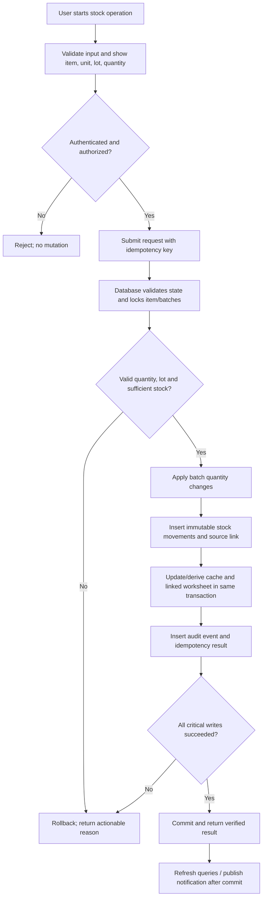
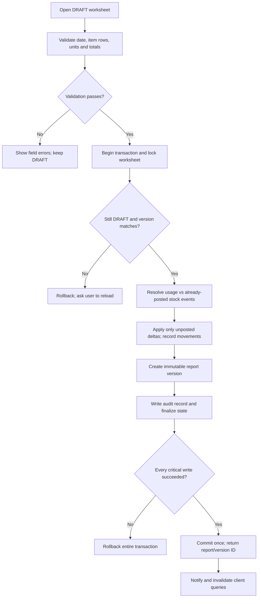
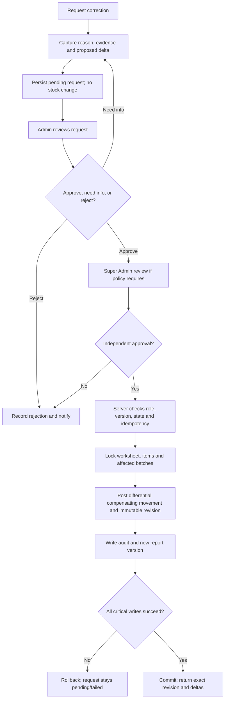
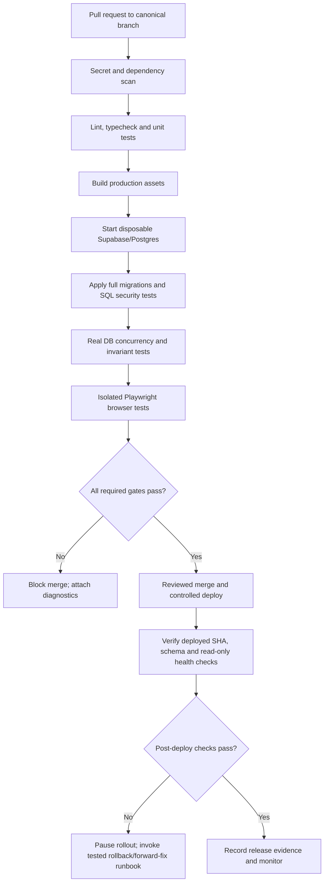
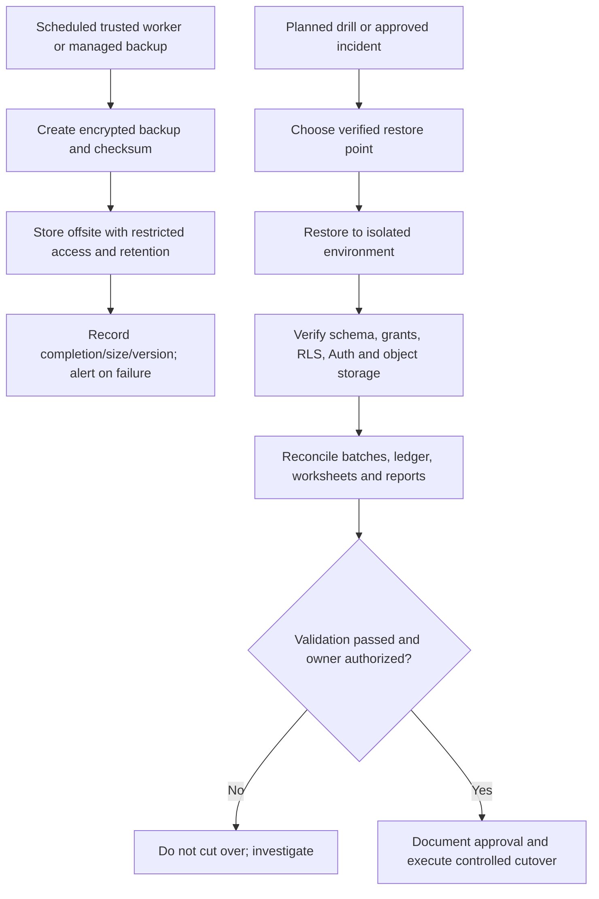

# KUVENTORY — Total System Audit & Remediation Blueprint

**Prepared:** 24 October 2026  
**Repository:** [OwnerTest-byte/kuventory](https://github.com/OwnerTest-byte/kuventory)  
**Reviewed ref:** `main`  
**Reviewed HEAD:** `d141d57d212b613946269112dd05d11a3876bb88`  
**Audit type:** Read-only source, migration, documentation, workflow and test-configuration review; external standards and established open-source reference comparison.

> **Important scope limit:** This is a thorough plan grounded in the repository files reviewed and publicly available engineering guidance. I did not authenticate to KUVENTORY’s live Supabase project, query production grants/data, access Netlify administration, restore a backup, or run the application and its tests locally. Therefore, findings below distinguish source-proven weaknesses from production conditions that must be checked. No responsible review can guarantee “zero defects”; the goal is to remove known critical defects, prove key inventory/security invariants, and make residual defects observable and recoverable.

## 1. Executive assessment

KUVENTORY already has substantial work: React/TypeScript modules, Supabase/PostgreSQL migrations, stock batches, FEFO selection, daily inventory worksheets, reports, authentication/session logic, operational tools, tests, technical documentation, and CI. The problem is not lack of features. The highest risk is **inconsistent enforcement across layers**: older secure database functions are overwritten by later repairs with weaker fallbacks; a client can report a correction as successful without applying it; finalized inventory can succeed after stock consumption or auditing failed; inventory mutations and daily-sheet synchronization are separate operations; and some E2E test code contains privileged test logins and mutates a fixed Supabase project.

Do **not** begin by adding barcode scanning, AI forecasting, multi-branch support, or more Super Admin panels. First make the existing system trustworthy. The immediate goals are:

1. Contain potentially exposed test credentials and guarantee automated tests cannot touch production.
2. Close anonymous/unauthorized access to privileged database functions and prove actor attribution from a verified identity.
3. Establish one atomic stock-posting workflow so batch quantities, movements, daily worksheets, reports and audit logs cannot silently diverge.
4. Remove every “success” result that can be returned after the requested change did not happen.
5. Turn CI into a real merge/release gate using an isolated database and meaningful browser tests.
6. Verify migrations, permissions, backups and the deployed version in the live environment before calling the system ready.

### Recommended release posture

**Do not certify the current build as production-safe until the P0/P1 checks in this document are resolved or explicitly risk-accepted by the owner.** This is a source-level assessment; whether the risky functions, accounts and grants are active in production must be verified directly by an authorized owner.

## 2. How this review was performed

Reviewed the `main` tree and recent commit metadata; package scripts; CI and Playwright configuration; authentication, password-recovery and session-lease code; inventory APIs; finalized correction service; selected core RLS, grants, security-hardening and latest repair migrations; SQL test files; and the repository’s known-issues and claim-register documents.

The design benchmark uses representative, maintained references rather than claiming to read every repository or every developer resource: PostgreSQL and Supabase function/transaction guidance; OWASP Authentication, Forgot Password, Logging and ASVS guidance; NIST SSDF; Playwright testing guidance; WCAG 2.2; and inventory patterns documented/implemented in ERPNext and Odoo. The relevant links are listed at the end.

### Current repository baseline observations

- GitHub reports `master` as the default branch, while `main` and `master` currently point to the same HEAD SHA (`d141d57...`). The CI workflow triggers for `main`; the keepalive workflow has runs on `master`. Choose one authoritative branch and align default branch, workflows, deployment and rules.
- The GitHub branch API reported both `main` and `master` as `protected: false`. Verify repository Rulesets separately; do not assume a branch is protected merely because CI exists.
- `docs/19_EVIDENCE_AND_CLAIM_REGISTER.md` and `docs/15_KNOWN_ISSUES_RISKS_AND_ROADMAP.md` describe an audit date of 19 October and an older HEAD (`135f10b...`), while reviewed HEAD is `d141d57...` and the tree includes newer 22 October migrations. Documentation claims need regeneration against the actual current commit.
- The repository’s workflow had a successful main-branch CI run on 21 October, but that alone does not prove the current production schema, grants, secrets, deployment or live workflows are safe. The CI configuration does not run the whole configured browser matrix on every push to `main` and does not run the checked-in SQL test scripts.

## 3. Priority scale

| Priority | Meaning | Required handling |
|---|---|---|
| **P0 — contain now** | Possible privileged credential exposure, anonymous mutation path, or test-driven production outage/data mutation | Contain immediately; do not wait for normal feature work. Verify live exposure and log evidence. |
| **P1 — data/security integrity** | Stock ledger/report mismatch, false success, broken authorization or missing transaction atomicity | Fix before trusting inventory/finalized reports or granting operational sign-off. |
| **P2 — reliability and workflow** | Session reliability, reset workflow, observability, test depth, recovery operations | Fix after P0 containment and core invariants. |
| **P3 — usability and maintainability** | Accessibility, UI consistency, speed, documentation, safe optional features | Improve once data/security fundamentals pass. |

## 4. Findings register: verified source observations and required fixes

### P0-1. E2E tests contain privileged login passwords and mutate a fixed Supabase project

**Evidence:** [`e2e/critical_workflow_repairs.spec.ts`](https://github.com/OwnerTest-byte/kuventory/blob/main/e2e/critical_workflow_repairs.spec.ts) hard-codes a Supabase project URL and publishable key, logs in using hard-coded staff and Super Admin test credentials, and changes the global `system_settings` key `maintenance_lock` both OFF and ON. `beforeEach`/`afterEach` call a cleanup helper whose failures are caught and logged rather than failing the test. [`src/lib/supabase.ts`](https://github.com/OwnerTest-byte/kuventory/blob/main/src/lib/supabase.ts) repeats the project URL and publishable-key fallback.

**Why it matters:** This creates a path for CI, a manual test run, or a fork/PR-triggered test to touch the project identified by the test file. The passwords may or may not still be valid and the project may or may not be production; this audit did not attempt login. Treat the credentials as exposed until ownership confirms they are isolated, disposable test accounts. A global maintenance flag can restrict staff access if a test/cleanup fails or a test run overlaps with users.

**Actions, in order:**
1. Confirm with the project owner whether the hard-coded accounts and target project are live, production, or disposable test resources. Verify current maintenance state from the trusted admin console.
2. If any credentials correspond to actual accounts, rotate their passwords immediately, revoke their active sessions, enforce MFA for privileged users, and review Supabase Auth logs, relevant database/audit logs and recent privileged operations. Do not paste the credentials into issue trackers or reports.
3. Disable the E2E workflow path that can reach the fixed project until isolation is in place. Remove hard-coded passwords from the repository and prevent future secrets with GitHub secret scanning and push protection where available. Consider the historical Git history exposed too; deleting a line from the latest commit does not make old history private.
4. Run E2E only against local Supabase or a dedicated disposable test project using temporary fixtures. Add a startup guard that fails if the URL/project ID is not on an explicit test allow-list. Never make production credentials available to PR workflows.
5. Cleanup must verify that each test fixture and setting is restored; if setup or cleanup fails, fail the test and surface a critical alert. Prefer test-scoped rows/tenants instead of modifying a global maintenance flag.

**Exit criteria:** No privileged password in any active code or CI log; E2E cannot connect to production; target project allow-list is verified; test fixture setup/teardown is checked; production Auth/audit logs reviewed by the owner; and a test proving a production-like URL is rejected before any database request.

### P0-2. Privileged stock RPCs are granted to `anon` and use identity fallbacks

**Evidence:** [`20261022030000_repair_schema_and_stock_adjustment.sql`](https://github.com/OwnerTest-byte/kuventory/blob/main/supabase/migrations/20261022030000_repair_schema_and_stock_adjustment.sql) defines `public.consume_stock(...)` as `SECURITY DEFINER`, grants execution to both `authenticated` and `anon` for the three- and four-argument overloads, and uses fallbacks that select an Admin/Super Admin profile or even the first profile if `auth.uid()` is null. [`20261022040000_fix_receive_stock_and_auth_fallbacks.sql`](https://github.com/OwnerTest-byte/kuventory/blob/main/supabase/migrations/20261022040000_fix_receive_stock_and_auth_fallbacks.sql) adds similar fallbacks for receiving, draft creation and finalization, including use of caller-provided `p_user_id` or the worksheet creator as a fallback actor. [`20260902050500_grants.sql`](https://github.com/OwnerTest-byte/kuventory/blob/main/supabase/migrations/20260902050500_grants.sql) grants broad table, sequence and default privileges to `anon` in the baseline migration.

**Why it matters:** A security-definer function runs with the function owner’s privileges. If these grants/fallbacks are present in the live schema, an anonymous or otherwise unauthorized caller could potentially change stock and have a movement attributed to a privileged profile. A user-supplied `p_user_id` must never be trusted as proof of who performed a transaction. The exact production exploitability depends on which migrations and grants are active, so live privilege inspection is mandatory.

**Actions:**
1. Query live PostgreSQL privileges for **every overload** of every `SECURITY DEFINER` function and every exposed table/view/sequence, not just one function name. Capture function signature, owner, `prosecdef`, `proconfig`/search path and ACL. Compare them with the migration chain.
2. Immediately revoke `EXECUTE` from `anon` and `PUBLIC` for privileged mutation functions and overloads; grant only to intended roles. Review default privileges and table grants; do not rely on RLS to rescue intentionally overbroad grants.
3. Remove all “choose an admin if identity is missing” fallbacks. Sensitive mutation routines must fail closed if verified authentication and authorization are absent. Derive actor identity from `auth.uid()`/verified server context only. Never accept client-supplied actor IDs as authentication.
4. Put explicit role/state/resource checks *inside the database boundary*; UI routes and React role checks are not authorization. Validate that the caller may act on the specific item/worksheet and that the worksheet is editable.
5. Prefer `SECURITY INVOKER`. Where `SECURITY DEFINER` is necessary, use a fixed safe search path (prefer `search_path = ''`) and fully schema-qualify objects. Revoke default function execution and grant narrowly in the same migration transaction.
6. Create regression tests for anonymous execution of every mutation RPC/overload and attempted actor spoofing; run them against a disposable PostgreSQL/Supabase environment.

**Exit criteria:** Anonymous calls to all mutation functions are denied; every mutation requires a verified user and an allowed role; actor ID in the ledger always equals the verified caller; no privileged function has a profile-selection identity fallback; live schema ACLs match the checked-in least-privilege policy.

### P1-1. Finalization can commit after stock deduction or audit logging fails

**Evidence:** The latest `finalize_daily_inventory` definition in [`20261022040000_fix_receive_stock_and_auth_fallbacks.sql`](https://github.com/OwnerTest-byte/kuventory/blob/main/supabase/migrations/20261022040000_fix_receive_stock_and_auth_fallbacks.sql) catches `WHEN OTHERS` from `consume_stock`, emits only `RAISE NOTICE`, and continues finalizing/report creation. A later audit insert is also wrapped in a catch that executes `NULL`. The same function version does not retain the earlier explicit `DRAFT`-state check visible in [`20260902120000_security_hardening.sql`](https://github.com/OwnerTest-byte/kuventory/blob/main/supabase/migrations/20260902120000_security_hardening.sql), which explicitly required authentication and a DRAFT worksheet.

**Impact:** A finalized report can say a day was posted even when actual physical stock did not change correctly, or the critical audit event was not written. A retry might then be dangerous because the UI/report state claims completion.

**Fix:** Replace this with one transactional `finalize_daily_inventory` procedure that: verifies `auth.uid()` and role; locks the parent worksheet; requires `state = 'DRAFT'`; checks all worksheet values and business-date rules; validates all required stock availability; locks affected items/batches in deterministic order; posts required stock movements exactly once; creates a versioned report snapshot; writes an audit event; and transitions state to `FINALIZED` only after all mandatory writes succeed. Do not catch and swallow transaction-critical errors. If any required step fails, raise so the entire transaction rolls back. Use an idempotency key and unique constraint to prevent double submission. Keep notifications dispatch separate via a reliable outbox after commit, because notification delivery may be retried without changing the financial/stock transaction.

**Exit criteria:** Injected failure at each critical write leaves the worksheet DRAFT and makes no partial stock/report/audit changes; a second finalization returns the original result without duplicating movements; a FINALIZED sheet cannot be finalized again or edited directly; an audit failure cannot be reported as success.

### P1-2. Finalized correction can report success without applying the correction

**Evidence:** [`src/features/daily-inventory/services/correctionService.ts`](https://github.com/OwnerTest-byte/kuventory/blob/main/src/features/daily-inventory/services/correctionService.ts) calls the `correct_finalized_daily_inventory` RPC. If the RPC is missing from schema cache (`PGRST202`), it writes a revision-like record or falls back to a JSON array stored under `system_settings`, then returns `success: true` with “Revision recorded successfully.” That fallback does not apply the intended stock reconciliation and can swallow insert failures. This contradicts the service’s own comment that finalized correction must use one transactional RPC only.

**Fix:** Delete the metadata-only “successful correction” fallback. Return a clear failure with a correlation/request ID and safe retry instructions. Deploy the corrected migration to the test environment and verify the exact RPC signature/schema cache before enabling correction UI. The actual correction must be a single database transaction that applies quantity deltas, compensating stock ledger entries, revision snapshot, approval metadata and audit log together. Keep revision history in typed relational tables with unique `(daily_inventory_id, revision_number)` and concurrency-safe sequence allocation—not JSON blobs under `system_settings`.

**Exit criteria:** When the RPC is absent or fails, UI shows failure and no revision is falsely reported as applied; when it succeeds, batch totals, stock movements, worksheet values, report versions and revision record all reconcile.

### P1-3. Stock mutations and daily-sheet updates are separate, best-effort requests

**Evidence:** [`src/features/inventory/api/index.ts`](https://github.com/OwnerTest-byte/kuventory/blob/main/src/features/inventory/api/index.ts) adds stock through `add_stock`, then separately calls `syncItemToTodayDailyInventory`. Removing stock separately calls `consume_stock`, then attempts to increment daily-sheet PM usage. The synchronization helper catches errors, warns and returns normally. Thus a physical stock mutation may succeed even when the daily worksheet update failed, while UI code can still treat the overall flow as successful.

**Additional risk:** `removeStock` reads the current quantity in the client and clamps `qtyToConsume` to the client-observed balance before calling the server. Concurrent users can change the balance between the read and the mutation. It can silently post only part of the quantity requested, and the client-side balance read must not be the final authority.

**Fix:** Create one canonical server-side posting API for each business event. A single transaction should apply the business action, batch quantity changes, immutable stock movements, relevant daily-sheet accounting, idempotency record and audit event. Return a structured result containing requested, posted and remaining quantities. The database decides availability under row locks. If business policy allows partial posting, obtain explicit confirmation and report exact posted quantity; otherwise reject the whole request on insufficient stock. Add idempotency key, unique constraint and retry-safe response so double-clicks, reconnects and timeouts cannot duplicate operations.

**Exit criteria:** Fault injection or disconnection cannot leave physical stock posted but its required worksheet/ledger event missing. Two simultaneous requests return correct, understandable outcomes; retrying the same idempotency key has no duplicate effect.

### P1-4. Likely double-consumption path between live stock removal and daily finalization

**Evidence:** The `removeStock` path in `src/features/inventory/api/index.ts` calls `consume_stock` immediately and then adds the same consumption quantity to the daily worksheet PM column through `syncItemToTodayDailyInventory`. The current finalizer in `20261022040000_fix_receive_stock_and_auth_fallbacks.sql` later calls `consume_stock` again for worksheet `am + pm` consumption. If the same sales/outflow uses both paths, it can be deducted twice. The source code proves both mechanisms exist; exact live impact depends on whether and where the UI invokes `removeStock` for the same events.

**Fix:** Make an explicit architecture decision: either (A) daily worksheet consumption is recorded as the source event and physical stock is posted only at finalization, or (B) physical stock is posted immediately and the worksheet references those already-posted event IDs without deducting them again. Do not keep two independently mutating paths for the same sale. Add a unique source-document/event reference in `stock_movements`; finalization should reconcile linked events and post only missing differences. Audit historical data for evidence of duplicated withdrawals before backfilling or correcting balances.

**Exit criteria:** For a controlled test case, one unit sold produces exactly one net unit decrease in batch quantities and exactly one removal ledger effect regardless of screen, retry or finalization path.

### P1-5. Stock adjustment fallback can break batch totals and ledger traceability

**Evidence:** In `20261022030000_repair_schema_and_stock_adjustment.sql`, downward `adjust_stock_to_target` catches any `consume_stock` exception and directly subtracts from batches. That fallback records no per-batch movement for those direct deductions and does not verify that it deducted the full difference; it later sets `inventory_items.total_quantity` to the target independent of the real sum of batch quantities. In the upward adjustment path, if no usable expiry date is found, it invents an expiry date 90 days ahead.

**Fix:** Remove the “catch any error, make a best effort deduction” fallback. If the canonical adjustment fails, roll back and report the exact issue. A physical count correction is a first-class ledger transaction, not a direct balance setter. It must record per-batch deductions/additions and an adjustment document with reason, count reference, actor, approver if necessary and before/after snapshot. Add a constraint/index to keep item code normalization unique. Do not invent an expiry for unknown lots; require the operator to identify the actual lot/expiry or explicitly mark an item category as non-expiring under a documented policy.

**Exit criteria:** After every adjustment, `inventory_items.total_quantity` (if retained as a cache) equals `SUM(stock_batches.quantity)`; batch-level movement sums match the adjustment; the adjustment rolls back if the full requested target cannot be represented correctly; there are no fabricated expiry values.

### P1-6. Super Admin UI privilege is partly inferred from email address

**Evidence:** [`src/features/auth/context/AuthContext.tsx`](https://github.com/OwnerTest-byte/kuventory/blob/main/src/features/auth/context/AuthContext.tsx) treats two hard-coded email addresses as Super Admin even when role data is missing or different. The code also falls back to a less privileged `USER` on a caught profile query exception, which is good as a display fallback, but role authority still must not be email-based.

**Fix:** Use the canonical database role (or verified custom claims maintained exclusively by a trusted server) as the single source of authorization truth. A verified email address is an identity attribute, not a role. Enforce permissions inside RLS and every security-definer RPC. Create a migration to normalize `MASTER_ADMIN` versus `SUPER_ADMIN` only after the owner defines whether `MASTER_ADMIN` is truly distinct. Do not leave role aliases scattered across components, migrations and docs.

**Exit criteria:** A normal user with a matching-looking email cannot gain privileges; changing a profile’s role through client REST is denied; Admin cannot promote self or another user to Super Admin; every privileged action is denied by the server for an unauthorized user even if the UI route is visited directly.

### P1-7. Session-lease failure is treated as success; login ignores the claim result

**Evidence:** [`src/features/auth/services/sessionLeaseService.ts`](https://github.com/OwnerTest-byte/kuventory/blob/main/src/features/auth/services/sessionLeaseService.ts) returns `success: true` with reason `fail_open` when the lease RPC fails or throws. `LoginForm.tsx` calls `claimSessionLease(..., true)` without awaiting/validating the result and activates the session immediately. The forced-takeover parameter is used on the ordinary login path.

**Fix:** Decide if one-active-device enforcement is a firm security/operational requirement or a best-effort advisory. If it is mandatory, the server must atomically claim/reject/take over the lease; the UI must await the structured result and require confirmation before takeover. If the lease service is unavailable, do not silently tell the user the policy is enforced—show a retryable status or explicitly adopt a reviewed fail-open policy with documented risk. Never revoke a lease just because a transient request failed. Add cross-device tests and double-login race tests.

**Exit criteria:** Server responses determine whether login proceeds or asks for takeover; network outage and timeout do not falsely claim enforcement; two-device behavior is deterministic and documented.

### P1-8. Password recovery is a request queue, not a complete, trustworthy reset flow

**Evidence:** [`src/features/auth/services/passwordResetService.ts`](https://github.com/OwnerTest-byte/kuventory/blob/main/src/features/auth/services/passwordResetService.ts) throttles via `localStorage`, generates a request code with `Math.random`, tries several persistence/notification fallbacks, catches their errors, and still returns `success: true`. It can place email addresses and request content in `system_settings` JSON or notification fields. The shown service does not itself call Supabase Auth’s password-reset email method.

**Fix:** Separate two workflows: (A) actual password reset via Supabase Auth single-use, expiring reset links/tokens and recovery callback; and (B) a manual support request when mail/account recovery is unavailable. The actual reset flow must not depend on an Admin manually changing the password or showing a hash. Return generic messages so the endpoint does not reveal whether an email account exists. Enforce rate limits server-side/by account and IP; local storage may improve UX but is not a security boundary. Do not say a request was saved unless the server confirms durable persistence. Keep PII out of system-wide JSON settings and broad notification channels; use limited-access, typed request records and retention rules. Do not log tokens, passwords or secrets.

**Exit criteria:** Existing and non-existing accounts receive equivalent public messaging; rate limiting works across browsers/devices; reset token is single-use and expires; all persistence failures are visible as safe errors; support-ticket status is auditable and never misrepresented as a completed password reset.

## 5. Further design risks to address in the root-cause repair

### 5.1 One stock ledger, one authoritative posting model

Treat stock movement history as the authoritative business record. Batches hold remaining per-lot quantity, and a cached item-level total may exist only as a derived value. Never silently set a cached total without matching batch-level effects. Every posted transaction should include:

- Unique transaction/event ID and idempotency key.
- Item, unit, batch/lot, quantity and movement direction/type.
- Verified actor ID and trusted server timestamp; business date explicitly interpreted in `Asia/Manila` where appropriate.
- Source document (receipt, issue/sale, worksheet, waste, count, correction or reversal).
- Reason/reference and before/after balances.
- Reversal/correction linkage rather than editing or deleting prior posted movements.

Recommended movement types: `RECEIPT`, `ISSUE`, `TRANSFER_OUT`, `TRANSFER_IN`, `ADJUSTMENT_IN`, `ADJUSTMENT_OUT`, `WASTE`, `EXPIRED`, `RETURN`, `CORRECTION_REVERSAL`. Use the names that fit current schema; the important property is that all effects are explicit and reconcilable.

A daily integrity check should compare (a) `SUM(stock_batches.quantity)`, (b) cached item totals, and (c) quantity reconstructed from stock ledger events within a well-defined opening balance/time window. It should emit an incident report, not automatically “heal” money/stock records by overwriting one value.

### 5.2 Define the daily inventory formula and state machine precisely

Before coding more, document the exact business meanings of `beg`, `add`, `total`, `am`, `pm`, `ending` and any physical-count column. A suggested model is:

- `beginning` = opening physical balance at start of business date.
- `receipts` = posted receipts associated with this business date.
- `available` = `beginning + receipts`.
- `AM usage` and `PM usage` = clearly defined consumption values, not an ambiguous mixture of cash sales, sold portions and physical counts.
- `expected ending` = `available − AM usage − PM usage`.
- `physical count` = actual measured balance, captured separately if needed.
- `variance` = `physical count − expected ending`.

Decide if the sheet records usage or physical count per shift; these are not interchangeable. Negative values, unexplained overuse, impossible units, missing dates and invalid item references must be blocked by database constraints as well as the UI.

Suggested state machine:

`DRAFT → SUBMITTED_FOR_REVIEW (if the business requires review) → FINALIZED → CORRECTED_BY_REVISION (zero or more linked revisions)`.

Do not reopen an already finalized sheet by deleting its report or altering the original snapshot. Keep the original immutable, and post a new correction/reversal event with reason, old/new data, approval, actor, timestamp and impact on stock.

### 5.3 FEFO, expiry and batch traceability

Keep FEFO on the server as well as in the display: earliest valid expiry first, stable tie-break by receipt date then unique ID, and locks taken in a consistent order. Expired lots cannot be issued; lot/expiry policy must be explicit for items that do not expire. Show the selected batch breakdown to users for a consumption transaction and write each batch deduction into the ledger. Receiving must bind item, supplier/source, batch/lot code, received date, expiry date, quantity, unit, cost if valued, and the staff member who received it. Add clear expired, expiring-soon and low-stock alert states. A stock adjustment must not invent expiry provenance.

ERPNext’s stock-ledger and immutable-ledger patterns are useful references: keep original postings and use traceable reversals/corrections rather than silently replacing history. See [ERPNext Stock Ledger](https://docs.frappe.io/erpnext/stock-ledger), [ERPNext Immutable Ledger](https://docs.frappe.io/erpnext/immutable-ledger-in-erpnext), [ERPNext batch tracking](https://docs.frappe.io/erpnext/batch), and [Odoo FEFO](https://www.odoo.com/documentation/master/applications/inventory_and_mrp/inventory/shipping_receiving/removal_strategies/fefo.html).

### 5.4 Receiving, adjustment, transfer and duplicate-click safety

For each business operation, decide what is the document (the user’s intent) and what are the accounting effects. A receipt draft may be edited; a posted receipt should be immutable and corrected with a reversal/return. A submit button should disable while pending, but front-end disabling is not enough: database idempotency must reject duplicate requests. Concurrent changes should use row locks, versions or optimistic-concurrency checks and return a clear “stock changed, refresh and review” result.

Do not swallow network/database errors after a mutation. Each UI operation must display one of: `Not saved`, `Saving`, `Saved` (with server confirmation), `Partially completed` (only if business policy allows and server response details the quantity), or `Failed; no changes applied` when transaction rollback is guaranteed. Include a request ID for support.

### 5.5 Notifications and automation

An alert system must be derived from real current conditions and transitions. Avoid hard-coding fake trends, reporting a scheduled job as healthy just because it is configured, or treating read status as stock condition. Use dedupe keys that distinguish threshold crossings and alert cycles; re-arm a low-stock alert when stock goes above threshold and then falls again. Record the last successful run, next due time, duration, last error and alert recipient for each scheduled service. Use an outbox/retry mechanism for notifications after the stock transaction commits. All background jobs must run in an environment that actually stays alive; a static Netlify bundle does not run a persistent `node-cron` worker.

### 5.6 Database constraints, indexes and schema drift

Add database-enforced checks appropriate to actual units and business rules: quantities finite and valid, batch quantities not negative, minimum stock not negative, valid state transitions, unique business date per scope, unique normalized item code, one revision number per finalized sheet, and required relationships not nullable by accident. Use decimals and explicit unit conversion rules for fractional goods; do not apply integer-only constraints blindly to every item.

Review indexes for `stock_batches(item_id, expiry_date, received_date, id)`, `stock_movements(item_id, created_at)`, daily sheets by business date/state, item/category references and revision lookups. Use `EXPLAIN (ANALYZE, BUFFERS)` on a staging copy with realistic data before indexing hot paths. Don’t add indexes speculatively; record why each index exists. Keep generated columns generated—never send them in writes—and generate TypeScript database types from the actual migrated schema rather than hand-maintaining overlapping declarations.

Maintain a single migration chain, run every migration from an empty database and from a sanitized copy of the current deployed schema, and test upgrade paths. Avoid using “schema cache fallback” to mask a migration that was not applied. Migration success means code, RPC signatures, generated columns, grants, policies and frontend query types agree.

## 6. Permission model and operational workflow

Use one canonical role vocabulary. The proposed responsibilities below must be approved by the system owner before enforcement; do not silently infer what `MASTER_ADMIN` means.

| Capability | Staff | Admin | Super Admin |
|---|---|---|---|
| View inventory, batches, permitted reports | Yes | Yes | Yes |
| Record permitted receiving/consumption/counts | Yes, within assigned workflow | Yes | Yes |
| Create/update catalog items and categories | No or request | Yes | Yes |
| Approve ordinary count variance | No | Within thresholds; not own transaction | Yes when policy requires |
| Request finalized-sheet correction | Yes | Yes | Yes, but cannot approve own request |
| Review correction request | No | First-level review | Final approval for high-impact correction; independent actor |
| Unlock staff accounts | No | Yes | Yes |
| Unlock Admin account | No | No | Yes, with verified recovery and audit |
| Change Admin/Super Admin role | No | Cannot create/promote Super Admin | Only authorized Super Admin process; prevent self-escalation |
| Change auth/security/migration/maintenance settings | No | Only explicitly allowed narrow settings | Yes, with reauthentication/MFA and full audit |
| Backup/restore production database | No | No direct browser-side restore | Initiate a controlled server-side/runbook restore after confirmation; never direct untrusted REST multi-table restore |

### Finalized correction workflow

1. Staff/Admin opens a finalized worksheet and selects **Request correction**.
2. System shows the immutable original and records proposed values, required reason, evidence/reference, request ID, actor and a version snapshot.
3. Server validates values and creates a pending request—no stock changes yet.
4. Admin independently reviews: approve for next stage, request more info, or reject with a reason. Requester cannot approve their own request.
5. Super Admin approves high-impact/finalized changes as required by policy; recent reauthentication/MFA recommended.
6. One database transaction locks the worksheet/items/batches, checks state/version and idempotency, calculates exact before/after deltas, applies compensating stock movements, adds revision snapshot, links reports and writes audit log.
7. Any failure rolls back every critical mutation and reports failure. On success, return exact revision ID, stock deltas, audit reference and new report version.
8. Notify after commit; notifications can retry without repeating stock movement.
9. Original report and historical movements remain readable and immutable.

### Profile and support contacts

For Admin/Super Admin profile pages, keep private login email distinct from public support contact email/phone. Let each field choose visibility; hide public contacts unless explicitly published. For social links, store a structured list (platform, label, URL, visibility, order), validate URL schemes, allow only `https:` for ordinary public links, allow `mailto:`/`tel:` only in their dedicated fields, block `javascript:`, `data:` and `file:` schemes, and render external links safely. Persist via a role-protected server operation, audit changes, and refresh other active clients via Realtime/query invalidation with a reconnect/refetch fallback. Never store auth secrets or passwords in the profile settings object.

## 7. CI/CD and test strategy that actually proves the system

### Current source gaps

The workflow in [`/.github/workflows/ci.yml`](https://github.com/OwnerTest-byte/kuventory/blob/main/.github/workflows/ci.yml) runs lint/typecheck, Vitest and build. Its Playwright job runs only on manual dispatch or PR, and runs only `--project=chromium`. The Playwright config has Firefox, WebKit and mobile/tablet projects, but this workflow does not execute them. `supabase/tests/rls_test.sql` and `supabase/tests/rpc_test.sql` exist but are not run by this workflow. The concurrency test named `concurrentStockDeductionIntegration.test.ts` uses an in-memory simulation, not actual PostgreSQL locking. These are valuable unit scenarios, but they do not prove database constraints or real RPC authorization.

### Required release pipeline

1. **One branch:** align the default branch, workflow triggers, deployment branch and branch rules. Required checks must be attached to the actual release branch.
2. **Static checks:** lint, TypeScript typecheck, format check if adopted, production build, unit tests, dependency audit/SCA, secret scan, and code scanning. Lock the Node version and lockfile. Pin third-party workflow actions to reviewed immutable commit SHAs where practical.
3. **Disposable database:** start local Supabase/Postgres in CI; apply every migration from empty; run SQL permission/RPC tests; test upgrades from an approved, sanitized database snapshot; fail on drift. Never point this job at production.
4. **Database integration:** test real row locks with independent DB sessions; run competing stock deductions; assert batch totals, movement counts, FEFO order and rollback; test all function overloads and unauthorized roles.
5. **UI E2E:** use ephemeral seeded staff/admin/super-admin accounts and isolated data. Assert user-visible outcomes. Run Chromium smoke on every PR and main merge; run Firefox/WebKit and mobile/tablet matrix before release or on scheduled nightly if the full matrix materially slows PRs. Do not label Chromium as actual Edge/Safari support; use an actual browser engine/device when making those claims.
6. **Release gate:** no merge/deployment if a critical permission or ledger invariant fails. Save Playwright traces/screenshots and test reports as CI artifacts with secrets redacted. Branch rules require the exact status checks and review of security/migration changes.
7. **Post-deploy verification:** apply migrations via one controlled process, record deployed commit and migration version, perform read-only health/invariant checks, verify headers and Auth flows, and have a tested rollback/forward-fix plan. A green frontend build is not proof that the live database matches.

### Automated tests that must exist

| Area | Minimum tests |
|---|---|
| Anonymous/unauthenticated | Every stock-mutating RPC and overload is denied; no anonymous table writes; no profile enumeration beyond intended public information. |
| Authorization | Staff cannot change roles or finalized sheets; Admin cannot promote Super Admin; direct REST/RPC denies any UI-bypassing attempt; actor fields cannot be spoofed through parameters. |
| Stock invariants | After receipt/issue/adjustment/return/waste, item cached total equals sum of batches; movements reconcile to batch deltas; negative batch stock is impossible; expired lots are not consumed. |
| FEFO | Earlier valid expiry depleted first, then received-date/ID tie-break; null/non-expiring dates follow explicit policy; expired batches are excluded. |
| Concurrent posting | Two sessions issue more than available: exactly the permitted quantity succeeds and all others receive clear rejection/partial result per business policy; no duplicates, lost updates or negative totals. |
| Idempotency | Double click, retry after timeout, duplicate network submission and repeated finalization do not duplicate movement, report, receipt or correction. |
| Finalization | DRAFT only; no finalization on invalid data; forced failure at each required write leaves no partial result; report, stock, worksheet and audit record all reconcile. |
| Correction | Original snapshot immutable; approval required; requester cannot self-approve; version conflict stops stale corrections; failed RPC never returns success; stock deltas are differential, not replayed. |
| Auth/recovery | Generic reset/login messaging; throttling across browsers; expired/used token rejected; lockout persists across devices; unlock requires role and records audit; session lease race tests. |
| Business date | Boundaries near midnight in `Asia/Manila`, client timezone mismatch, server date, scheduled job date and historical date all agree. |
| Realtime | Reconnect after network loss, missed event, duplicate event and tab sleep cause refetch/reconciliation rather than stale mutation assumptions. |
| Restore | Restore rehearsal on a separate database restores database and storage and verifies row counts, grants, RLS, references and balances. |
| Accessibility/responsive | Keyboard, focus, screen-reader labels, contrast, validation/error announcements, modal focus, 200–400% zoom and small viewport overflow. |

### Browser/device coverage

Test at widths **320, 360, 393, 768, 820, 1024, 1280 and 1440 px**, plus landscape and high zoom. Check Chrome/Chromium, Firefox, Safari/WebKit, Edge where supported, iOS Safari and Android Chrome. Emulation is useful but does not fully replace at least one real iPhone/iPad and Android-device verification before claiming device independence. Verify all tables, modals, dropdowns, nav drawer, QR/camera use (if enabled), forms, reports/export and long item names in narrow layouts. WCAG 2.2 AA should be an explicit quality gate, not merely an automated score.

## 8. Security architecture and account recovery

### Password storage and reset

Use Supabase Auth as the authority for password verification and password storage. Do not create/display `public.profiles.password_hash`, do not invent a custom password verifier, do not log passwords or reset tokens, and do not send a password/hash to Admins. Supabase documents bcrypt-based storage in `auth.users.encrypted_password`: [Supabase Password Security](https://supabase.com/docs/guides/auth/password-security).

Use a reset email with an expiring, single-use token and a recovery page that validates the token before calling Supabase Auth to set a new password. The public response should not reveal whether the account exists. Enable strong password settings, leaked-password protection where the selected plan supports it, MFA for elevated roles, reauthentication for critical changes, and session revocation on password/reset/security events as appropriate.

### Failed login / lockout

The login form currently calls Supabase Auth directly from the browser. A rate limiter on an optional Express server does not protect that path unless all attempts actually pass through it. Configure the Auth-side rate controls supported by Supabase and, only if a custom server mediation is required, ensure there is exactly one trusted supported login verification path; do not duplicate or bypass Supabase password verification. Apply account-based throttling, IP/device risk telemetry and safe delays without creating an easy denial-of-service vector against a named account. Generic public messages should not reveal account existence or lock state. Choose exact lockout thresholds after reviewing likely staff usage and operational risk; the example `5 attempts/15 minutes` followed by a timed lock is a policy proposal, not an existing verified behavior.

### Audit and security events

Record successful/failed authentication, role changes, account activation/disable, lockout/unlock, password-reset request and completion, session revocation/takeover, maintenance mode, stock changes, corrections, report export, backup/restore, and privileged settings changes. Include actor, event, target, timestamp, request ID/correlation ID and outcome. Do not log passwords, access/refresh tokens, service-role key, reset tokens or sensitive headers. Protect audit records from edit/delete by application roles and send high-severity events to a monitored channel.

Use OWASP ASVS as a requirements/test checklist, not as a certificate claim. See [OWASP ASVS](https://owasp.org/projects/asvs), [Authentication Cheat Sheet](https://cheatsheetseries.owasp.org/cheatsheets/Authentication_Cheat_Sheet.html), [Forgot Password Cheat Sheet](https://cheatsheetseries.owasp.org/cheatsheets/Forgot_Password_Cheat_Sheet.html) and [Logging Cheat Sheet](https://cheatsheetseries.owasp.org/cheatsheets/Logging_Cheat_Sheet.html).

## 9. Operations, backup, disaster recovery and observability

The repository’s known-issues document already acknowledges that the Super Admin browser restore is disabled because multiple client-side REST writes cannot guarantee an atomic database restore, and that `node-cron` does not run as a persistent worker on Netlify’s static CDN. Keep those safeguards. Do not re-enable a browser-side multi-table restore button or imply a backup job is running just because a script exists.

### Backup/restore plan

1. Determine the Supabase plan’s actual backup/PITR capabilities, retention and recovery granularity; verify what is covered (database, storage objects, configuration/auth users if relevant). Record plan and owner.
2. Arrange scheduled encrypted backups through a real supported service/worker independent of the static web host. Restrict credentials to least privilege and never place server keys in `VITE_` variables or the browser.
3. Store backups offsite with retention and access controls; verify checksum, encryption, size and completion status. Alert on missed jobs.
4. Test restoring to an isolated project at least monthly and before risky migrations. Verify login, RLS, grants, RPCs, references, batches, stock ledger, reports, files and Realtime publication. A dump existing does not prove restoration works.
5. Define owner-approved Recovery Point Objective (RPO) and Recovery Time Objective (RTO); initial discussion targets could be **24 hours maximum data loss** and **4 hours to restore core operations**, but select these based on real business needs and plan limits, not as a promise.
6. Keep a runbook with authorization, confirmation, point-in-time selection, restore steps, validation checklist, DNS/app cutover, user communication and rollback. Restore procedures must be performed by authorized trusted automation/operations, not a user browser writing table rows one by one.

### Monitoring dashboard

Expose genuine measures and last-success timestamps for: failed/successful logins, lockouts and unlocks; RPC failure rate; `consume_stock`/receipt/finalization failures; stock reconciliation mismatches; current database migration/version; Realtime connected/reconnecting state; last successful scheduled job/backup; file upload failures; slow queries; application exceptions; deployment commit SHA; and alerts awaiting action. Do not substitute one live ping measurement for a historical latency graph. If there is no time-series history, label it “current probe” and show missing history honestly.

### Incident handling

Define severity, owner, alert destination, triage steps and incident review. For a suspected credential exposure: rotate/revoke, preserve access/audit logs, determine affected time window and scope, inspect privileged mutations, recover only from verified sources, document decisions, and add a regression test. For a stock mismatch: pause risky mutation if needed, export the ledger and current batch totals, identify the first mismatch, post a controlled adjustment/reversal with approval, and preserve original records. Never “fix” a mismatch by overwriting the total without a traceable ledger event.

## 10. Performance, availability and user experience

Performance work should follow a measured baseline, not guesswork. Instrument query latency and use realistic seeded data (for example, 10k catalog items and the volume expected over a year of movements). Paginate long lists server-side; avoid loading every movement or notification into the browser; use targeted selects, indexes backed by query plans and sensible caching. Keep TanStack Query cache invalidation consistent and make Realtime events invalidate authoritative queries rather than assuming events always arrive. On reconnect, refetch all relevant data and show sync status. Offline mode should be explicitly read-only unless a carefully designed conflict/idempotency model is approved; do not pretend a cached shell permits safe stock mutation.

Proposed initial targets to measure in staging (confirm after baseline): warm catalog/search p95 API response under 500 ms on a normal network; common UI response under 200 ms where no server round trip is required; failed/unknown mutation outcomes visible to the user; zero layout overflow at supported viewport widths; and no silent data-sync errors. These are planning targets, not claims about current runtime performance.

UX requirements:
- Keep primary actions clear: Receive Stock, Record Usage/Count, View Batches, Reconcile, View Movement History, Reports, Request Correction.
- Put dangerous actions behind confirmation and require reason + recent reauthentication where appropriate.
- Use plain language on state: Draft, Waiting for review, Finalized, Correction requested, Corrected by revision, Failed—not vague “Done”.
- Keep the form input on transient network errors, show retry with same idempotency key, and avoid double submission.
- Display units consistently (e.g. kg vs pieces), expiry and batch identity clearly, with explicit warnings before consuming/adjusting near-expiry stock.
- Ensure modals are keyboard navigable, error fields have labels/live announcements, focus is restored, contrast passes WCAG 2.2 AA, and color is not the only status cue.

## 11. Migration, delivery and change-management rules

1. No production SQL edits without a checked-in migration and reviewed impact plan.
2. Every security/stock migration receives a second review and test coverage for both allow and deny paths.
3. Use expand → backfill → verify → switch code → contract migrations when schema changes affect multiple deployed versions.
4. Record migration ID, current HEAD, deployed build SHA, result, duration and validation query output for each deployment.
5. Test migration from an empty database and from a sanitized snapshot representing production’s real schema. A successful TypeScript build does not prove `rpc()` names and SQL parameter signatures match.
6. Prefer forward fixes over destructive down-migrations for production data, but document rollback/backup requirements and the data-loss risk of every migration.
7. Do not ship schema-cache fallbacks that report success or silently write alternate data representations.
8. After deployment, run a read-only smoke test that checks stock reconciliation, permissions, critical RPC calls, report view and current maintenance status.
9. No deployment until all P0s are closed, P1 invariants pass, backup/restore has been demonstrated, and the owner signs off on known residual risk.

## 12. Implementation roadmap

### Phase 0 — Immediate containment (P0)
- Confirm whether the hard-coded E2E accounts/project are live; rotate exposed passwords/revoke sessions if real; review auth/audit logs.
- Stop production-targeted E2E tests and add a hard project allow-list.
- Check live maintenance-lock state and verify no test has left the system locked.
- Inspect production grants and all `consume_stock`/adjustment/receive/finalize overloads; revoke unauthorized anon/public execution.
- Compare actual deployed SHA and applied migration list with reviewed source.

**Gate:** No unresolved P0 risk of anonymous stock mutation or test-driven production side effects.

### Phase 1 — Authorization and database baseline (P1)
- Build a generated inventory of exposed tables/views/functions, ownership, RLS, grants, function signatures, `SECURITY DEFINER`, search paths and triggers.
- Remove actor fallbacks; centralize database authorization helpers; normalize canonical roles.
- Remove overbroad anon/default grants and add specific grants.
- Ensure role and worksheet-state checks are enforced in the database, not just frontend routes.
- Add local database migration, RLS/RPC and actor-spoof tests to CI.

**Gate:** Unauthorized-role test matrix passes against actual Postgres policies/functions.

### Phase 2 — Inventory correctness and single transaction model (P1)
- Decide exactly when stock is decremented relative to shift worksheets.
- Create one transactional server posting path for receipt, consumption, adjustment, finalization and finalized correction.
- Remove false-success schema-cache fallbacks, swallowed critical exceptions and direct-batch adjustment fallback.
- Add idempotency, unique event references, state transition checks and version conflicts.
- Add read-only reconciliation reports for batch sum, item cache, movement ledger, daily sheet and reports; inspect historical data before correcting it.

**Gate:** Invariant tests pass under failures and real concurrent DB sessions; every posted event is represented once and no false success is possible.

### Phase 3 — Auth, reset, session and role workflow (P1/P2)
- Replace email-based role elevation with server-verified role.
- Make session lease behavior deterministic and remove unobserved forced takeover.
- Connect real reset-email flow, secure recovery callback, backend throttling, generic messages and a separate audited support request.
- Build audited account unlock/recovery with privilege restrictions and MFA/reauth for Admin/Super Admin actions.

**Gate:** Security/auth test matrix passes without a privileged account hard-coded in source.

### Phase 4 — CI, release and environment isolation (P1/P2)
- Normalize default branch and branch protection/rulesets.
- Isolate CI Supabase environment; run current SQL tests; add actual Postgres concurrency tests, PR browser tests, scheduled broader browser matrix, SCA and secret scanning.
- Fix test names/claims so in-memory simulations are described as unit/simulation tests, not database integration tests.
- Generate the evidence register against current commit.

**Gate:** Required checks block merge/deploy; all tests run only on isolated data; no stale claims about unexecuted tests.

### Phase 5 — Recovery and operations (P2)
- Set RPO/RTO; implement encrypted backup schedule; restore monthly in a separate project; implement alerting and incident runbooks.
- Unify deployed security headers and verify CSP/CORS using a real deployed response scan. Remove unnecessary wildcard CORS for the static application; keep CSP script sources narrowly scoped and connect to Supabase only through `connect-src`.
- Add operational health indicators with truthful last-run/history data.

**Gate:** Owner can demonstrate a restore and identify deployed code/schema version.

### Phase 6 — Product quality and optional enhancements (P3)
- WCAG 2.2 AA remediation and manual keyboard/screen-reader review.
- Responsive/browser device test matrix and measured performance tuning.
- Improve onboarding, item forms, search/filter, reports, loading/empty/error states and user/admin guide.
- Only then assess barcode/QR receiving, supplier purchase orders, multi-location inventory, forecasting or offline mutation support.

**Gate:** User acceptance tests pass for the real workflow on target devices; accessibility/performance results are documented.

## 13. System diagrams

These diagrams describe the proposed target state. They are not a claim that the present implementation already behaves this way. After fixes, update the repository’s existing `.mmd` diagrams against the actual functions/state machine and link each flowchart node to the relevant module/RPC/test.

### 13.1 Canonical stock transaction

### 13.2 Daily worksheet finalization

### 13.3 Finalized correction approval

### 13.4 Login and account recovery

```mermaid
flowchart TD
    A[Login or recovery requested] --> B[Auth service applies rate limits]
    B --> C{Login succeeds?}
    C -- Yes --> D[Fetch canonical role and account state]
    D --> E[Server session claim and policy check]
    E --> F{Lease/authorization permits access?}
    F -- No --> G[Show conflict or retry; do not fake session claim]
    F -- Yes --> H[Enter app; record security event]
    C -- No --> I[Generic login error; record safe failure event]
    A --> J[Forgot password submitted]
    J --> K[Generic public response; server throttle]
    K --> L[Send single-use expiring auth reset link]
    L --> M{Valid unused token?}
    M -- No --> N[Reject safely; offer new request/support]
    M -- Yes --> O[Update password through Auth; revoke sessions as policy says]
    O --> P[Record completion and notify user]
```

### 13.5 Delivery gate

### 13.6 Backup and restore

## 14. Release acceptance checklist

A release is ready only when all applicable boxes can be checked with saved evidence:

- [ ] No active privileged login credentials are hard-coded in source, test files or CI logs; if exposed credentials were real, rotation/revocation/log review is complete.
- [ ] CI/E2E target is proven isolated and rejects production project IDs before any read/write.
- [ ] Live database functions and grants have been inventoried; no anonymous/public caller can mutate inventory, profiles, role, maintenance, corrections, reports or audit data.
- [ ] Every security-definer function has owner review, fixed safe search path, schema-qualified objects, minimal execution grants and explicit role/resource checks.
- [ ] Missing authenticated identity or failed authorization always rejects mutation; no admin-profile attribution fallback remains.
- [ ] Finalization and correction are atomic; critical exceptions roll back; no false success; immutable history and idempotency are proved.
- [ ] One consumption event produces one net stock movement; receipt/adjustment/expiry semantics are defined and tested.
- [ ] All tests run against the current commit and actual disposable database; required checks are attached to the protected release branch.
- [ ] Empty-database install and production-like upgrade migration tests pass; SQL signatures/types match the frontend.
- [ ] `SUM(stock_batches.quantity)`, cached totals and ledger balances reconcile for all active inventory items or every mismatch is tracked as an approved incident.
- [ ] Super Admin/role policy, correction authority, user unlock and emergency maintenance flows are owner-approved and enforced server-side.
- [ ] Reset flow sends real reset links with safe generic messages; login/reset throttling is server-side; sensitive data is not logged.
- [ ] Backup has been restored into a separate environment successfully; RPO/RTO are approved; alerting and recovery runbooks exist.
- [ ] WCAG, browser, responsive, error-state and performance results are recorded from the reviewed build.
- [ ] Claim register and architecture diagrams name the exact current commit and clearly distinguish source proof, automated test, observed deployment and not-live-verified statements.

## 15. Work to defer until the release gate passes

Barcode/QR camera scanning, automatic purchase-order emailing, AI/predictive stock forecasting, multi-branch tenancy, a browser-side restore, true offline stock mutation and additional Super Admin control panels should not be treated as immediate fixes. They add workflow complexity and can multiply the consequences of bad balances or weak authorization. Multi-branch support in particular requires a deliberate `branch_id`/tenant security design across every row, function, report, notification, file and realtime subscription—not just a dropdown. Offline mutation requires a carefully specified queue, idempotency, conflict policy and server reconciliation; otherwise keep the app read-only while disconnected.

## 16. Ready-to-paste Antigravity implementation brief

> You are working on the real KUVENTORY repository. First inspect the current canonical branch and exact HEAD; do not assume this document or old claim-register SHA is current. This is a staged safety-first implementation, not permission to make unreviewed production changes.
>
> **Phase 0: evidence and containment.** Create an evidence-backed issue list with exact paths/lines. Ensure E2E cannot connect to production or mutate global maintenance settings; remove hard-coded privileged passwords, keep test accounts ephemeral and verify cleanup; make missing production environment configuration fail closed. Do not attempt authentication with discovered credentials or perform unapproved live mutations. Document which live checks require the owner.
>
> **Phase 1: least-privilege database security.** Inventory all tables, views, policies, function overloads, grants and SECURITY DEFINER functions. Remove anon/PUBLIC execution from privileged mutation functions, replace actor fallbacks with verified `auth.uid()` and fail-closed logic, use a safe search path and schema-qualified names, and test every role boundary. Do not make UI-only fixes for database authorization. Write additive reviewed migrations; do not modify production directly.
>
> **Phase 2: inventory integrity.** Establish one canonical posting transaction for receipt, consumption, adjustment, finalization and finalized-sheet corrections. Identify and eliminate duplicate consumption paths; never swallow stock/audit errors; never return success for metadata-only revisions; remove direct-adjustment fallbacks that skip movement rows; do not invent expiry dates. Use idempotency keys, locks/version checks, immutable movements/revisions and full rollback. Preserve existing data and produce a reconciliation report before any historical repair.
>
> **Phase 3: authentication and recovery.** Use Supabase Auth for passwords/reset, generic reset messages and server-side rate controls. Replace email-based super-admin UI role inference with canonical server-enforced roles. Make session lease outcomes deterministic and correctly awaited. Specify and test who can unlock which role, approve finalized corrections, configure maintenance and restore backups.
>
> **Phase 4: verification.** Add a disposable local Supabase/Postgres setup in CI; run full migrations and RLS/RPC tests; add actual multi-session database concurrency and failure-injection tests; make Playwright test user-visible workflows against isolated fixtures. Align default branch, branch rules, CI triggers and deployment; include secret/dependency scanning and accurate reports. The current test URL must never be a production URL.
>
> **Required execution discipline:** work in small reviewable changes, one phase at a time; for each change provide root cause, files changed, migration safety/rollback notes, tests added, exact commands/results, risks and acceptance criteria. Run lint, typecheck, unit, build, database migration/RLS/RPC/concurrency and browser tests available in the isolated environment. Do not claim an unrun test passed. Do not silently catch a critical error or substitute a fallback success. Do not modify production data, account credentials, maintenance state, branches, or deployed configuration without owner authorization. Stop after Phase 0 findings/containment if live system access is needed; list the exact owner action required.

## 17. Reference material

These resources inform the recommended standards and patterns; they are references, not proof that KUVENTORY is compliant.

### KUVENTORY source files
- [Repository root and current branch history](https://github.com/OwnerTest-byte/kuventory)
- [E2E tests with direct Supabase target and maintenance mutations](https://github.com/OwnerTest-byte/kuventory/blob/main/e2e/critical_workflow_repairs.spec.ts)
- [Supabase client configuration/fallback](https://github.com/OwnerTest-byte/kuventory/blob/main/src/lib/supabase.ts)
- [Latest stock repair migration](https://github.com/OwnerTest-byte/kuventory/blob/main/supabase/migrations/20261022030000_repair_schema_and_stock_adjustment.sql)
- [Latest receive/finalization/auth fallback migration](https://github.com/OwnerTest-byte/kuventory/blob/main/supabase/migrations/20261022040000_fix_receive_stock_and_auth_fallbacks.sql)
- [Finalized correction service](https://github.com/OwnerTest-byte/kuventory/blob/main/src/features/daily-inventory/services/correctionService.ts)
- [Inventory mutation and daily sync API](https://github.com/OwnerTest-byte/kuventory/blob/main/src/features/inventory/api/index.ts)
- [Auth role resolution](https://github.com/OwnerTest-byte/kuventory/blob/main/src/features/auth/context/AuthContext.tsx)
- [Session lease service](https://github.com/OwnerTest-byte/kuventory/blob/main/src/features/auth/services/sessionLeaseService.ts)
- [Password reset request service](https://github.com/OwnerTest-byte/kuventory/blob/main/src/features/auth/services/passwordResetService.ts)
- [CI workflow](https://github.com/OwnerTest-byte/kuventory/blob/main/.github/workflows/ci.yml)
- [Playwright config](https://github.com/OwnerTest-byte/kuventory/blob/main/playwright.config.ts)
- [Current claim register (must be refreshed after fixes)](https://github.com/OwnerTest-byte/kuventory/blob/main/docs/19_EVIDENCE_AND_CLAIM_REGISTER.md)

### Security, database and engineering references
- [Supabase database functions and SECURITY DEFINER guidance](https://supabase.com/docs/guides/database/functions)
- [Supabase password security and bcrypt storage](https://supabase.com/docs/guides/auth/password-security)
- [PostgreSQL CREATE FUNCTION: safe SECURITY DEFINER usage and execution privileges](https://www.postgresql.org/docs/current/sql-createfunction.html)
- [PostgreSQL transaction isolation](https://www.postgresql.org/docs/current/transaction-iso.html)
- [OWASP Authentication Cheat Sheet](https://cheatsheetseries.owasp.org/cheatsheets/Authentication_Cheat_Sheet.html)
- [OWASP Forgot Password Cheat Sheet](https://cheatsheetseries.owasp.org/cheatsheets/Forgot_Password_Cheat_Sheet.html)
- [OWASP Logging Cheat Sheet](https://cheatsheetseries.owasp.org/cheatsheets/Logging_Cheat_Sheet.html)
- [OWASP Application Security Verification Standard (ASVS)](https://owasp.org/projects/asvs)
- [NIST Secure Software Development Framework (SSDF)](https://csrc.nist.gov/projects/ssdf)
- [GitHub secret scanning](https://docs.github.com/en/code-security/concepts/secret-security/secret-scanning)
- [GitHub branch protection](https://docs.github.com/en/repositories/configuring-branches-and-merges-in-your-repository/managing-protected-branches/about-protected-branches)
- [Playwright best practices](https://playwright.dev/docs/best-practices) and [Playwright CI](https://playwright.dev/docs/ci)
- [W3C WCAG 2.2](https://www.w3.org/TR/WCAG/)

### Inventory reference implementations and documentation
- [ERPNext Stock Reconciliation](https://docs.frappe.io/erpnext/stock-reconciliation)
- [ERPNext Stock Ledger](https://docs.frappe.io/erpnext/stock-ledger)
- [ERPNext Immutable Ledger](https://docs.frappe.io/erpnext/immutable-ledger-in-erpnext)
- [ERPNext Stock Entry](https://docs.frappe.io/erpnext/stock-entry)
- [ERPNext Batch](https://docs.frappe.io/erpnext/batch)
- [ERPNext stock ledger implementation](https://github.com/frappe/erpnext/blob/develop/erpnext/stock/doctype/stock_ledger_entry/stock_ledger_entry.py)
- [Odoo FEFO removal strategy](https://www.odoo.com/documentation/master/applications/inventory_and_mrp/inventory/shipping_receiving/removal_strategies/fefo.html)

---

**Final recommendation:** Freeze new feature work until Phase 0–2 pass. KUVENTORY will become more dependable by strengthening the data and authorization boundaries, making each stock event atomic and traceable, testing the actual database and real user outcomes, and proving restore capability—not by adding more control panels or promising perfection.

## 18. Mandatory failure-first engineering contract — applies to every change

This section is a required extension to the audit, not optional advice. The request “add a feature” must never be interpreted as “implement only the successful path.” Every change must be designed as an end-to-end system change with explicit failure behavior before implementation begins.

### 18.1 Required design artifact for every feature, fix, migration, configuration change, automation, or UI change
Before writing code, create a short Feature Failure & Recovery Card containing all of the following:
- **Problem and user outcome:** which real user task is being improved, who can perform it, and what observable result means it worked.
- **Current-state trace:** exact UI entry points, hooks, services, RPCs/functions, tables/views/triggers/policies, role checks, background jobs, Realtime subscriptions, reports, and tests involved. Trace reads and writes, not just the screen being edited.
- **Invariants:** facts that must remain true before, during, and after the operation. Inventory examples: no negative eligible batch quantity; no movement without a successful stock change; a final report matches the finalized worksheet; a failed transaction leaves no partial business change; an actor ID is not accepted as proof of identity.
- **Happy-path state machine:** each state, allowed transition, persisted side effect, and terminal status.
- **Failure-mode list:** for each step, identify trigger/cause, effect, severity, likelihood, how the failure is detected, safe system behavior, user message/action, operator alert/audit event, recovery procedure, and automated regression test.
- **Retry and duplicate policy:** which errors are retryable, retry limit/backoff, how duplicate clicks/replays are deduplicated, and how an ambiguous timeout is reconciled. Never retry a non-idempotent mutation blindly.
- **Authorization matrix:** staff/admin/super_admin (and any still-required legacy role) for view/create/update/delete/approve/unlock/restore/export. Include unauthenticated users, inactive users, revoked sessions, changed roles, direct RPC calls, and cross-record access. Enforce authorization in the trusted server/database boundary, not only in navigation/UI.
- **Data and migration impact:** tables, constraints, indexes, triggers, RLS, function overloads and grants, generated columns, types, Storage paths, report snapshots, audit log, caches, Realtime publication, backup/restore and existing data migration. Address schema-cache delays and partially applied deployments.
- **Consistency and concurrency:** simultaneous requests, two users editing, stale forms, duplicate requests, deadlocks, lock timeouts, isolation conflicts, and cross-process race conditions. State what is locked/versioned and where transaction boundaries start/end.
- **Observability:** stable error code, correlation/request ID, duration, actor ID from verified identity, target entity IDs, outcome, retry count, and severity. Do not log passwords, access/refresh/reset tokens, secret values, or excessive personal data.
- **Recovery:** how to retry safely, reload/reconcile state, repair orphaned files/outbox jobs, roll back or roll forward a migration, compensate an external side effect, restore backup, or escalate to an administrator. A rollback button is not a recovery plan unless it is safe and tested.
- **Verification:** unit tests, real PostgreSQL/Supabase integration tests, role/RLS/RPC tests, browser tests, accessibility/device checks, fault-injection tests, migration upgrade tests, and regression tests for the exact prior bug.
- **Release plan:** feature flag/kill switch if appropriate, staging validation, metrics to monitor, abort thresholds, rollback/forward fix, owner approval required for production mutations, and post-release checks.
- **Evidence:** before/after behavior, commands actually run, test logs/results, migration SHA, exact commit SHA, remaining limitations, and what could not be live-verified.

No feature is implementation-ready until this card is reviewed. If an external dependency, environment credential, schema state, or permission cannot be verified, record it as a blocker/owner action. Do not fill the gap with a fake success, permissive fallback, silent catch, invented data, or a client-side substitute for a missing trusted operation.

### 18.2 Failure-mode severity and response
Use an FMEA-like register (Failure Mode and Effects Analysis). Score severity, likelihood, and difficulty of detection from 1–10 and record the reasoning; use a risk-priority score to sort work, but do not let a low calculated score downgrade a catastrophic security/data-loss scenario. Label each risk P0 (contain immediately), P1 (block production sign-off), P2 (must resolve for reliability), or P3 (quality/optimization). Re-score after the mitigation and add evidence that residual risk is acceptable.

**Minimum severity rule:**
- **Critical (P0):** unauthorized mutation, cross-account data disclosure, false-success for stock/finalization/reset/restore, missing or untraceable ledger event, irreversible data loss, a test able to mutate production, or an incorrect role escalation. Stop rollout and contain first.
- **High (P1):** partial workflow persistence, duplicated consumption/receipt, finalized report mismatch, incorrect FEFO selection, loss of audit history, broken backup restore, or broad outage. Block release until fixed or explicitly risk-accepted with mitigation.
- **Moderate (P2):** stale dashboard/notification, export failure, recoverable session interruption, or inaccessible noncritical screen. Give a visible recoverable state and alert/measure repeated occurrences.
- **Low (P3):** presentation defects without data/security impact. Still track and test the fix.

### 18.3 Standard error taxonomy — use consistently across frontend, trusted APIs, database and jobs
| Error class | Examples | Correct response | Forbidden response |
|---|---|---|---|
| `VALIDATION_ERROR` | Blank required field, non-finite quantity, impossible date, invalid URL | Reject before mutation, explain the field, preserve safe input | Retry automatically or coerce invalid data to zero/default silently |
| `UNAUTHENTICATED` | Expired/missing token, reset required | Ask user to sign in again; preserve draft locally only if safe | Choose another user/admin identity or continue with elevated privileges |
| `FORBIDDEN` | Staff tries to promote a user or approve a correction reserved for Super Admin | Reject in database/API, record security event where appropriate | Hide the button and assume the operation is secured |
| `NOT_FOUND` | Removed item or nonexistent worksheet | Refresh/search and present a clear message | Create an unintended replacement record |
| `CONFLICT` | Stale version, concurrent edit, duplicate finalized worksheet | Return current version, require reload/merge/review | Overwrite the newer row silently |
| `INSUFFICIENT_STOCK` | Concurrent deduction consumed stock first | Roll back entire transaction and display available amount after re-query | Clamp to zero and claim requested amount was consumed |
| `RATE_LIMITED` | Excessive login/reset attempts | Respect Retry-After/cooldown and provide safe support path | Retry loop or disclose account existence |
| `DEPENDENCY_UNAVAILABLE` | Supabase/network/email/Storage unavailable | Bounded retry only for transient/idempotent work; queue/reconcile where designed | Treat timeout as proof operation failed or succeeded |
| `OUTCOME_UNKNOWN` | Client times out after server may have committed | Query operation status by idempotency/correlation ID before offering a retry | Submit a second stock movement blindly |
| `SCHEMA_MISMATCH` | Missing RPC/column, PGRST202, mismatched generated columns | Stop the affected mutation, alert operators, verify migration/version | Fake success, bypass trusted RPC, or write metadata-only fallback |
| `INTEGRITY_VIOLATION` | Ledger/stock totals disagree, impossible worksheet arithmetic | Abort, preserve evidence, create incident, quarantine unsafe operation | Auto-rewrite history without a reviewed reconciliation plan |
| `INTERNAL_ERROR` | Unexpected exception | Safe message plus request reference; detailed sanitized server log | Reveal SQL, secret, stack trace, token or sensitive user data |

Every externally visible mutation must return an explicit result with success, stable code, message, request_id/operation ID, and (where appropriate) retryable, retry_after, and canonical server result. Do not make clients infer success merely because an RPC returned no transport error.

### 18.4 Required result states and user experience
For each form/action, design and test at least these outcomes: untouched, invalid, submitting, succeeded, rejected by permission, conflict/stale data, disconnected, server error, timed out with unknown outcome, and retry in progress. For long jobs, add queued/running/succeeded/failed/dead-letter states. Prevent double submission while pending, but do not rely on a disabled button for duplicate protection.

The user must always be able to answer: Did my change save? What exact record changed? If it failed, did anything change? Can I retry safely? What should I do next? On a timeout the UI must say the outcome is being verified or could not yet be confirmed—not “failed” if the server may already have committed and not “success” without proof.

### 18.5 Bounded retry and idempotency policy
Retries are a reliability mechanism, not a substitute for correct transaction design. Use one coordinated retry policy rather than stacking retries at every layer. Set a per-attempt timeout, bounded attempts, exponential backoff with jitter for background work, respect Retry-After, and stop on validation, authorization, missing-record, schema and integrity errors. Interactive read requests may use a short bounded retry; a write requires an idempotency/status-resolution design first. Avoid endless retry loops and cascading retry storms. If a background job exhausts retries, preserve the payload and reason in a durable dead-letter/failed-job record, alert, and support safe replay.

For each mutation, generate a stable operation ID/idempotency key at the client or trusted ingress and enforce uniqueness at the database transaction boundary. Store the final outcome against that key. A duplicate request must return the original outcome without repeating side effects. Idempotency key scope, retention, and behavior on mismatched payload reuse must be defined and tested.

## 19. Feature-by-feature failure-mode and recovery register

### 19.1 Login, account lockout, session lease, and role resolution
- **Supabase Auth unavailable / request times out:** Keep user unauthenticated; show connection-specific message and request reference. Do not claim credentials are wrong for infrastructure failures.
- **Wrong password repeatedly / attacker rotates IP:** Enforce server-side account and IP/device throttles with an escalation policy; avoid a lockout mechanism that lets attackers permanently deny service to a victim. Show generic errors.
- **Authentication succeeds but lease RPC fails:** Define whether single-session enforcement is a hard requirement. Privileged mutations must not bypass authorization because lease infrastructure is down; either deny entry with retry/support or admit only under an explicitly approved reduced-security policy with visible telemetry and server-side mutation policy. Never silently label a fail-open session as protected.
- **Lease RPC returns occupied/revoked/unknown:** Distinguish conflict from unknown network outcome. Re-query authoritative lease before signing out or taking over. No “continue anyway” unless explicitly authorized and server-atomic.
- **Session heartbeat/realtime drops:** Temporary uncertainty should not eject the user immediately. Use bounded server re-verification, explicit offline/verification banner and final decision from authoritative state. A real revocation/deactivation must take effect.
- **Role lookup/profile missing or stale:** Deny elevated UI and database actions until authoritative role is confirmed; display a recoverable profile error. Do not elevate based on email, browser state, user metadata or a cached old role.
- **Auth listener race with initial session restore:** Ensure one consistent initialization state and avoid stale login callbacks restoring a signed-out session. Unsubscribe/cancel effects correctly.
- **Browser storage unavailable/private mode:** App should degrade with a clear session limitation; no unhandled exception from localStorage access during component initialization.

### 19.2 Password recovery and support request
- **Unknown email vs registered email:** Same public message and comparable response behavior; real reset link is issued only by Supabase Auth's trusted flow.
- **User requests many resets / distributed abuse:** Server-side throttle, cooldown and abuse telemetry; browser localStorage is only UX assistance, never the security boundary.
- **Reset email service unavailable:** Do not claim an email was delivered. Use provider result/webhook state if available; show safe retry/support instructions and a request reference.
- **Request row insert fails or schema cache missing:** Return a failure/unknown result rather than fake success; do not write the same sensitive request into unrelated system_settings JSON or notification payload as an uncontrolled fallback.
- **Email delivery succeeded but UI times out:** Query reset-request status or let user retry through an idempotent request; don't create duplicate work blindly.
- **Admin marks request resolved without actually resetting password:** Separate support-request workflow from the actual secure reset-token flow; status alone never resets or verifies password. Require proof of outcome and actor audit.
- **Reset link expired, reused or redirected to wrong origin:** Reject expired/single-use token, validate redirect allow-list and password policy; provide a fresh request route.

### 19.3 Product/catalog CRUD, categories, suppliers, item images, and user administration
- **Duplicate item code/name collision under concurrent saves:** Normalize at the trusted boundary and enforce a unique database constraint for the defined business uniqueness rule; present conflict and preserve entered form.
- **Item save succeeds but initial batch or movement fails:** Use one transaction/RPC for item plus opening stock plus movement plus notification/outbox. Roll back the item if the atomic operation fails.
- **Quantity/cost overflow, NaN, Infinity, negative values, excess decimal precision:** Validate in frontend and database; precision/unit policy must be explicit. Reject impossible quantity/cost instead of coercing.
- **Category deleted while referenced by an item/report:** Enforce FK/on-delete behavior and explain that the category is in use; prefer archive/merge where historical labels need preserve.
- **Item archived/deactivated while stock remains or open worksheet references it:** Prevent destructive deletion of referenced stock/history; preserve historical item snapshots and define whether archived stock remains visible/consumable.
- **Image upload succeeds but item save fails, or vice versa:** Track staged uploads and clean orphan objects; do not leave broken image URLs. If updating image fails, keep previous valid image.
- **Invalid/malicious image or oversized upload:** Verify MIME and actual content, size and allowed formats; randomize storage object path; authorize upload/download by policy; remove metadata if needed.
- **User role update races with protected action:** Authorization and role update must be atomic/authoritative at server boundary; new demotion/revocation takes effect within defined window.
- **Admin creates user but Auth account succeeds and profile insert fails:** Create account/profile via a controlled server flow with compensation or repair queue; never show fully successful account creation until both are reconciled. Do not expose privileged Auth admin keys to the browser.

### 19.4 Receive stock and batch creation
- **User double-clicks Submit or network times out after insert:** One idempotent receipt transaction with one receipt ID; on timeout query that ID before permitting a second receipt.
- **Expiry date missing/invalid/past or barcode date ambiguous:** Reject invalid date; do not invent 90-day expiry as a silent default. Where legitimately non-expiring stock exists, model an explicit expiry policy instead of guessing.
- **Expired/near-expiry batch received by mistake:** Configurable receipt validation/warning policy; block expired stock unless authorized exception with explicit reason. Mark quarantine/hold if the business needs it.
- **Stock batch created but daily worksheet ADD update fails:** Prefer a single database transaction updating batch, movement, worksheet delta and outbox. If not possible due a deliberate architecture, record a durable repair event and surface reconciliation state; never swallow error and imply full two-way sync.
- **Item is archived, finalized worksheet, or invalid category changes during receipt:** Re-check current state under lock inside transaction; reject on conflict, no stale UI assumptions.
- **Duplicate supplier invoice/delivery:** Support receipt/invoice reference and business-level duplicate detection; warn/block per policy.
- **Receipt notification/outbox fails:** Inventory transaction remains correct; durable outbox retries the alert; no fake notification status.

### 19.5 Consumption, sales, stock adjustment, and FEFO
- **Two users consume the same last stock concurrently:** Database locks and constraints serialize the operation; one request succeeds and the other receives `INSUFFICIENT_STOCK`; no balance below zero.
- **FEFO queue contains expired, zero-quantity, quarantined or null-expiry batches:** Enforce a documented eligibility rule; sort valid expiry dates first, then deterministic receipt/id tie-breakers. Null expiry and expired stock must follow explicit policy.
- **Client pre-read says stock is sufficient but another mutation wins first:** Database RPC rechecks stock under locks and owns the final decision. Pre-read is display only.
- **A requested quantity exceeds available stock:** Reject the whole operation with actual available quantity and optional adjustment workflow. Do not silently clamp to available stock and report requested consumption as done.
- **One item operation updates multiple batches then fails mid-loop:** Entire transaction rolls back all batch updates and ledger inserts.
- **Negative/zero/nonfinite quantity:** Define zero as a no-op only when explicitly intended; negative and nonfinite inputs always reject.
- **Manual adjustment increases stock without known batch/expiry:** Require an explicit reconciliation reason, approved source/expiry policy, batch identity or quarantine state. Never fabricate product expiry or batch history.
- **Adjustment-down fallback bypasses consumption ledger/FEFO or leaves batch totals wrong:** One canonical adjustment transaction that creates a typed movement for every impacted batch, respects eligibility and records reason/actor; no catch-and-deduct fallback.
- **Cached inventory_items.total_quantity diverges from SUM(stock_batches.quantity):** Make one representation authoritative; enforce/recompute derived total through a single trusted path and run scheduled reconciliation. Do not independently edit cache and batches with different results.
- **Duplicate client retry after unknown outcome:** Return original result by idempotency key or query operation log before reattempt.

### 19.6 Daily inventory draft, shift entry, finalization, report generation
- **Two users create today's draft at once:** Unique constraint on business date plus atomic insert/upsert; return same authoritative draft, do not create two worksheets.
- **Draft initialized while batches change:** Specify beginning-stock snapshot time and source. Snapshot and draft record must have a consistent transaction boundary or explicit timestamp/version.
- **User enters arithmetic inconsistent with formula:** Define and enforce formula and allowed inputs at DB boundary. Ending stock = available − AM out − PM out.
- **Save loses data, autosave races or browser closes mid-save:** Show saved/pending/failed state; version optimistic concurrency; keep unsaved changes visible; retry only with version/idempotency protections.
- **Finalize clicked twice or concurrent finalization:** Server state machine DRAFT -> FINALIZING/FINALIZED under row lock and idempotency. Only one authoritative report and one stock posting per worksheet.
- **Finalized state/report commits but stock consumption fails:** Whole database transaction rolls back state transition, report snapshot and stock/ledger postings. Never catch and continue.
- **Stock consumption happens in live item removal and then again on daily finalization:** Separate ad-hoc physical deductions from tally sheet consumption. Deduct each business sale once.
- **Report item insert fails or generated columns mismatch:** Transaction rollback and explicit schema mismatch alert. Never supply values to GENERATED ALWAYS columns.
- **Report re-finalization deletes old snapshots then fails:** Immutable versioned snapshots; correction creates a new version with links to old version, not destructive delete-and-rebuild.
- **Day boundary/timezone/DST or client clock wrong:** Use Asia/Manila business date computed by trusted server/database policy; store event timestamp in UTC and business date separately.

### 19.7 Finalized-day correction and approval
- **Correction RPC missing from schema cache:** No correction is committed, and no success/revision-only fallback is allowed. Mark the operation failed with a support reference.
- **Two approvers/users submit correction concurrently:** Use unique revision numbers/row lock/version comparison and idempotency; one version wins or second must reload.
- **Proposed correction omits an item, adds foreign item, or sends arbitrary baseline:** Server loads canonical old snapshot and item set; rejects unknown/missing/duplicate records according to policy.
- **Admin and Super Admin approval workflow bypassed:** Model states SUBMITTED -> ADMIN_REVIEW -> READY_FOR_SUPER_ADMIN -> APPROVED -> APPLIED; DB verifies authority and separation-of-duties requirements.
- **Stock delta cannot be reconciled or would create negative quantity:** Validate computed delta against live locked batches; present exact difference and require authorized decision; abort atomically if not reconcilable.
- **Correction partly updates daily items/stock batches/ledger/report/audit:** One DB transaction, version lock, old/new snapshots, movements, updated report version and audit commit together.
- **Correction is replayed or browser retries:** Idempotency key returns same revision number/result.

### 19.8 Search, filters, pagination, analytics, exports and reports
- **Pagination hides items or duplicates during stock changes:** Stable deterministic sort with unique tie-breaker.
- **Search special chars/Unicode/partial matches break results:** Safely encode user search terms, normalize consistently and distinguish no results from query failure.
- **Analytics total doesn't reconcile with list/ledger:** Each metric defines source, time window, timezone, exclusions, and update freshness.
- **Export fails or truncates content:** Do not report download ready until file created; surface retry with same filter snapshot.
- **CSV/formula injection or spreadsheet type confusion:** Neutralize dangerous leading spreadsheet formula characters (`=`, `+`, `-`, `@`, `\t`, `\r`); preserve intended numeric/date types.
- **PDF/XLSX generation runs on malicious or very large input:** Bound row counts, validate output data, stream/async for large exports.
- **Data changed during report/export:** Define whether an export is a consistent snapshot.

### 19.9 Notifications, Realtime, automation and integrations
- **Realtime WebSocket drops or event is missed:** Use Realtime for freshness, not as sole source of truth; invalidate/refetch on reconnect, focus and network restore.
- **Duplicate/out-of-order Realtime events:** Make reducers/invalidation idempotent.
- **Notification insert fails after stock succeeds:** Transactional outbox or durable retry; stock remains committed.
- **Threshold event storms every update:** Deduplicate by entity + state transition/version.
- **Cron/worker executes twice or not at all:** Each scheduled task has run ID, unique window/key, lease/heartbeat, bounded runtime.
- **Supabase Realtime or pg_cron not enabled in production:** Preflight environment and live check; feature reports degraded/disabled rather than “active.”

### 19.10 Super Admin, maintenance mode, settings, contact links, backup and restore
- **Role UI visible but underlying mutation is unauthorized:** Database RPC rechecks role and target; forbidden direct calls fail. Email address alone never grants role.
- **Super Admin accidentally locks everyone out:** Require confirmation, reason, expiry/rollback owner and audit entry; separate emergency control plane.
- **Support URL malicious or app deep link unsupported:** Validate allowed protocols (`https:`, `mailto:`, `tel:`); block `javascript:`, `data:`, `file:`.
- **System setting writes arbitrary JSON/key:** Schema validation and per-setting capability allow-list.
- **Backup reports success but is incomplete/unencrypted:** Define included schema/data/Storage/Auth/config; verify manifest and checksum.
- **Restore partially imports tables or breaks cross-references:** Restore into isolated environment; no browser sequential inserts.
- **Restore rolls database back but Auth/Storage/config stays newer:** Coordinated recovery plan across database, Auth metadata, Storage, secrets.

### 19.11 Migrations, deployment, configuration, CI and documentation
- **Migration applied partially or fails on new/old schema:** Forward repair migration; do not rerun manual SQL blindly.
- **Function overload or argument default ambiguity:** Inventory exact signatures and grants; remove obsolete overloads deliberately.
- **Frontend deploy precedes DB migration or vice versa:** Use expand/contract rollout.
- **CI passes but SQL security/E2E tests did not run:** Required CI must actually execute migration, RLS/RPC/concurrency tests and isolated E2E.
- **Production env var missing or fallback points at wrong project:** Build/deploy health check fails closed for required production config.
- **Docs/diagrams claim behavior that code does not have:** Generate claim register from current SHA and test evidence.

### 19.12 Accessibility, responsive behavior, performance and browser compatibility
- **Layout overflows on small viewport/zoom:** Reflow tables/forms/dialogs; use appropriate scroll containers (`overflow-x-auto min-w-*`) and modal widths (`w-[95vw] sm:max-w-xl`).
- **Keyboard/screen reader cannot use core workflow:** Semantic labels/landmarks, focus management, accessible error summaries, dialog focus trapping, status announcements.
- **Slow query or large inventory freezes UI:** Paginate server-side, use indexes, debounce search, avoid duplicate fetches.
- **Cache or service worker serves stale app/schema:** Version static assets, ensure safe update prompt/reload.
- **Browser/OS API unsupported:** Feature-detect, request permission only on action, provide manual fallback.
- **Error message inaccessible or disappears too quickly:** Persistent inline status with `aria-live`; preserve form state.

## 20. Cross-system business invariants and reconciliation jobs
1. **Batch quantity invariant:** every stock batch quantity is finite and non-negative.
2. **On-hand invariant:** catalog current quantity equals the authoritative aggregation of stock batches.
3. **Movement invariant:** every posted receipt, consumption, stock adjustment, transfer, expiry/write-off, and correction has a unique immutable movement.
4. **Atomicity invariant:** stock state, movement ledger, worksheet posting, finalization state, report version and critical audit event commit together when they represent one business transaction.
5. **No duplicate-post invariant:** every logical business event is posted no more than once, even under double-click, queue retry, reload, or timeout.
6. **FEFO invariant:** consumption selects only eligible batches under the chosen expiry/quarantine policy, ordered deterministically by earliest valid expiry.
7. **Worksheet invariant:** beginning, additions, shift consumption, calculated ending, physical count and discrepancy are distinct concepts.
8. **Finalization invariant:** one worksheet date/branch has a defined uniqueness rule; finalized worksheets are immutable.
9. **Correction invariant:** corrections append old/new snapshot, actor, reason, request/approval IDs, item-level deltas and stock movement changes. Never erase the original record.
10. **Identity invariant:** every privileged mutation has a verified actor from trusted authentication context; no fallback admin, first-profile, or client-supplied actor ID.
11. **Authorization invariant:** role check and resource/state check execute on the trusted mutation boundary.
12. **Audit invariant:** audit events include outcome as well as attempted action, and are protected from routine alteration/deletion.
13. **Business-date invariant:** UTC timestamps and Manila business date are explicitly separated.
14. **Notification invariant:** notifications are delivered from durable state/outbox and deduplicated; noncritical notification failure must not corrupt a committed stock event.
15. **Restore invariant:** every backup has integrity metadata and an actual restore drill.
16. **Environment invariant:** automated tests and preview builds cannot point at production or use production credentials.

### 20.1 Daily/periodic reconciliation jobs
- Compare item aggregate/cache vs `SUM(stock_batches.quantity)`.
- Reconcile stock movements per batch/item against opening balance + movement deltas.
- Find duplicate event/idempotency keys, duplicate worksheets, duplicate report snapshots, gaps/duplicates in correction revision numbers.
- Detect `SECURITY DEFINER` functions with unsafe/missing search path or unexpected `EXECUTE` grants.

## 21. Mandatory failure-injection test catalog
- **Database transaction and concurrency:** Throw/fail after each write of a receipt, consumption, adjustment, finalization, report creation and finalized correction; assert all or none commit. Test competing operations for last units of stock.
- **Auth, roles and test isolation:** Run each privileged RPC as anon, staff, admin, super admin, inactive account, expired JWT, revoked lease. Verify E2E refuses a production project identifier before any network mutation.
- **Network, integrations and automation:** Disable network during read, save, upload, finalize, export, reset, Realtime. Verify idempotency keys prevent duplicate side effects.
- **User-visible reliability:** Ensure each form preserves input after validation/network/server failure. Verify mobile viewport, keyboard navigation, screen-reader status across browsers.

## 22. Add/change request workflow: operating discipline
1. Clarify expected behavior from actual product context.
2. Map dependencies and blast radius.
3. Pre-mortem the feature: write top likely failures and worst credible failures before code.
4. Design contract/state machine with explicit failure states.
5. Implement smallest coherent vertical slice.
6. Add positive and negative tests before declaring done.
7. Measure and observe.
8. Ship gradually with feature flags/gates.
9. Verify after deployment.
10. Update documentation with evidence.

## 23. Release and rollback rules for failure-prone changes
- Use short-lived feature flags only where flag state is secured, audited and observable.
- Use expand/contract for migrations: add backward-compatible objects, deploy compatible client, verify, contract.
- Take restorable backups before destructive schema changes.
- Roll back frontend only if compatible with current schema.
- Stop rollout immediately if P0/P1 invariants fail.

## 24. Updated Antigravity instruction — failure-first requirement
**FAILURE-FIRST ENGINEERING IS MANDATORY FOR EVERY CHANGE.** Do not implement only the happy path. Before coding any requested feature, bug fix, UI change, RPC, migration, report, QR flow, automation, security control or deployment change, create a Feature Failure & Recovery Card using Section 18 and map every affected layer in the real KUVENTORY repository.

For every operation with more than one write, define a transaction boundary and inject faults after each significant write. Assert durable DB state, not just the returned promise/message. If the user sees a failure while the server may have committed, use a stable operation/idempotency ID and reconcile canonical state before retrying. Never swallow errors or return success if only metadata was recorded. No unsafe fallback is permitted to bypass authorization, constraints, expiry rules, ledger, or atomicity.

Definition of done: the feature works on the happy path; all expected rejection paths are safe; critical data changes are atomic and idempotent; an ambiguous result can be reconciled; user/operator errors are understandable and observable; recovery is documented and tested; permission boundaries hold when UI checks are bypassed; tests pass on the exact commit; and residual risk plus required owner actions are clearly stated.

## 25. Added current references for failure-first design
- [Microsoft Well-Architected guidance: handling transient faults](https://learn.microsoft.com/en-us/azure/well-architected/design-guides/handle-transient-faults)
- [OWASP ASVS 5.0.0](https://asvs.owasp.org/)
- [Playwright best practices](https://playwright.dev/docs/best-practices)
- [Supabase database functions security](https://supabase.com/docs/guides/database/functions)
- [ERPNext Stock Reconciliation](https://docs.frappe.io/erpnext/stock-reconciliation)
- [PostgreSQL transaction isolation](https://www.postgresql.org/docs/current/transaction-iso.html)

