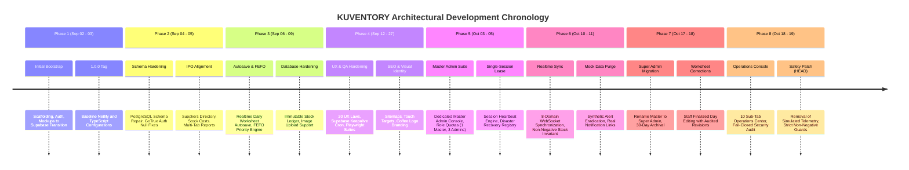

# KUVENTORY — Project Overview & Historical Development Log

```
Document:               docs/00_PROJECT_OVERVIEW_AND_HISTORY.md
Audience:               Technical Examiners, Software Architects, Operations Engineers, System Administrators
Purpose:                System purpose, operational problem statement, user personas, verified goals,
                        constraints, milestones, and full chronological development history from Git evidence.
Verification Status:    Verified against repository Git commits, code artifacts, and migrations
Audit Date:             2026-10-19
Authoritative HEAD SHA: 135f10b807fedec368383c9e34895566da3d69fc
Primary References:     git log --reverse, package.json, supabase/migrations/, src/
```

---

## 1. Executive Summary & Problem Statement

**KUVENTORY** is a specialized, web-based inventory management, batch-tracking, and daily audit system engineered specifically for **Kape Uno Bistro**, an artisanal food and beverage enterprise operating in the Philippines.

### The Operational Challenge at Kape Uno Bistro
Prior to the implementation of KUVENTORY, the bistro faced recurring operational, financial, and inventory control friction:
1. **Perishable Ingredient Expiration:** Dairy products, syrups, coffee beans, artisanal sauces, and produce suffered unrecorded spoilage due to lack of a disciplined First-Expired, First-Out (FEFO) consumption mechanism.
2. **Shift Desynchronization:** Morning (AM) and evening (PM) shift handovers relied on fragmented paper clipboards or unlinked spreadsheets. Mid-shift deliveries and end-of-day waste were frequently unaccounted for until monthly audits.
3. **Double Counting & Concurrent Overwrites:** When multiple staff members attempted to record inventory additions or counts on different mobile devices or tablets, spreadsheets suffered race conditions and silent data overwrites.
4. **Timezone Truncation Discrepancies:** Standard cloud databases storing dates in UTC caused operations occurring between 00:00 and 07:59 Philippine Standard Time (PST, UTC+8) to be attributed to the previous calendar day, distorting opening stock balances.
5. **Lack of Immutable Historical Snapshots:** End-of-day stock records could be altered retroactively without an audit log, making discrepancy investigations unreliable.

### What KUVENTORY Delivers
KUVENTORY replaces paper logs and fragile spreadsheets with a centralized, reactive Single Page Application (SPA) built on **React 19**, **TypeScript**, and **Vite**, backed by a hardened **Supabase PostgreSQL** database engine. It provides:
- **Strict Business Date Management:** Standardized on `Asia/Manila` (PST, UTC+8) to eliminate UTC boundary shift glitches.
- **Atomic FEFO Stock Consumption:** Automated batch allocation prioritizes earliest-expiring inventory first, enforced at the database layer with PostgreSQL row-level locks (`SELECT ... FOR UPDATE`).
- **Reactive Shift Worksheets:** Daily inventory sheets with real-time bidirectional synchronization, automated mathematical balance formulas, and audited post-finalization correction revisions.
- **Zero-Trust Security & Role Isolation:** Strict role boundaries across `USER` (Staff), `ADMIN` (Manager), and `SUPER_ADMIN` (Owner/Operations Console), backed by database Row Level Security (RLS) policies and single-session lease heartbeats.
- **Offline Shell & Fast Export Engine:** Fast PWA caching, instant stock movements, and client-side compilation of PDF, XLSX, and CSV reports with protection against formula injection.

---

## 2. Intended Users & Role Boundaries

KUVENTORY models three distinct operational personas based on actual source code authorization gates:

| Role Name in Code | Display Persona | Operational Context | Primary Responsibilities & Permissions |
| :--- | :--- | :--- | :--- |
| `USER` | **Staff / Barista / Kitchen Staff** | Mobile phones, station tablets behind the counter | Records AM and PM shift consumption, records physical stock counts, submits daily draft worksheets, views item stock levels and expiry warnings, and requests audited corrections for finalized worksheets. |
| `ADMIN` | **Branch Manager / Supervisor** | Tablets, back-office desktop | Creates and updates catalog items, categories, and suppliers; receives restock batches with mandatory expiry dates; finalizes daily shift worksheets; reviews stock discrepancy reports; exports XLSX/PDF summaries; manages staff accounts. |
| `SUPER_ADMIN`<br/>*(legacy alias: `MASTER_ADMIN`)* | **Business Owner / System Administrator** | Dedicated desktop / management laptop | Accesses the 10-tab Operations Console (`/super-admin`), activates emergency maintenance lockdowns, monitors database health and live keepalive ping telemetry, reviews immutable security audit logs, terminates rogue session leases, manages disaster recovery checkpoints, and verifies deployment health. |

*Evidence Citation:* [src/features/auth/types/index.ts](file:///c:/Users/Nuero/OneDrive/Desktop/KUVENTORY-FINAL/src/features/auth/types/index.ts#L1), [src/features/auth/components/RequireAuth.tsx](file:///c:/Users/Nuero/OneDrive/Desktop/KUVENTORY-FINAL/src/features/auth/components/RequireAuth.tsx#L31-L90), and [supabase/migrations/20261018000000_super_admin_foundation_and_control_center.sql](file:///c:/Users/Nuero/OneDrive/Desktop/KUVENTORY-FINAL/supabase/migrations/20261018000000_super_admin_foundation_and_control_center.sql).

---

## 3. System Goals, Scope & Explicit Constraints

### Project Goals (Evidenced from Code and Specification)
1. **Data Integrity Above All:** The system must never permit negative stock balances. If recorded consumption exceeds physical stock, the system must clamp the ending balance to zero, flag a discrepancy, and raise an operational notification.
2. **Deterministic Expiry Queue:** Stock deduction must always select the earliest expiring batch that is not past its expiration date.
3. **Realtime Multi-Device Consistency:** Changes committed by one station must reflect across all other connected terminals within 100ms via WebSocket change streams, without requiring full page refreshes.
4. **Auditability:** Every stock adjustment, shift finalization, sheet correction revision, and privileged administrative action must be immutably recorded in PostgreSQL audit tables with actor ID, timestamp, and metadata payload.

### System Scope Boundaries
- **In Scope:** Raw material inventory, beverage ingredients, kitchen supplies, batch expiration tracking, supplier directory, station categorization, daily shift inventory balancing, historical report snapshots, multi-device realtime synchronization, and operational disaster recovery checkpoints.
- **Out of Scope (Explicitly Excluded):** Customer-facing Point-of-Sale (POS) order taking, electronic payment gateway processing, customer loyalty programs, and accounting general ledgers. KUVENTORY is strictly an internal operational inventory control and audit system.

### Operational Constraints & Assumptions
- **Hosting & Infrastructure:** Deployed as a static SPA on Netlify Edge CDN, connecting over HTTPS and WSS to a cloud-hosted Supabase PostgreSQL project.
- **Browser Requirements:** Modern Evergreen browsers (Chromium 120+, Firefox 120+, Safari 17+) supporting ES2022, WebSockets, and CSS Grid.
- **Offline Boundary:** KUVENTORY supports static PWA asset caching for fast shell loading, but **does not support offline write queuing**. All stock mutations require an active network connection to verify server-side row-level locks and PostgreSQL transactional constraints.

---

## 4. Chronological Development History (Git Log Analysis)

The KUVENTORY codebase spans **105 Git commits** beginning on **2026-09-02** through the current authoritative audit commit on **2026-10-19**. Below is the verified chronological development timeline grouped into eight distinct engineering phases.



### Phase 1: Bootstrap & Foundational Scaffolding (2026-09-02 – 2026-09-03)
* **Goal:** Initialize repository, implement foundational authentication, and construct initial inventory components.
* **Key Commits:**
  * `427070c` (2026-09-02): `chore: initial bootstrap`
  * `8545468` (2026-09-02): `feat(auth): complete Phase 03 authentication and role handling`
  * `738b15b` (2026-09-02): `feat: complete phase 04 inventory engine`
  * `2199e66` (2026-09-03): `chore: KUVENTORY 1.0.0 Version Release`
  * `fd3e553` (2026-09-03): `fix: resolve Netlify Linux case-sensitivity and strict typing build failures`
  * `532b872` (2026-09-03): `Finalize application: Removed mock data, integrated Supabase, and resolved all IDE warnings`
* **Verification Evidence:** Initial migration files created in `supabase/migrations/20260831000000_initial_schema.sql` through `20260902130000_cleanup_rpc_signatures.sql`.

### Phase 2: Schema Reconstruction & Full-Stack Supabase Integration (2026-09-04 – 2026-09-05)
* **Goal:** Eliminate schema mismatches, repair GoTrue authentication null token errors, and establish suppliers directory.
* **Key Commits:**
  * `a898737` (2026-09-04): `feat: complete full-stack reconstruction and bug fixes`
  * `3574f29` (2026-09-04): `Fix database error querying schema due to GoTrue null parsing bug`
  * `329c15e` (2026-09-04): `feat: full-stack PostgreSQL connection, real RPC integration, seed business items`
  * `cc588a7` (2026-09-04): `feat(ipo): complete IPO alignment - stock details, item costs & suppliers, sort/search, archive data`
  * `1b89c7d` (2026-09-05): `feat(backend): add system_settings, suppliers directory, and multi-layer audit tracking`
* **Verification Evidence:** Migrations `20260904112028_fix_auth_null_tokens.sql` and `20260905004000_system_settings_and_suppliers.sql`.

### Phase 3: Inventory Engine Hardening, Autosave & FEFO Priority (2026-09-06 – 2026-09-09)
* **Goal:** Implement debounced autosave on daily worksheets, enforce immutable stock ledgers, and establish FEFO ordering.
* **Key Commits:**
  * `7f1cd7e` (2026-09-06): `feat: real-time daily inventory autosave, full CRUD permissions for staff and admins`
  * `ffaec3b` (2026-09-08): `feat: add table sliders, collapsible sidebar, password reset, consolidated FEFO`
  * `18255c0` (2026-09-08): `feat(database-security): full database hardening, immutable stock ledger, and frontend role boundaries`
  * `606b6cb` (2026-09-09): `feat: responsive layout auto-fit for all devices and item image upload support`
* **Verification Evidence:** [src/features/daily-inventory/pages/DailyInventoryPage.tsx](file:///c:/Users/Nuero/OneDrive/Desktop/KUVENTORY-FINAL/src/features/daily-inventory/pages/DailyInventoryPage.tsx) autosave implementation and migration `20260908210000_database_hardening_and_security.sql`.

### Phase 4: UX Laws, CI Test Automation & Supabase Keepalive (2026-09-12 – 2026-09-27)
* **Goal:** Harden security headers, prevent Supabase free-tier project dormancy, introduce automated Vitest and Playwright test suites, and resolve accessibility findings.
* **Key Commits:**
  * `33a9456` (2026-09-12): `feat: implement 20 UX laws, sidebar simplification, security audit hardening, Supabase keep-alive, and Docker auto-wake engine`
  * `f8f9638` (2026-09-12): `fix(security): convert public views to security_invoker = true to remediate Supabase linter error`
  * `5f086ee` (2026-09-23): `feat(qa-production): resolve frontend QA test report defects, fix sticky table hover bug, add Vitest & Playwright suites`
  * `e08744e` (2026-09-26): `fix(qa): resolve WCAG accessibility, touch targets, LCP image optimization, PWA, and security headers`
* **Verification Evidence:** Workflow files [.github/workflows/ci.yml](file:///c:/Users/Nuero/OneDrive/Desktop/KUVENTORY-FINAL/.github/workflows/ci.yml) and [.github/workflows/supabase-keepalive.yml](file:///c:/Users/Nuero/OneDrive/Desktop/KUVENTORY-FINAL/.github/workflows/supabase-keepalive.yml).

### Phase 5: Master Admin Architecture & Single-Session Lease Engine (2026-10-03 – 2026-10-05)
* **Goal:** Construct a dedicated administrative governance tier, enforce database-level role quotas, and prevent concurrent account hijacking.
* **Key Commits:**
  * `756f828` (2026-10-03): `feat(ui,auth,master-admin): apply artisanal bistro design system, master admin console, backup/restore`
  * `0545690` (2026-10-04): `feat(security): enforce 1 Master Admin and 3 Admin quota in database triggers, RPCs, and UI`
  * `05900e0` (2026-10-04): `feat(directive): implement single session lease, recovery save-state engine, and fefo preservation`
  * `3f48aa7` (2026-10-04): `fix(connectivity): harmonize all frontend API queries, table schemas, and RPC endpoints with Supabase database`
* **Verification Evidence:** Migrations `20261003180000_master_admin_and_concurrency.sql` and `20261004220000_single_session_lease_and_recovery_engine.sql`.

### Phase 6: Realtime Synchronization & Non-Negative Stock Invariant (2026-10-10 – 2026-10-11)
* **Goal:** Expand WebSocket synchronization to 8 core domains, enforce strict non-negative stock clamps across UI and database, and eliminate fake notification popups.
* **Key Commits:**
  * `29ad5c4` (2026-10-10): `feat(notifications): replace bell with realtime pop-up, add fast session lease teardown, instant telemetry stream`
  * `4d38c45` (2026-10-10): `feat(inventory): enforce strict non-negative stock invariant, auto-zero deficit sales, and alert discrepancy`
  * `44a6c44` (2026-10-10): `feat(sync): comprehensive 8-domain real-time synchronization, multi-worker concurrency protection`
  * `579932e` (2026-10-11): `fix: purge synthetic mock alerts from database, specify exact item names in Notification Center`
* **Verification Evidence:** Unit test suite [src/features/inventory/__tests__/concurrencyAndLocking.test.ts](file:///c:/Users/Nuero/OneDrive/Desktop/KUVENTORY-FINAL/src/features/inventory/__tests__/concurrencyAndLocking.test.ts).

### Phase 7: Super Admin Role Migration & Finalized Sheet Revisions (2026-10-17 – 2026-10-18)
* **Goal:** Standardize administrative naming from "Master Admin" to "Super Admin", implement emergency maintenance lockdown, and empower staff to submit audited corrections to finalized shift worksheets.
* **Key Commits:**
  * `920bb59` (2026-10-17): `feat: rename Master Admin to Super Admin, hide from non-master accounts, enable station pills scroll`
  * `573948d` (2026-10-18): `feat: complete Super Admin Control Center implementation and role migration`
  * `e782039` (2026-10-18): `feat: enable staff and user role to correct finalized daily inventory sheets with audited revisions`
  * `36d1c8e` (2026-10-18): `fix(daily-inventory): resolve correction mode row edit save failures and fix revision number incrementation`
* **Verification Evidence:** Migrations `20261018000000_super_admin_foundation_and_control_center.sql` and `20261018110000_critical_workflow_repairs.sql`.

### Phase 8: Operations Console Conversion & Fail-Closed Safety Audit (2026-10-18 – 2026-10-19)
* **Goal:** Transform the Super Admin view into an interactive 10-tab operations console, resolve security vulnerabilities, eliminate misleading simulated telemetry, and enforce fail-closed integrity guards.
* **Key Commits:**
  * `4d71bb0` (2026-10-18): `feat(admin): convert Super Admin Control Center into fully functional operations console`
  * `135f10b` (2026-10-19, Authoritative HEAD): `fix(security): apply main-branch audit safety guards and fail-closed integrity rules`
* **Verification Evidence:** Latest migration `20261019090000_final_safety_guards.sql` and passing Vitest test suite (107/107 passed across 16 files).

---

## 5. Historical Contradictions & Audit Record

During this documentation overhaul, an extensive contradiction audit was conducted against legacy documentation. The table below documents stale historical claims and establishes current code-verified ground truth:

| Topic | Stale Legacy Claim | Current Verified Ground Truth | Source / Proof Citation |
| :--- | :--- | :--- | :--- |
| **React Framework Version** | "React 18.3.1 with React DOM 18" | **React 19.2.8** (declared `^19.2.8`, lockfile resolved `19.2.8`) | [package.json](file:///c:/Users/Nuero/OneDrive/Desktop/KUVENTORY-FINAL/package.json#L46), [package-lock.json](file:///c:/Users/Nuero/OneDrive/Desktop/KUVENTORY-FINAL/package-lock.json) |
| **Top Administrative Role** | "Master Admin (`MASTER_ADMIN`)" | **Super Admin (`SUPER_ADMIN`)**; `MASTER_ADMIN` retained strictly as backward-compatible alias | [src/features/auth/types/index.ts](file:///c:/Users/Nuero/OneDrive/Desktop/KUVENTORY-FINAL/src/features/auth/types/index.ts#L1), migration `20261018000000` |
| **Operating Timezone** | "Browser local UTC date" | **Standardized strictly to `Asia/Manila` (PST, UTC+8)** | [src/lib/businessDate.ts](file:///c:/Users/Nuero/OneDrive/Desktop/KUVENTORY-FINAL/src/lib/businessDate.ts#L9), [src/__tests__/businessDate.test.ts](file:///c:/Users/Nuero/OneDrive/Desktop/KUVENTORY-FINAL/src/__tests__/businessDate.test.ts) |
| **Telemetry Fallback Data** | "Displays 32 simulated active items and 99.9% uptime" | **Fallback shows 0 / 'Unavailable'**; simulated mocks purged to prevent false sense of health | [src/features/admin/services/superAdminService.ts](file:///c:/Users/Nuero/OneDrive/Desktop/KUVENTORY-FINAL/src/features/admin/services/superAdminService.ts#L36-L56) |
| **Disaster Recovery Restore** | "1-click multi-table database restore from browser" | **Held in safe disabled mode** pending transactional backend RPC; recovery points act as metadata registry | [src/features/admin/components/super/SuperRecoveryTab.tsx](file:///c:/Users/Nuero/OneDrive/Desktop/KUVENTORY-FINAL/src/features/admin/components/super/SuperRecoveryTab.tsx#L182-L200) |
| **Deployment Rollback** | "Netlify build hook triggered directly from browser" | **Client-side trigger deprecated for security**; rollback held in safe read-only guidance mode | [src/features/admin/components/super/SuperDeploymentsTab.tsx](file:///c:/Users/Nuero/OneDrive/Desktop/KUVENTORY-FINAL/src/features/admin/components/super/SuperDeploymentsTab.tsx#L145-L162) |
| **Offline Mutation Queue** | "App is fully functional offline with auto-sync" | **Static PWA caching only**; offline write queuing is not implemented. Database connectivity is required | [src/main.tsx](file:///c:/Users/Nuero/OneDrive/Desktop/KUVENTORY-FINAL/src/main.tsx#L32-L38) |
| **Background Cron Uptime** | "node-cron runs automated database backups continuously" | `node-cron` is configured in `scripts/backup-db.mjs` but **does not run on Netlify static hosting**; requires standalone runner | [scripts/backup-db.mjs](file:///c:/Users/Nuero/OneDrive/Desktop/KUVENTORY-FINAL/scripts/backup-db.mjs#L14-L21) |

---

## 6. Evidence Gaps & Owner-Side Prerequisites

The following items cannot be fully verified from repository static code analysis alone and require live provider credentials or owner access:
1. **Live Supabase PostgreSQL RLS State:** Verifying that all 53 migration scripts have been executed sequentially in the live production instance requires access to Supabase Database Dashboard or `supabase db remote commit`.
2. **Netlify Deployment Identity:** The exact production Netlify site ID, deployed commit hash, and custom apex domain SSL configuration can only be confirmed via Netlify team administrative console.
3. **Automated pg_cron Schedule Execution:** Confirming that the `daily_expiry_check` cron job is currently executing at midnight UTC requires running `SELECT * FROM cron.job_run_details ORDER BY start_time DESC LIMIT 5;` inside the live Supabase SQL editor.
