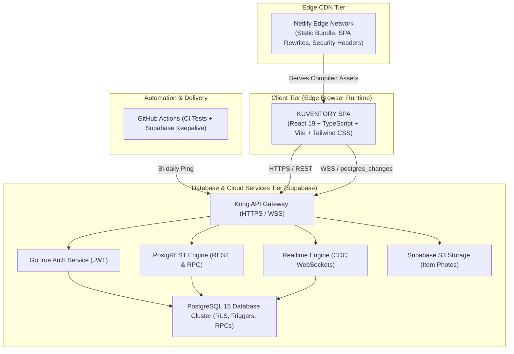
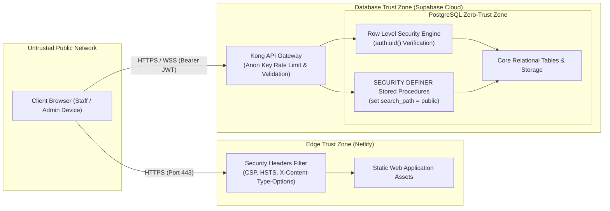

# KUVENTORY — System Architecture & Component Design

```
Document:               docs/02_SYSTEM_ARCHITECTURE.md
Audience:               Software Architects, Technical Examiners, Backend Engineers, DevOps Leads
Purpose:                C4 architectural model, container/component topology, trust boundaries,
                        data flows, network protocols, and validated design decisions.
Verification Status:    Verified against repository codebase, network routes, and Netlify/Supabase configurations
Audit Date:             2026-10-19
Authoritative HEAD SHA: 135f10b807fedec368383c9e34895566da3d69fc
Primary References:     src/app/App.tsx, vite.config.ts, netlify.toml, supabase/migrations/
```

---

## 1. Architectural Approach & Overview

KUVENTORY follows a modern **Cloud-Native Decoupled Architecture** consisting of an optimized **React 19 Single Page Application (SPA)** served globally via the **Netlify Edge CDN**, communicating directly with a **Supabase Managed PostgreSQL Platform** over secure HTTPS and WSS protocols.



*(See full source diagram: [docs/diagrams/system_context.mmd](file:///c:/Users/Nuero/OneDrive/Desktop/KUVENTORY-FINAL/docs/diagrams/system_context.mmd))*

---

## 2. C4 Model Breakdown

### Level 1: System Context
The system interfaces with three operational user groups:
* **Staff / Baristas (`USER`):** Access daily worksheets and stock levels via mobile phones or counter tablets.
* **Store Managers (`ADMIN`):** Manage catalog items, suppliers, batch receiving, and shift finalization via back-office tablets or desktops.
* **System Administrator / Owner (`SUPER_ADMIN`):** Governs maintenance lockdowns, audit logs, sessions, and recovery via desktop workstations.

### Level 2: Container Topology

| Container | Technology | Runtime Environment | Responsibility | Communication Protocol |
| :--- | :--- | :--- | :--- | :--- |
| **Frontend Web App** | React 19, TypeScript, Vite, Tailwind CSS | Client Web Browser / Mobile PWA | UI rendering, client-side route guards, TanStack query caching, client-side report compilation. | HTTPS / WSS |
| **Edge Hosting CDN** | Netlify Edge Network | Netlify Global CDN | Serves static bundles, enforces SPA fallback (`/* -> /index.html 200`), injects security headers (HSTS, CSP, X-Frame). | HTTPS (TLS 1.3) |
| **API Gateway** | Kong API Gateway | Supabase Cloud | Reverse proxy, SSL termination, API key verification, request routing to internal services. | HTTPS / WSS |
| **Auth Service** | GoTrue (Supabase Auth) | Supabase Managed Container | User authentication, password hashing (`bcrypt`), JWT token issuance, password recovery. | HTTPS (REST) |
| **Data Engine (REST/RPC)** | PostgREST | Supabase Managed Container | Translates HTTPS requests into parameterized PostgreSQL queries and invokes PL/pgSQL stored procedures. | HTTPS (REST / RPC) |
| **Realtime Daemon** | Supabase Realtime (Elixir) | Supabase Managed Cluster | Tails PostgreSQL logical replication Write-Ahead Log (WAL) and broadcasts `postgres_changes` events to subscribers. | WSS (WebSocket) |
| **Database Core** | PostgreSQL 15 | Dedicated AWS / Supabase Cloud DB | Relational data persistence, Row Level Security (RLS) policies, atomic stored procedures (`consume_stock`), audit triggers. | PostgreSQL Wire Protocol |
| **Asset Storage** | Supabase Storage (S3 API) | Supabase Cloud Object Storage | Stores uploaded inventory product photos with CDN caching. | HTTPS (S3 API) |
| **Keepalive Engine** | GitHub Actions Runner | GitHub Ubuntu VM | Scheduled bi-daily curl ping (`0 0 */2 * *`) to prevent Supabase 7-day inactivity project pause. | HTTPS |

*(See full container diagram: [docs/diagrams/system_architecture_container.mmd](file:///c:/Users/Nuero/OneDrive/Desktop/KUVENTORY-FINAL/docs/diagrams/system_architecture_container.mmd))*

### Level 3: Frontend Component Topology
The React SPA is structured around feature-sliced modular boundaries under `src/features/`:
1. **`auth` (`src/features/auth/`):**
   * Context: `AuthContext.tsx` maintains active Supabase session, profile, and heartbeat interval.
   * Routing Guards: `RequireAuth.tsx` enforces authentication, maintenance lockdown checks, and role gates (`RequireAdmin`, `RequireSuperAdmin`).
   * Services: `sessionLeaseService.ts` handles single-session lease renewal and heartbeat tracking.
2. **`inventory` (`src/features/inventory/`):**
   * Catalog: `ItemsCatalogPage.tsx` and `ItemDetailsPage.tsx` manage item listings, filtering by station pills, and modal updates.
   * Batch Allocation: `StockUpdateModal.tsx` receives new stock shipments with expiration dates.
   * Realtime: `useRealtimeSync.ts` subscribes to 16 database tables and triggers query cache invalidations.
3. **`daily-inventory` (`src/features/daily-inventory/`):**
   * Worksheet Grid: `DailyInventoryPage.tsx` and `InventorySheet.tsx` display station-grouped inventory items.
   * Calculation Engine: `InventoryRow.tsx` and `calculations.ts` evaluate balance formulas with debounced autosaving.
   * Revision Engine: `DailyCorrectionModal.tsx` submits post-finalization adjustments with audited reason logging.
4. **`reports` (`src/features/reports/`):**
   * Reports Hub: `ReportsLibraryPage.tsx` and `ReportViewPage.tsx` query immutable report snapshots.
   * Analytics: `AnalyticsPage.tsx` executes Recharts visualizations (Pie, Bar).
   * File Exporters: `pdf.ts` (`jsPDF`), `xlsx.ts` (`exceljs`), and `csv.ts` compile deliverables client-side.
5. **`admin` (`src/features/admin/`):**
   * Manager View: `AdminPage.tsx` manages staff user accounts and category configurations.
   * Operations Console: `SuperAdminPage.tsx` and `SuperAdminControlCenter.tsx` manage the 10 operational tabs.

---

## 3. Trust Boundaries & Network Security



### Trust Boundary Analysis
1. **Browser to Edge CDN:** Transport is encrypted via HTTPS (TLS 1.3). Static bundles are protected by strict Content Security Policy (CSP), HTTP Strict Transport Security (HSTS with 1-year max-age), and `X-Frame-Options: DENY` to eliminate clickjacking.
2. **Browser to Supabase API Gateway:** Every request transmits either the public anonymous key or a short-lived user JWT. The anonymous key grants zero access to table rows without a valid authenticated user session.
3. **API Gateway to PostgreSQL Engine:** PostgREST executes queries within the PostgreSQL connection pool under the authenticated user's role. Every query passes through PostgreSQL's kernel-level **Row Level Security (RLS)** engine, verifying `auth.uid() = id` or checking the user's role in `public.profiles`.
4. **Privileged Functions (`SECURITY DEFINER`):** Stored procedures executing with elevated privileges (such as `consume_stock`, `finalize_daily_inventory_sheet`, and `apply_daily_sheet_correction`) strictly set `search_path = public` to prevent search path injection attacks, and validate role claims internally before mutating records.

---

## 4. Key Architectural Decisions (ADR Summary)

* **Decision 1: React 19 + Vite over Next.js SSR.**
  * *Context:* KUVENTORY is an internal operational tool for a single restaurant enterprise; SEO indexing of private inventory screens is unnecessary.
  * *Decision:* Utilize Vite for high-speed local development and client-side code splitting, deploying a pure SPA on Netlify Edge CDN.
  * *Consequence:* Eliminates cold-start serverless container latency on low-traffic hours and significantly reduces operational cloud hosting costs.
* **Decision 2: Supabase PostgREST + Realtime over Custom Node Backend.**
  * *Context:* The application requires instant multi-device reactivity when stock is counted or deducted.
  * *Decision:* Utilize Supabase's managed Postgres, GoTrue, PostgREST, and Realtime engine rather than maintaining a bespoke Node.js CRUD layer.
  * *Consequence:* Shifts authorization logic into robust, battle-tested PostgreSQL RLS policies and stored procedures.
* **Decision 3: Single-Session Lease Engine.**
  * *Context:* Prevent baristas and managers from sharing a single set of credentials concurrently across multiple phones, which led to unrecorded shift discrepancies.
  * *Decision:* Enforce a single active lease per user ID in `public.system_sessions`, validated on every 30-second heartbeat tick.
  * *Consequence:* Logging in on a new device terminates the previous device's session cleanly.
* **Decision 4: Standardized Business Timezone (`Asia/Manila`).**
  * *Context:* Restaurant shifts run late into the evening and early morning (00:00 - 04:00 AM PHT). Standard UTC dates truncated early morning shifts to the prior calendar day.
  * *Decision:* Centralize all date strings via `getBusinessDateString()`, pinning `Intl.DateTimeFormat` to `Asia/Manila` (UTC+8).
  * *Consequence:* Eliminates UTC shift-overlap bugs across all daily inventory worksheets and reports.
