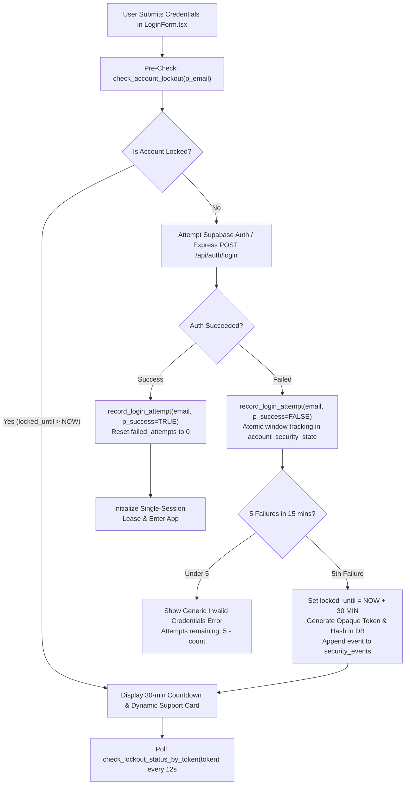
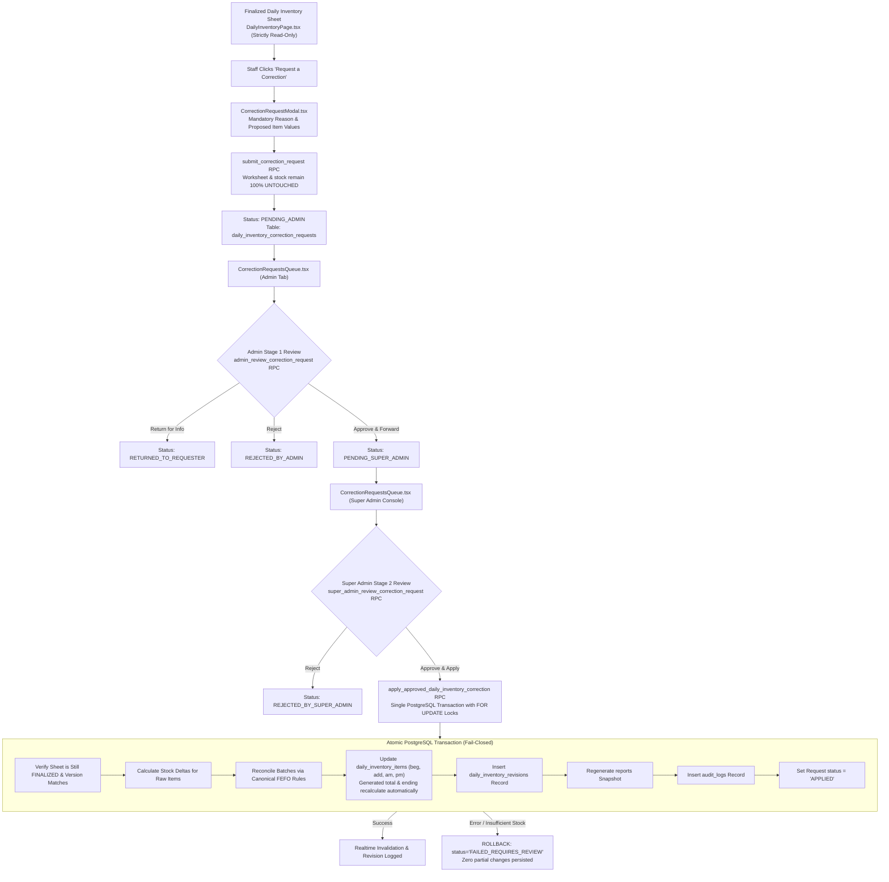

# KUVENTORY — Authentication, Security & RBAC Governance

```
Document:               docs/07_AUTH_SECURITY_AND_ROLES.md
Audience:               Security Officers, Technical Auditors, Software Architects, Database Administrators, Defense Panel
Purpose:                Authentication lifecycle, Single-Session Lease Engine, Role-Based Access Control (RBAC),
                        Row Level Security (RLS) policies, SECURITY DEFINER audit, account lockout/recovery,
                        profile support channels, and two-stage finalized-inventory correction governance.
Verification Status:    Verified against main branch & feature branch feat/security-recovery-and-correction-approvals
Audit Date:             2026-10-24
Branch Baseline:        feat/security-recovery-and-correction-approvals (originating main @ d141d57)
Primary References:     src/features/auth/, src/features/daily-inventory/, supabase/migrations/, netlify.toml
```

---

## Architecture Flowcharts Directory

All system, authentication, and workflow architecture diagrams are located in [`docs/diagrams/`](file:///c:/Users/Nuero/OneDrive/Desktop/KUVENTORY-FINAL/docs/diagrams):

1. **High-Level Security & Governance Map:** [`docs/diagrams/system_security_and_governance_map.mmd`](file:///c:/Users/Nuero/OneDrive/Desktop/KUVENTORY-FINAL/docs/diagrams/system_security_and_governance_map.mmd)
2. **Login Lockout & Admin Unlock Lifecycle:** [`docs/diagrams/login_lockout_and_unlock.mmd`](file:///c:/Users/Nuero/OneDrive/Desktop/KUVENTORY-FINAL/docs/diagrams/login_lockout_and_unlock.mmd)
3. **Password Recovery & Support Workflow:** [`docs/diagrams/password_recovery_and_support.mmd`](file:///c:/Users/Nuero/OneDrive/Desktop/KUVENTORY-FINAL/docs/diagrams/password_recovery_and_support.mmd)
4. **Profile Contacts & Realtime Updates:** [`docs/diagrams/profile_contacts_realtime.mmd`](file:///c:/Users/Nuero/OneDrive/Desktop/KUVENTORY-FINAL/docs/diagrams/profile_contacts_realtime.mmd)
5. **Role Permission & Capability Matrix:** [`docs/diagrams/role_permission_matrix.mmd`](file:///c:/Users/Nuero/OneDrive/Desktop/KUVENTORY-FINAL/docs/diagrams/role_permission_matrix.mmd)
6. **Two-Stage Finalized Inventory Correction Approval:** [`docs/diagrams/finalized_correction_approval.mmd`](file:///c:/Users/Nuero/OneDrive/Desktop/KUVENTORY-FINAL/docs/diagrams/finalized_correction_approval.mmd)
7. **System Error & Fail-Closed Recovery:** [`docs/diagrams/system_error_and_recovery.mmd`](file:///c:/Users/Nuero/OneDrive/Desktop/KUVENTORY-FINAL/docs/diagrams/system_error_and_recovery.mmd)
8. **Deployment & Migration Gates:** [`docs/diagrams/deployment_and_migration_gate.mmd`](file:///c:/Users/Nuero/OneDrive/Desktop/KUVENTORY-FINAL/docs/diagrams/deployment_and_migration_gate.mmd)

---

## 1. Authentication Lifecycle & Credential Security

KUVENTORY utilizes Supabase GoTrue authentication (JSON Web Tokens) augmented by a custom **Single-Session Lease Engine** and server-enforced **Account Lockout & Attempt Throttling**.

### Password Security & Hashing (Auditor Proof)
* **Zero Custom Password Storage:** KUVENTORY delegates credential storage and verification entirely to Supabase Auth (`GoTrue`).
* **Storage Location:** User password hashes are stored in the protected system catalog `auth.users.encrypted_password` using **bcrypt with per-user cryptographic salt**.
* **Public Schema Isolation:** The application schema (`public.profiles`, `public.system_settings`, `public.account_security_state`, etc.) contains **no `password_hash`**, **no `password`**, and **no `salt`** columns. 
* **Defense Demonstration:** To prove password security without leaking credential hashes, technical auditors inspect the public schema to verify no password fields exist and review Supabase Auth security configurations.

---

## 2. Server-Owned Failed Login Lockout (5 Attempts -> 30-Minute Lockout)

KUVENTORY implements server-authoritative account lockout to protect restaurant accounts against brute-force attacks.



### Key Policy Rules:
1. **Observation Window:** 15-minute rolling window tracks failed attempts per normalized email.
2. **Lockout Duration:** Exactly 30 minutes (`locked_until = NOW() + INTERVAL '30 minutes'`).
3. **Server-Sourced Countdown:** The client countdown timer (`MM:SS`) is presentation-only and derived directly from server timestamp `locked_until`. Local storage or client clock modifications cannot bypass lockout.
4. **Opaque Polling Token:** When locked, the client receives an opaque, cryptographically random lockout token (stored as SHA-256 hash on server). The browser polls `check_lockout_status_by_token(p_token)` without exposing account identity or email enumeration.
5. **Hierarchical Authorized Unlock:**
   - **Admin** can unlock locked **Staff** accounts.
   - **Super Admin** can unlock **Staff** and **Admin** accounts.
   - Requires mandatory justification reason and logs immutable security event to `security_events`.
   - Accessible via **Admin Settings → Login Lockouts** and **Super Admin Console → Security → Login Lockouts**.

---

## 3. Authoritative Forgot-Password & Recovery Workflow

1. **Submission:** User enters email in `LoginForm.tsx` Forgot Password dialog.
2. **Server-Side Throttling:** Calls `request_password_reset(p_email)` RPC, enforcing a 60-second cooldown between requests independently of browser localStorage.
3. **Generic Non-Enumerating Response:** The UI displays a safe, generic message (*"If an account matches this address, a reset link will arrive by email..."*) regardless of whether the email exists.
4. **Support Ticket Persistence:** A record is inserted into `password_reset_requests` with status `PENDING` (no passwords or tokens stored).
5. **Email Delivery & Verified Recovery Session:**
   - Supabase Auth sends an expiring, single-use recovery link pointing to `/reset-password`.
   - `/reset-password` validates that an active recovery session exists before rendering the password update form.
   - If SMTP is unavailable, the UI automatically falls back to the configured support contacts retrieved from `get_public_support_contacts()`.

---

## 4. Shared Profile & Opt-In Support Contacts (Admin / Super Admin)

Both Admin and Super Admin manage their profile and public contact channels through the shared, responsive **My Profile** modal (`src/features/admin/components/MyProfileModal.tsx`), reachable from the header avatar or Admin account tab.

### Permitted Profile Fields:
- Display Name (required)
- Public Support Phone (E.164 validated)
- Public Support Email (distinct from login email)
- Job Title / Role Label
- Avatar Image (uploaded to Supabase Storage bucket `avatars` with 2MB size limit and MIME validation)
- Toggle: *"Show this contact on the locked-login screen"*
- Dynamic Social Links (`profile_contact_links`): Facebook, Messenger, Instagram, WhatsApp, Telegram, Website (validated HTTPS / tel: / mailto: schemes; script/data schemes blocked).

### Safe Public Projection:
- Anonymous callers on the login screen can only execute `get_public_support_contacts()`.
- Returns strictly: `display_name`, `support_phone`, `support_email`, `job_title`, and public social links.
- Private profile fields, email addresses, and roles are never exposed.

---

## 5. Two-Stage Finalized Daily Inventory Correction Governance

Direct editing of finalized daily inventory worksheets is permanently disabled for all users. Changes to finalized sheets require a formal two-stage approval and atomic reconciliation.



### Separation of Duties & Fail-Closed Guardrails:
1. **Requester Cannot Review:** If an Admin submits a correction request, database RPC prevents them from performing the Stage 1 review.
2. **Super Admin Final Authority:** Only Super Admin can approve and trigger `apply_approved_daily_inventory_correction`.
3. **No Fake Client Success:** In `correctionService.ts`, the legacy fallback that wrote pseudo-revisions to `system_settings` on RPC failure is completely removed. Any failure aborts with an explicit error.
4. **Concurrency Protection:** The transaction acquires `FOR UPDATE` row locks on `daily_inventory` and `daily_inventory_items`, ensuring concurrent edits or replayed requests cannot corrupt stock ledgers.

---

## 6. Role-Based Access Control (RBAC) Hierarchy

The system defines a strict three-tier role hierarchy in `public.profiles`:

| Tier | Role in Database | Application Display Name | Scope of Authority & Accessible Routes |
| :---: | :--- | :--- | :--- |
| **Tier 1** | `USER` / `staff` | **Staff / Barista** | Access to `/inventory`, `/daily-inventory` (read, draft edit, submit correction request), `/items` (read-only), `/reports` (read-only), `/notifications`. Finalized sheets read-only. Cannot manage users, unlock accounts, or approve corrections. |
| **Tier 2** | `ADMIN` / `admin` | **Branch Manager** | Full Tier 1 permissions + Catalog item CRUD, supplier management, batch receiving, shift finalization, staff account creation, Stage 1 correction review, unlock Staff accounts, manage own support contact channels (`/admin`). |
| **Tier 3** | `SUPER_ADMIN` / `super_admin` | **System Administrator / Owner** | Full Tier 2 permissions + Standalone Operations Console (`/super-admin`), Stage 2 final correction approval, unlock Admin/Staff accounts, emergency maintenance lockdown, session termination, disaster recovery, audit logs. |

### Quota Enforcement (Database Triggers)
PostgreSQL triggers enforce strict administrative role quotas:
* **`SUPER_ADMIN` Quota:** Clamped to a **maximum of 1 account** in the system.
* **`ADMIN` Quota:** Clamped to a **maximum of 3 accounts** in the system.
* Any mutation violating these quotas is rejected by PostgreSQL trigger `trg_enforce_admin_quota`.

---

## 7. Row Level Security (RLS) Policy Architecture

All exposed tables in the `public` schema have Row Level Security enabled (`ALTER TABLE ... ENABLE ROW LEVEL SECURITY`). Anonymous direct access is blocked across all core data tables.

| Table | Operation | Policy / Grant Name | Permitted Roles & Condition |
| :--- | :--- | :--- | :--- |
| `inventory_items` | `SELECT` | `items_authenticated_read` | All authenticated users. |
| `inventory_items` | `INSERT/UPDATE/DELETE` | `items_admin_manage` | `ADMIN` and `SUPER_ADMIN` only. |
| `stock_batches` | `SELECT` | `batches_authenticated_read` | All authenticated users. |
| `stock_batches` | `INSERT/UPDATE` | `batches_admin_manage` | `ADMIN` and `SUPER_ADMIN`. (Internal stock consumption executes via `SECURITY DEFINER` RPC). |
| `daily_inventory` | `SELECT` | `sheets_read` | All authenticated users. |
| `daily_inventory` | `INSERT/UPDATE` | `sheets_write` | All authenticated users can save drafts; finalization restricted via RPC. Finalized sheets are immutable. |
| `daily_inventory_correction_requests` | `SELECT` | `corr_req_select_policy` | Requester sees own requests; `ADMIN` and `SUPER_ADMIN` see all requests. |
| `daily_inventory_correction_requests` | `INSERT` | `corr_req_insert_policy` | Authenticated users (via `submit_correction_request` RPC). |
| `profile_contact_links` | `SELECT` | `contact_links_read_policy` | Public can read active opted-in links; owners can read all own links. |
| `profile_contact_links` | `ALL` | `contact_links_manage_policy` | Profile owner (`profile_id = auth.uid()`). |
| `account_security_state` | `ALL` | RLS Enabled | Private to system; accessed strictly via `SECURITY DEFINER` RPCs (`record_login_attempt`, `check_account_lockout`, `unlock_account`). Direct client access REVOKED. |
| `security_events` | `SELECT` | `security_events_super_admin_read` | `SUPER_ADMIN` only. Appended via server RPCs; direct client mutation REVOKED. |
| `audit_logs` | `SELECT` | `audit_super_admin_read` | `SUPER_ADMIN` only. |

---

## 8. `SECURITY DEFINER` Stored Procedure Audit

Procedures executing with `SECURITY DEFINER` run with elevated privileges. The repository enforces four mandatory guardrails:
1. **Explicit Search Path Setting:** Every function includes `SET search_path = public, pg_temp;` to prevent search-path injection attacks.
2. **Strict Identity Verification:** Verifies caller identity via `auth.uid()`. Fallback actor patterns (e.g., substituting the first admin profile) are **strictly forbidden** and have been removed.
3. **Execution Grants:** Default execution is **REVOKED from `PUBLIC` and `anon`**. Grants are explicitly assigned only to `authenticated` or executed through trusted server wrappers.
4. **Fail-Closed Transactionality:** Internal stock consumption, batch reconciliation, revision logging, and audit records execute in single transactions without swallowing exceptions.

---

## 9. HTTP Security Headers (Netlify Edge)

Configured in [netlify.toml](file:///c:/Users/Nuero/OneDrive/Desktop/KUVENTORY-FINAL/netlify.toml), edge CDN delivers hardened security headers on every response:

```toml
[[headers]]
  for = "/*"
  [headers.values]
  X-Frame-Options = "DENY"
  X-XSS-Protection = "1; mode=block"
  X-Content-Type-Options = "nosniff"
  Referrer-Policy = "strict-origin-when-cross-origin"
  Strict-Transport-Security = "max-age=31536000; includeSubDomains; preload"
  Content-Security-Policy = "default-src 'self'; script-src 'self' 'unsafe-inline'; style-src 'self' 'unsafe-inline' https://fonts.googleapis.com; font-src 'self' https://fonts.gstatic.com data:; img-src 'self' data: blob: https:; connect-src 'self' https: wss:;"
```
