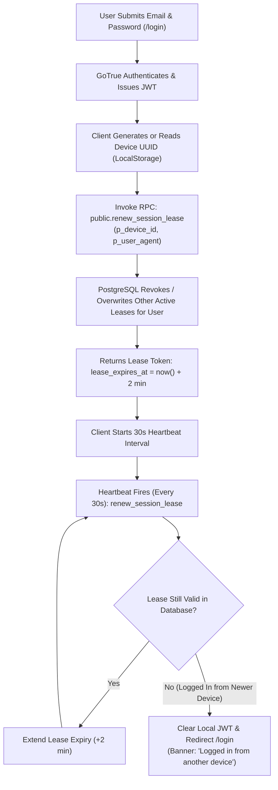
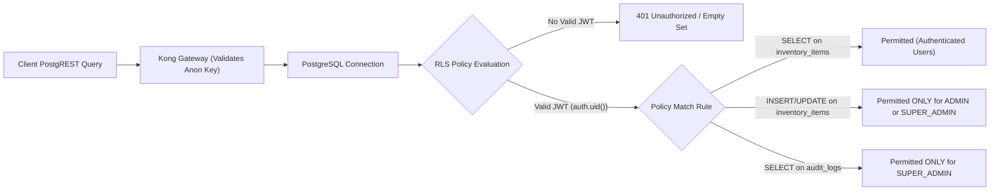

# KUVENTORY — Authentication, Security & RBAC Governance

```
Document:               docs/07_AUTH_SECURITY_AND_ROLES.md
Audience:               Security Officers, Technical Auditors, Software Architects, Database Administrators
Purpose:                Authentication lifecycle, Single-Session Lease Engine, Role-Based Access Control (RBAC),
                        Row Level Security (RLS) policies, SECURITY DEFINER audit, headers, and maintenance lockdown.
Verification Status:    Verified against src/features/auth/, supabase/migrations/, and netlify.toml
Audit Date:             2026-10-19
Authoritative HEAD SHA: 135f10b807fedec368383c9e34895566da3d69fc
Primary References:     src/features/auth/, supabase/migrations/, netlify.toml
```

---

## 1. Authentication Lifecycle & Single-Session Lease Engine

KUVENTORY employs Supabase GoTrue authentication (JSON Web Tokens) augmented by a custom **Single-Session Lease Engine** to prevent credential sharing and unauthorized multi-device concurrency.



### Heartbeat & Fail-Closed Session Verification
* **Heartbeat Frequency:** The client triggers `renew_session_lease` every **30 seconds** via `setInterval` in [AuthContext.tsx](file:///c:/Users/Nuero/OneDrive/Desktop/KUVENTORY-FINAL/src/features/auth/context/AuthContext.tsx#L159).
* **Lease Expiration Window:** Each heartbeat extends the lease expiration in `public.system_sessions` by **2 minutes** (`now() + INTERVAL '2 minutes'`).
* **Session Takeover Semantics:** If an employee logs in on Device B using the same credentials, Device B claims the active lease. When Device A's next 30-second heartbeat executes, the server responds with `{ valid: false, reason: 'REVOKED' }`, immediately ejecting Device A back to `/login`.
* **Fail-Closed Guard:** If the database connection drops and the lease RPC fails repeatedly for over 2 minutes, the client transitions to an unverified state to protect restaurant records.

---

## 2. Role-Based Access Control (RBAC) Hierarchy

The system defines a strict three-tier role hierarchy in `public.profiles`:

| Tier | Role in Database | Application Display Name | Scope of Authority & Accessible Routes |
| :---: | :--- | :--- | :--- |
| **Tier 1** | `USER` | **Staff / Barista** | Access to `/inventory`, `/daily-inventory` (read, draft edit, submit correction), `/items` (read-only), `/reports` (read-only), `/notifications`. Blocked from user management and system settings. |
| **Tier 2** | `ADMIN` | **Branch Manager** | Full Tier 1 permissions + Catalog item CRUD, supplier management, batch receiving with expiry dates, daily shift finalization, discrepancy reviews, staff account creation (`/admin`). |
| **Tier 3** | `SUPER_ADMIN`<br/>*(legacy: `MASTER_ADMIN`)* | **System Administrator / Owner** | Full Tier 2 permissions + Standalone Operations Console (`/super-admin`), emergency maintenance lockdown, session termination, disaster recovery checkpoints, audit log inspection, drift diagnostics. |

### Quota Enforcement (Database Triggers)
To prevent unauthorized administrative privilege escalation, PostgreSQL triggers enforce strict role quotas:
* **`SUPER_ADMIN` Quota:** Strictly clamped to a **maximum of 1 account** in the system.
* **`ADMIN` Quota:** Strictly clamped to a **maximum of 3 accounts** in the system.
* Any `INSERT` or `UPDATE` on `public.profiles` attempting to assign an administrative role beyond these quotas is rejected by PostgreSQL trigger `trg_enforce_admin_quota`.

---

## 3. Row Level Security (RLS) Policy Architecture

All 18 tables in the `public` schema have Row Level Security enabled (`ALTER TABLE ... ENABLE ROW LEVEL SECURITY`). Public anonymous access is blocked across all core data tables.



### Key RLS Policies

| Table | Operation | Policy Name | Permitted Roles & Condition |
| :--- | :--- | :--- | :--- |
| `inventory_items` | `SELECT` | `items_authenticated_read` | All authenticated users (`auth.role() = 'authenticated'`). |
| `inventory_items` | `INSERT/UPDATE/DELETE` | `items_admin_manage` | `auth.uid() IN (SELECT id FROM profiles WHERE role IN ('ADMIN', 'SUPER_ADMIN', 'MASTER_ADMIN'))`. |
| `stock_batches` | `SELECT` | `batches_authenticated_read` | All authenticated users. |
| `stock_batches` | `INSERT/UPDATE` | `batches_admin_manage` | `ADMIN` and `SUPER_ADMIN`. (Internal stock consumption executes via `SECURITY DEFINER` RPC). |
| `daily_inventory_sheets` | `SELECT` | `sheets_read` | All authenticated users. |
| `daily_inventory_sheets` | `INSERT/UPDATE` | `sheets_write` | All authenticated users can insert drafts; finalization restricted via RPC. |
| `daily_inventory_items` | `ALL` | `daily_items_manage` | All authenticated users (supports shift draft autosave). |
| `audit_logs` | `SELECT` | `audit_super_admin_read` | Restricted strictly to `SUPER_ADMIN` and `MASTER_ADMIN`. |
| `audit_logs` | `INSERT` | `audit_insert_internal` | All authenticated users can append audit logs; `UPDATE` and `DELETE` are disabled. |
| `system_sessions` | `ALL` | `session_user_isolation` | `user_id = auth.uid()` OR `role IN ('SUPER_ADMIN', 'MASTER_ADMIN')`. |
| `recovery_points` | `SELECT` | `recovery_super_admin_read` | Restricted strictly to `SUPER_ADMIN` and `MASTER_ADMIN`. |

---

## 4. `SECURITY DEFINER` Stored Procedure Audit

Procedures executing with `SECURITY DEFINER` run with the privileges of the database owner rather than the caller. The repository enforces two non-negotiable security rules across all such functions:
1. **Explicit Search Path Setting:** Every function includes `SET search_path = public, pg_temp;` to prevent search-path hijacking attacks.
2. **Caller Authorization Verification:** Functions verify the caller's identity via `auth.uid()` or inspect their role in `public.profiles` before performing sensitive operations:
   ```sql
   IF NOT EXISTS (
       SELECT 1 FROM public.profiles 
       WHERE id = auth.uid() 
         AND role IN ('SUPER_ADMIN', 'MASTER_ADMIN')
   ) THEN
       RAISE EXCEPTION 'Access denied: Super Admin authorization required.';
   END IF;
   ```

---

## 5. Emergency Maintenance Mode Lockdown

When an operational defect, data drift, or security compromise is detected, the Super Admin can toggle **Emergency Maintenance Lockdown** via the Operations Console:
1. **Trigger:** Super Admin toggles maintenance mode in `SuperSecurityTab.tsx`.
2. **Database State:** Sets `value = 'true'` for key `'maintenance_mode'` in `public.system_settings`.
3. **Realtime Broadcast:** Supabase Realtime pushes the change event to all connected browsers.
4. **Enforcement Gate:** `RequireAuth.tsx` intercepts all client-side navigation. For all users with role `USER` or `ADMIN`, it replaces the normal UI with the **Emergency Maintenance Screen**, blocking read/write operations.
5. **Super Admin Bypass:** Users authenticated as `SUPER_ADMIN` bypass the lockdown screen, allowing them to access `/super-admin` to execute drift repairs, review audit logs, or restore data.

---

## 6. HTTP Security Headers (Netlify Edge)

Configured in [netlify.toml](file:///c:/Users/Nuero/OneDrive/Desktop/KUVENTORY-FINAL/netlify.toml), the edge CDN delivers hardened security headers on every response:

```toml
[[headers]]
  for = "/*"
  [headers.values]
    X-Frame-Options = "DENY"
    X-XSS-Protection = "1; mode=block"
    X-Content-Type-Options = "nosniff"
    Referrer-Policy = "strict-origin-when-cross-origin"
    Strict-Transport-Security = "max-age=31536000; includeSubDomains; preload"
    Content-Security-Policy = "default-src 'self'; script-src 'self' 'unsafe-inline'; style-src 'self' 'unsafe-inline' https://fonts.googleapis.com; font-src 'self' https://fonts.gstatic.com data:; img-src 'self' data: blob: https:; connect-src 'self' https: wss:;"
```
* **Anti-Clickjacking:** `X-Frame-Options: DENY` prevents framing KUVENTORY in malicious iframes.
* **MIME Sniffing Prevention:** `X-Content-Type-Options: nosniff` forces browsers to adhere to declared Content-Types.
* **HSTS Enforced:** `max-age=31536000` enforces HTTPS encryption for 1 full calendar year.
