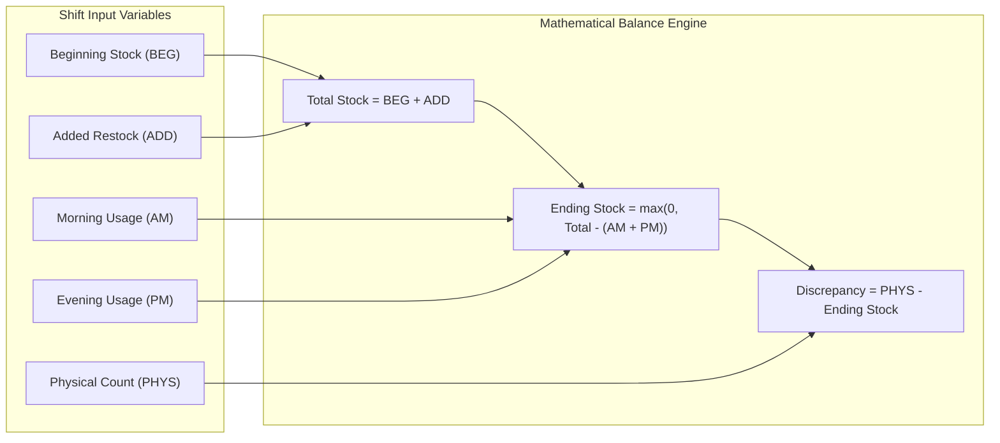
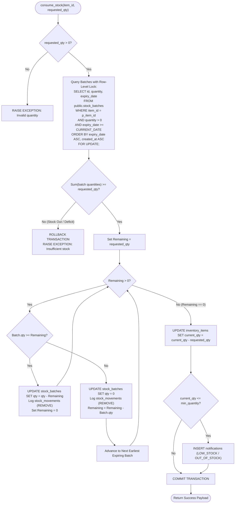
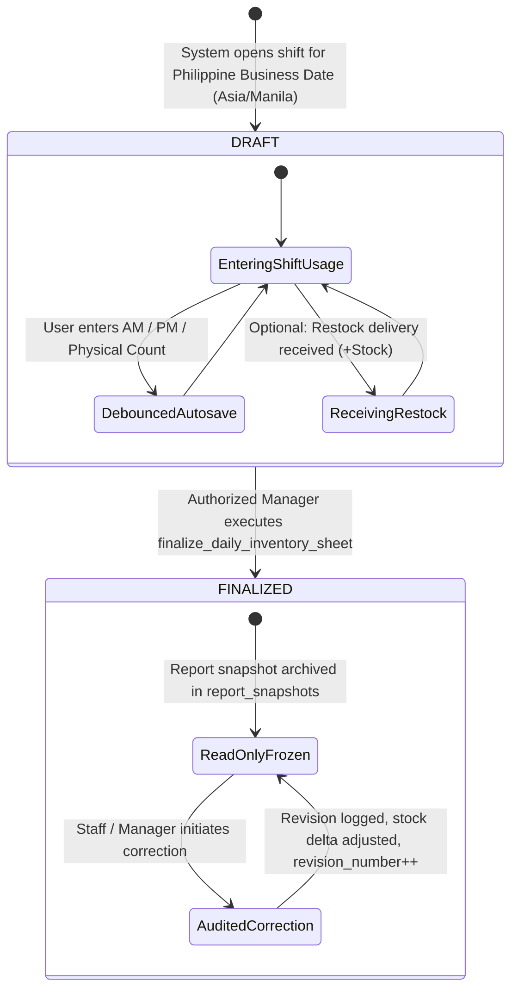

# KUVENTORY — Inventory Engine, Daily Worksheets & FEFO Rotation

```
Document:               docs/08_INVENTORY_DAILY_WORKSHEETS_AND_FEFO.md
Audience:               Technical Examiners, Software Architects, Operations Engineers, Barista Leads
Purpose:                Algorithmic mechanics of FEFO stock rotation, mathematical balance formulas,
                        row-level locking concurrency controls, daily shift worksheet lifecycle, and revision workflows.
Verification Status:    Verified against src/features/daily-inventory/, supabase/migrations/, and unit test suites
Audit Date:             2026-10-19
Authoritative HEAD SHA: 135f10b807fedec368383c9e34895566da3d69fc
Primary References:     src/features/daily-inventory/utils/calculations.ts, supabase/migrations/
```

---

## 1. Inventory Balancing Mathematical Formulas

All daily shift calculations are enforced at two levels: client-side reactive utility functions in [src/features/daily-inventory/utils/calculations.ts](file:///c:/Users/Nuero/OneDrive/Desktop/KUVENTORY-FINAL/src/features/daily-inventory/utils/calculations.ts) and server-side PostgreSQL generated columns in `public.daily_inventory_items`.



### 1.1 Formula 1: Total Available Stock
$$\text{Total Stock} = \text{Beginning Stock} + \text{Added Stock}$$
* **Variables:**
  * $\text{Beginning Stock}$ ($B \ge 0$): Unconsumed inventory carried over from the prior business day's finalized ending stock.
  * $\text{Added Stock}$ ($A \ge 0$): Mid-shift restock deliveries received and verified on the current operating date.
* **Database Invariant:** In `daily_inventory_items`, stored as a generated column:
  ```sql
  total_stock NUMERIC(12,2) GENERATED ALWAYS AS (beginning_stock + added_stock) STORED
  ```

### 1.2 Formula 2: Ending Stock (Strict Non-Negative Clamp)
$$\text{Ending Stock} = \max\left(0, (\text{Beginning Stock} + \text{Added Stock}) - (\text{AM Usage} + \text{PM Usage})\right)$$
* **Variables:**
  * $\text{AM Usage}$ ($U_{AM} \ge 0$): Quantity consumed or sold during the morning operational shift.
  * $\text{PM Usage}$ ($U_{PM} \ge 0$): Quantity consumed or sold during the evening operational shift.
* **Non-Negative Invariant:** In physical restaurant operations, sales recordings can inadvertently exceed recorded stock due to untracked emergency deliveries. Rather than allowing negative stock (e.g., $-5$ liters of milk), the system clamps ending stock strictly to **0**, highlights a discrepancy warning, and prevents downstream calculation distortions.
* **Database Invariant:** In `daily_inventory_items`, stored as:
  ```sql
  ending_stock NUMERIC(12,2) GENERATED ALWAYS AS (
      GREATEST(0, (beginning_stock + added_stock) - (am_usage + pm_usage))
  ) STORED
  ```

### 1.3 Formula 3: Shift Count Discrepancy
$$\text{Discrepancy} = \begin{cases} \text{Physical Count} - \text{Ending Stock}, & \text{if Physical Count is entered} \\ 0, & \text{if Physical Count is null} \end{cases}$$
* **Variables:**
  * $\text{Physical Count}$ ($P \ge 0$): Actual count manually counted by staff at shift close.
* **Interpretation:**
  * $\text{Discrepancy} = 0$: Perfect reconciliation.
  * $\text{Discrepancy} < 0$: Shortage (unrecorded waste, spillage, theft, or over-portioning).
  * $\text{Discrepancy} > 0$: Overage (under-portioning or unrecorded incoming stock).

---

## 2. First-Expired, First-Out (FEFO) Consumption Algorithm

The core inventory rotation algorithm is implemented in the PostgreSQL stored procedure `public.consume_stock`.



### Algorithmic Rules & Guarantees
1. **Earliest Expiry Priority:** Batches are ordered strictly by `expiry_date ASC`. A batch expiring on `2026-10-25` will always be completely depleted before a batch expiring on `2026-11-01` is touched.
2. **FIFO Tie-Breaking:** If two batches share the exact same expiration date, the algorithm breaks ties using `created_at ASC` (First-In, First-Out).
3. **Expired Batch Exclusion:** Any batch where `expiry_date < CURRENT_DATE` is strictly excluded from consumption (`WHERE expiry_date >= CURRENT_DATE`). Expired ingredients cannot be consumed; they must be written off via waste adjustments.

---

## 3. Concurrency Control & Row-Level Locking (`FOR UPDATE`)

In a busy bistro environment, multiple counter terminals may attempt to record transactions simultaneously. Without pessimistic row locking, concurrent reads produce the **Double-Deduction Race Condition**:

### The Concurrency Vulnerability (Without Locks)
1. Batch A currently has `10` units available.
2. Worker 1 requests to consume `8` units. Worker 1 reads `quantity = 10`.
3. Simultaneously, Worker 2 requests to consume `5` units. Worker 2 reads `quantity = 10`.
4. Worker 1 writes `quantity = 10 - 8 = 2`.
5. Worker 2 writes `quantity = 10 - 5 = 5` (overwriting Worker 1's write).
6. **Result:** Total consumed was $8 + 5 = 13$, but remaining balance shows $5$ instead of erroring on insufficient stock.

### The KUVENTORY Solution
In `consume_stock`, PostgreSQL pessimistic locking is enforced at the database transaction layer:
```sql
SELECT id, quantity, expiry_date
FROM public.stock_batches
WHERE item_id = p_item_id
  AND quantity > 0
  AND expiry_date >= CURRENT_DATE
ORDER BY expiry_date ASC, created_at ASC
FOR UPDATE;
```
* **Pessimistic Lock Semantics:** The `FOR UPDATE` clause places an exclusive lock on all matching batch rows for the duration of the transaction.
* When Worker 1 initiates consumption, PostgreSQL locks Batch A. Worker 2's transaction is queued until Worker 1 commits.
* When Worker 2 executes, it reads the updated quantity (`2`), recognizes that `2 < 5`, rolls back the transaction safely, and notifies Worker 2 that insufficient stock remains.

---

## 4. Daily Worksheet Lifecycle: Drafts, Finalization & Corrections



### 4.1 Shift Finalization (`finalize_daily_inventory_sheet`)
* Transitions worksheet status from `DRAFT` to `FINALIZED`.
* Loops through all rows in `daily_inventory_items`. For every item with total usage ($U_{AM} + U_{PM} > 0$), executes `consume_stock` to deduct physical batches in FEFO order.
* Creates an immutable JSON snapshot in `public.report_snapshots`.

### 4.2 Post-Finalization Revisions (`apply_daily_sheet_correction`)
* When an unintentional counting error is discovered on a finalized sheet, staff or managers submit a correction via `DailyCorrectionModal.tsx`.
* **Delta Calculation:**
  $$\Delta = (\text{New AM} + \text{New PM}) - (\text{Old AM} + \text{Old PM})$$
  * If $\Delta > 0$: Additional stock consumed $\rightarrow$ executes `consume_stock` for quantity $\Delta$.
  * If $\Delta < 0$: Over-reported usage corrected $\rightarrow$ restores quantity $|\Delta|$ to active batches.
* **Audit Persistence:** Stores a new record in `public.daily_inventory_revisions` containing caller ID, mandatory reason string, old state JSON, and new state JSON.
* **Revision Counter:** Increments `daily_inventory_sheets.revision_number` and refreshes the frozen snapshot in `report_snapshots`.
