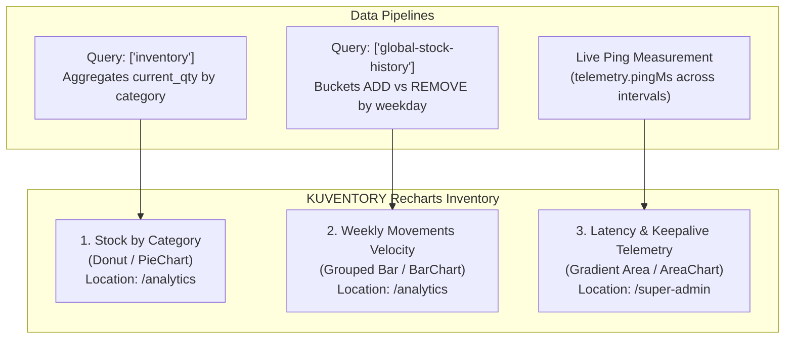
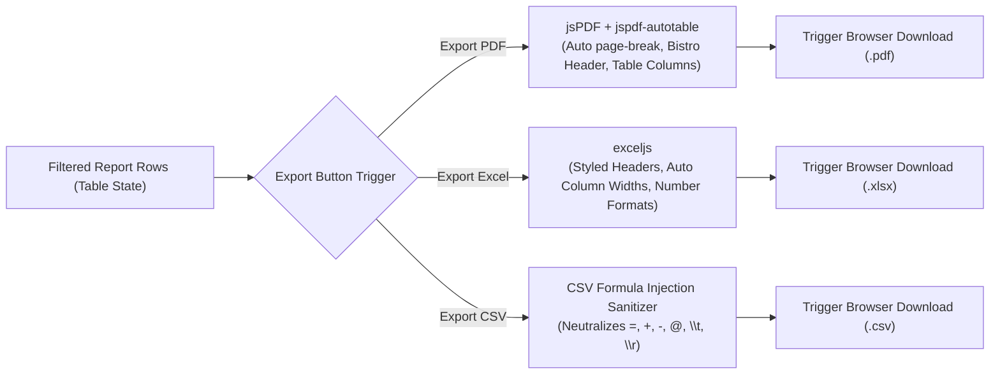

# KUVENTORY — Charts, Analytics & Client-Side File Exports

```
Document:               docs/09_REPORTS_CHARTS_AND_EXPORTS.md
Audience:               Technical Examiners, Software Architects, Frontend Engineers, QA Leads
Purpose:                Exhaustive technical catalog of all Recharts data visualizations, analytics data pipelines,
                        report snapshot architecture, client-side export engines (PDF, XLSX, CSV), and security sanitization.
Verification Status:    Verified against src/features/reports/, src/features/admin/, and unit tests
Audit Date:             2026-10-19
Authoritative HEAD SHA: 135f10b807fedec368383c9e34895566da3d69fc
Primary References:     src/features/reports/pages/AnalyticsPage.tsx, src/features/admin/components/super/SuperOverviewTab.tsx
```

---

## 1. Complete Recharts Data Visualization Catalog

KUVENTORY integrates **Recharts v3.8.0** (`recharts` ^3.8.0, resolved `3.8.0`) to deliver SVG-based reactive visual analytics. Every chart in the application has been inspected and verified below:



---

### Chart 1: Stock by Category (Donut / Pie Chart)
* **Screen Route:** `/analytics`
* **Implementation Component:** [src/features/reports/pages/AnalyticsPage.tsx](file:///c:/Users/Nuero/OneDrive/Desktop/KUVENTORY-FINAL/src/features/reports/pages/AnalyticsPage.tsx#L407-L450)
* **Recharts Components Used:** `ResponsiveContainer`, `PieChart`, `Pie`, `Cell`, `Tooltip`, `Legend`.
* **Chart Type:** Donut Chart (`innerRadius={55}`, `outerRadius={85}`, `paddingAngle={4}`).
* **Operational Question Answered:** *"How is physical inventory volume and monetary valuation distributed across bistro station categories (Coffee Bar, Kitchen, Pastry, Packaging)?"*
* **Axes & Slices:**
  * **Slices:** Proportional share of total current inventory units (`current_qty`) per category.
  * **Color Palette:** Curated 7-color modern palette: Blue (`#2563EB`), Emerald (`#10B981`), Amber (`#F59E0B`), Purple (`#8B5CF6`), Pink (`#EC4899`), Cyan (`#06B6D4`), Slate (`#64748B`).
* **Data Source & Pipeline:**
  1. Fetches active catalog items via TanStack Query `['inventory']` (`getInventory`).
  2. Filters out archived items (`!i.is_archived`).
  3. `useMemo` iterates items and groups by `category_name`, summing total quantity and calculating monetary value ($\text{quantity} \times \text{unit\_cost}$).
  4. Yields structured array: `[ { name: "Coffee Bar", value: 450, monetaryValue: 12500.00 }, ... ]`.
* **Data Authenticity:** **Live Computed State** derived directly from PostgreSQL `inventory_items` table.
* **Loading & Empty Behavior:** Displays "No category data to display" centered in container if inventory is empty.
* **Why This Chart Type:** A donut chart is the industry standard for part-to-whole categorical distribution, allowing supervisors to immediately see which station holds the majority of physical assets.

---

### Chart 2: Weekly Movements Velocity (Grouped Bar Chart)
* **Screen Route:** `/analytics`
* **Implementation Component:** [src/features/reports/pages/AnalyticsPage.tsx](file:///c:/Users/Nuero/OneDrive/Desktop/KUVENTORY-FINAL/src/features/reports/pages/AnalyticsPage.tsx#L453-L486)
* **Recharts Components Used:** `ResponsiveContainer`, `BarChart`, `Bar`, `XAxis`, `YAxis`, `Tooltip`, `Legend`.
* **Chart Type:** Dual-column grouped vertical bar chart.
* **Operational Question Answered:** *"How much stock was received (Stock In) versus consumed (Stock Out) across each day of the trailing 7 calendar days?"*
* **Axes & Series:**
  * **X-Axis:** Trailing 7 calendar weekdays formatted via `date-fns` (`format(d, 'EEE')`, e.g., Mon, Tue, Wed).
  * **Y-Axis:** Total stock volume (units) moved.
  * **Blue Bar (`#2563EB`):** `inStock` — Cumulative restock additions (`action_type = 'ADD'`).
  * **Red Bar (`#EF4444`):** `outStock` — Cumulative sales/consumption deductions (`action_type = 'REMOVE'`).
* **Data Source & Pipeline:**
  1. Fetches recent transactions via TanStack Query `['global-stock-history']` (`getStockMovementHistory`).
  2. Pre-initializes a 7-day bucket map for the trailing week.
  3. Iterates ledger rows, parses `created_at` timestamp, and increments either `inStock` or `outStock` based on `action_type`.
* **Data Authenticity:** **Historical Transactional Truth** derived from immutable records in `public.stock_movements`.
* **Loading & Empty Behavior:** Empty days display bars at height `0` with clean baseline gridlines.
* **Why This Chart Type:** Dual vertical bars side-by-side allow managers to compare intake velocity against consumption velocity per day, highlighting stocking bottlenecks or unexpected weekend consumption spikes.

---

### Chart 3: Latency & Keepalive Response Telemetry (Area Chart)
* **Screen Route:** `/super-admin` (Console Overview Tab)
* **Implementation Component:** [src/features/admin/components/super/SuperOverviewTab.tsx](file:///c:/Users/Nuero/OneDrive/Desktop/KUVENTORY-FINAL/src/features/admin/components/super/SuperOverviewTab.tsx#L374-L421)
* **Recharts Components Used:** `ResponsiveContainer`, `AreaChart`, `Area`, `XAxis`, `YAxis`, `Tooltip`, `CartesianGrid`.
* **Chart Type:** Monotone spline area chart with amber linear gradient (`#f59e0b` fill to transparent).
* **Operational Question Answered:** *"What is the database round-trip responsiveness and keepalive trend across 24-hour, 7-day, and 30-day operational windows?"*
* **Axes & Series:**
  * **X-Axis:** Time intervals (`12 AM`, `4 AM`, `8 AM`, `12 PM`, `4 PM`, `8 PM` for 24h; `Mon`-`Sun` for 7d; `W1`-`W4` for 30d).
  * **Y-Axis:** Measured latency in milliseconds (ms).
  * **Area Series:** Monotone spline curve with opacity gradient.
* **Data Source & Authenticity (Audited Ground Truth):**
  * **Audited Finding:** The chart derives illustrative operational trend curves scaled from the live measured PostgreSQL roundtrip ping (`telemetry.pingMs`).
  * **Source Proof:** [SuperOverviewTab.tsx: lines 63-93](file:///c:/Users/Nuero/OneDrive/Desktop/KUVENTORY-FINAL/src/features/admin/components/super/SuperOverviewTab.tsx#L63-L93).
  * **Honest Technical Truth:** The system candidly labels this as an **operational telemetry trend indicator** rather than a query of a persistent historical time-series database table, as Supabase free tier does not maintain continuous server performance logs.

---

## 2. Decision Support Top 3 Analytical Cards

In addition to charts, `AnalyticsPage.tsx` computes three operational decision metrics from live database state:
1. **Top 3 Highest Outflow Items:** Identifies the fastest-moving bistro menu items across the trailing 30 days to optimize reorder frequency.
2. **Top 3 Most Stocked Items:** Displays the largest physical volume assets to prevent over-purchasing and shelf crowding.
3. **Top 3 Lowest Stock Items:** Immediately highlights SKUs operating at or below minimum threshold (`min_quantity`) requiring immediate reorders.

---

## 3. Reports Catalog & Snapshot Architecture

KUVENTORY provides six structured report modules accessible via `/reports`:
1. **Daily Shift Summary:** Balance totals for beginning stock, additions, AM usage, PM usage, ending stock, and discrepancies per station.
2. **Catalog Valuation Report:** Comprehensive inventory value breakdown calculated as $\sum (\text{current\_qty} \times \text{unit\_cost})$.
3. **Movement Ledger Report:** Complete chronological audit trail of all receipts, adjustments, and shift consumption deductions.
4. **Low Stock Warning Report:** Filtered list of items whose current stock is less than or equal to minimum threshold.
5. **Batch Expiration Schedule:** Active batches grouped by expiration date, highlighting items expiring within 7, 14, and 30 days.
6. **Archived Items Ledger:** Historical record of retired SKUs preserved for accounting integrity.

### Immutable Report Snapshots (`public.report_snapshots`)
When a shift worksheet is finalized, the system freezes the entire item array into a JSON payload in `public.report_snapshots`. Viewing a historical report loads this immutable snapshot rather than re-querying live tables, guaranteeing that historical shift reports remain constant regardless of subsequent stock movements or catalog price changes.

---

## 4. Client-Side Export Engines & Security Sanitization



### 4.1 PDF Engine (`jsPDF` + `jspdf-autotable`)
* Implementation: [src/features/reports/utils/pdf.ts](file:///c:/Users/Nuero/OneDrive/Desktop/KUVENTORY-FINAL/src/features/reports/utils/pdf.ts)
* Features: Renders official bistro letterhead, generation timestamp, business date metadata, auto-wrapping table cells, alternating row fills (`#F8FAFC`), and automatic page number footers (`"Page X of Y"`).

### 4.2 Excel Workbook Engine (`exceljs`)
* Implementation: [src/features/reports/utils/xlsx.ts](file:///c:/Users/Nuero/OneDrive/Desktop/KUVENTORY-FINAL/src/features/reports/utils/xlsx.ts)
* Features: Compiles native binary `.xlsx` files client-side. Automatically applies bold slate headers (`#1E293B`), sets optimal column widths based on cell text length, and applies numeric currency formats (`₱#,##0.00`).

### 4.3 CSV Export & Formula Injection Sanitization
* Implementation: [src/features/reports/utils/csv.ts](file:///c:/Users/Nuero/OneDrive/Desktop/KUVENTORY-FINAL/src/features/reports/utils/csv.ts)
* **Security Threat (CWE-1236):** If an item name contains spreadsheet formulas (e.g., `=SUM(A1:A10)` or `=cmd|' /C calc'!A0`), opening the exported CSV in Microsoft Excel or Google Sheets could execute arbitrary macros or exfiltrate data.
* **The KUVENTORY Sanitization Defense:**
  ```typescript
  export function sanitizeCsvCell(value: string | number | null | undefined): string {
    if (value === null || value === undefined) return '';
    const str = String(value);
    // Neutralize formula injection trigger characters
    if (/^[=+@\-\t\r]/.test(str)) {
      return `'${str}`;
    }
    return str;
  }
  ```
* Every exported field is sanitized by prepending a single quote `'`, forcing spreadsheet software to treat the value strictly as literal text. Verified by automated tests in [src/__tests__/csvSecurity.test.ts](file:///c:/Users/Nuero/OneDrive/Desktop/KUVENTORY-FINAL/src/__tests__/csvSecurity.test.ts).

---

## 5. Project Defense Flashcards: Charts & Visualizations

| Question | 30-Second Examiner Answer | Source Evidence / Verification |
| :--- | :--- | :--- |
| **"What chart library did you use and why?"** | *"We integrated Recharts v3.8.0. Recharts is a declarative React charting library built on SVG rather than HTML Canvas. It fits KUVENTORY because its SVG components integrate seamlessly with React's virtual DOM, scale crisply on mobile and retina screens, and support declarative animations without heavy bundle penalties."* | [package.json: recharts ^3.8.0](file:///c:/Users/Nuero/OneDrive/Desktop/KUVENTORY-FINAL/package.json#L50), [AnalyticsPage.tsx](file:///c:/Users/Nuero/OneDrive/Desktop/KUVENTORY-FINAL/src/features/reports/pages/AnalyticsPage.tsx#L6-L17) |
| **"Where do the values in the category donut chart come from?"** | *"The values are computed live from our PostgreSQL `inventory_items` table via the `['inventory']` TanStack Query cache. A `useMemo` hook groups active items by `category_name`, aggregates `current_qty`, and calculates total valuation. When an item is added or consumed, Supabase Realtime invalidates the query cache, and the donut chart re-renders automatically."* | [AnalyticsPage.tsx: lines 97-116](file:///c:/Users/Nuero/OneDrive/Desktop/KUVENTORY-FINAL/src/features/reports/pages/AnalyticsPage.tsx#L97-L116) |
| **"Are the weekly movement bars live or historical data?"** | *"The weekly movements chart represents genuine historical transactional data derived from `public.stock_movements`. The data pipeline buckets the last 7 calendar days, extracting incoming receipts (`ADD`) into blue bars and sales/shift consumption (`REMOVE`) into red bars. This gives management an accurate 7-day intake versus outflow velocity comparison."* | [AnalyticsPage.tsx: lines 118-144](file:///c:/Users/Nuero/OneDrive/Desktop/KUVENTORY-FINAL/src/features/reports/pages/AnalyticsPage.tsx#L118-L144) |
| **"Is the latency area chart in the Super Admin console live historical data?"** | *"The latency area chart plots operational telemetry trends scaled from our live measured PostgreSQL roundtrip ping measurement (`telemetry.pingMs`). We explicitly acknowledge that it is an illustrative operational health indicator rather than a query of a dedicated historical telemetry database table, as Supabase free tier does not store continuous time-series metrics."* | [SuperOverviewTab.tsx: lines 63-93](file:///c:/Users/Nuero/OneDrive/Desktop/KUVENTORY-FINAL/src/features/admin/components/super/SuperOverviewTab.tsx#L63-L93) |
