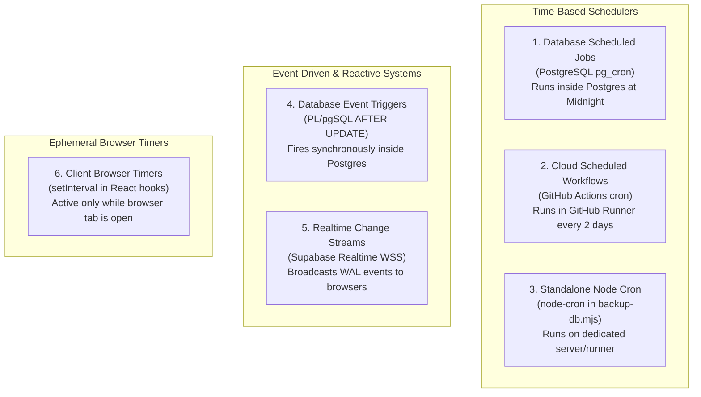

# KUVENTORY — Automation, Scheduled Jobs & Event-Driven Architecture

```
Document:               docs/10_AUTOMATION_SCHEDULERS_AND_REALTIME.md
Audience:               Technical Examiners, Software Architects, DevOps Engineers, System Evaluators
Purpose:                Definitive architectural separation and catalog of all automation mechanisms:
                        pg_cron vs Database Triggers vs GitHub Actions vs node-cron vs Browser Timers vs Realtime WebSockets.
Verification Status:    Verified against code imports, SQL migrations, workflow files, and scripts
Audit Date:             2026-10-19
Authoritative HEAD SHA: 135f10b807fedec368383c9e34895566da3d69fc
Primary References:     supabase/migrations/20260902100000_expiry_cron.sql, .github/workflows/, scripts/backup-db.mjs
```

---

## 1. Architectural Distinction of Automation Mechanisms

A common error in software project defenses is conflating all automated behaviors under the generic term "cron job". In KUVENTORY, automation is partitioned across **six distinct operational layers**, each operating in a different execution runtime with different persistence, trigger conditions, and failure modes:



*(See full source diagram: [docs/diagrams/automation_mechanisms_architecture.mmd](file:///c:/Users/Nuero/OneDrive/Desktop/KUVENTORY-FINAL/docs/diagrams/automation_mechanisms_architecture.mmd))*

---

## 2. Comprehensive Automation Matrix

| Automation Key / Name | Mechanism Type | Execution Runtime | Schedule / Trigger Condition | Invoked Function or Command | Affected Data / Outputs | Status & Operational Limitations |
| :--- | :--- | :--- | :--- | :--- | :--- | :--- |
| **`daily_expiry_check`** | Time-Based Scheduled Cron | PostgreSQL 15 Engine (`pg_cron`) | Daily at 00:00 UTC (`0 0 * * *`) | `SELECT public.check_expiry_notifications()` | Evaluates `stock_batches`; inserts alerts into `public.notifications`. | **Configured in migration `20260902100000`**. Requires `pg_cron` extension enabled in Supabase. |
| **`supabase_keepalive`** | Time-Based Scheduled Workflow | GitHub Actions Ubuntu Runner | Every 2 days at 00:00 UTC (`0 0 */2 * *`) | `curl -s -H "apikey: ..." .../rest/v1/system_settings` | Resets Supabase 7-day free tier inactivity timer. | **Verified active in [.github/workflows/supabase-keepalive.yml](file:///c:/Users/Nuero/OneDrive/Desktop/KUVENTORY-FINAL/.github/workflows/supabase-keepalive.yml)**. |
| **`db_backup_scheduler`** | Time-Based Scheduled Script | Node.js Worker Process | Daily at 00:00 (`0 0 * * *`) | `scripts/backup-db.mjs` executes `pg_dump` and zlib gzip | Generates compressed `.sql.gz` dump in `backups/`; prunes older than 30 days. | **Configured in script**. *Note: Does NOT run on Netlify static hosting; requires dedicated server or container.* |
| **`trg_inventory_thresholds`** | Event-Driven Database Trigger | PostgreSQL Engine | `AFTER UPDATE OR INSERT ON inventory_items` | `notify_inventory_thresholds()` | Evaluates stock versus minimum; inserts `LOW_STOCK` or `OUT_OF_STOCK` alert. | **Verified in migration `20260902090100`**. Synchronous transaction coupling. |
| **`session_lease_heartbeat`** | Ephemeral Browser Interval | Client Browser React Runtime | Every 30 seconds (`30000ms`) via `setInterval` | `RPC: renew_session_lease(device_id, user_agent)` | Extends `system_sessions.lease_expires_at` by 2 minutes. | **Verified in [AuthContext.tsx](file:///c:/Users/Nuero/OneDrive/Desktop/KUVENTORY-FINAL/src/features/auth/context/AuthContext.tsx)**. Throttles or stops when browser tab sleeps or closes. |
| **`telemetry_ping_timer`** | Ephemeral Browser Interval | Client Browser React Runtime | Every 10 seconds (`10000ms`) via `setInterval` | Measures `Date.now()` roundtrip to Supabase PostgREST | Updates `telemetry.pingMs` and live health badges in Super Admin console. | **Verified in [SuperAdminPage.tsx](file:///c:/Users/Nuero/OneDrive/Desktop/KUVENTORY-FINAL/src/features/admin/pages/SuperAdminPage.tsx)**. Active only while `/super-admin` is open. |
| **`realtime_wal_sync`** | Event-Driven WebSocket Stream | Supabase Realtime Cluster (Elixir) | PostgreSQL Logical Replication WAL commits on 16 tables | Multiplexed WebSocket push: `postgres_changes` | Invalidates TanStack Query keys; triggers seamless UI component updates. | **Verified in [useRealtimeSync.ts](file:///c:/Users/Nuero/OneDrive/Desktop/KUVENTORY-FINAL/src/features/inventory/hooks/useRealtimeSync.ts)**. Event delivery, not a scheduled job. |
| **`manual_drift_repair`** | Request-Driven Manual Action | Client $\rightarrow$ PostgREST RPC | Super Admin clicks "Apply Repairs" in Database tab | RPC `execute_inventory_drift_analysis` + batch sync | Reconciles discrepancies between `stock_batches` and `inventory_items`. | **Verified in [SuperDatabaseTab.tsx](file:///c:/Users/Nuero/OneDrive/Desktop/KUVENTORY-FINAL/src/features/admin/components/super/SuperDatabaseTab.tsx)**. Requires Super Admin confirmation. |

---

## 3. Deep Dive into Specific Automation Systems

### 3.1 PostgreSQL `pg_cron`: The Expiry Check Job
Defined in [supabase/migrations/20260902100000_expiry_cron.sql](file:///c:/Users/Nuero/OneDrive/Desktop/KUVENTORY-FINAL/supabase/migrations/20260902100000_expiry_cron.sql):
```sql
PERFORM cron.schedule(
    'daily_expiry_check',
    '0 0 * * *',
    'SELECT public.check_expiry_notifications()'
);
```
* **Execution Location:** Runs completely internal to PostgreSQL. It does not depend on an application server, browser tab, or network connectivity.
* **Function Logic (`check_expiry_notifications`):**
  1. Identifies batches where `quantity > 0 AND expiry_date < CURRENT_DATE` and creates `EXPIRED` alerts with deduplication key `'EXPIRED_' || batch_id`.
  2. Identifies batches where `quantity > 0 AND expiry_date <= CURRENT_DATE + INTERVAL '30 days'` and creates `EXPIRING_SOON` alerts with deduplication key `'EXPIRING_' || batch_id`.
* **Idempotency:** Uses `ON CONFLICT (dedup_key) DO NOTHING` to guarantee that the job can execute multiple times without producing duplicate notifications.

### 3.2 GitHub Actions Keepalive: Inactivity Timer Prevention
Defined in [.github/workflows/supabase-keepalive.yml](file:///c:/Users/Nuero/OneDrive/Desktop/KUVENTORY-FINAL/.github/workflows/supabase-keepalive.yml):
* **Problem Solved:** Supabase projects on the free tier automatically pause after 7 consecutive days of inactivity.
* **Workflow Mechanics:** GitHub Actions runs a scheduled runner every 2 days (`0 0 */2 * *`) executing:
  ```bash
  curl -s -o /dev/null -w "%{http_code}" \
    -H "apikey: ${{ secrets.VITE_SUPABASE_ANON_KEY }}" \
    -H "Authorization: Bearer ${{ secrets.VITE_SUPABASE_ANON_KEY }}" \
    "${{ secrets.VITE_SUPABASE_URL }}/rest/v1/system_settings?select=key&limit=1"
  ```
* **Authentication:** Passes the public anonymous key as a bearer token via GitHub Repository Secrets (`VITE_SUPABASE_ANON_KEY`).

### 3.3 Node.js Database Backup Script (`scripts/backup-db.mjs`)
* **Technology:** Node.js, `node-cron`, child_process `spawn('pg_dump')`, zlib streaming.
* **Usage:**
  * `node scripts/backup-db.mjs --now`: Immediate one-off backup.
  * `node scripts/backup-db.mjs`: Starts daily scheduler at midnight (`0 0 * * *`).
* **Hosting Limitation Notice:** KUVENTORY is hosted on Netlify as a static frontend. Netlify functions are serverless and do not support continuous long-running background cron processes. Therefore, automated execution of `backup-db.mjs` requires hosting on a dedicated internal bistro server, Docker container, or local management PC.

---

## 4. Project Defense Question Bank: Automations & Schedulers

| Question | 30-Second Examiner Answer | Source Evidence / Verification |
| :--- | :--- | :--- |
| **"How did you automate workflows in KUVENTORY?"** | *"We implemented a tiered automation architecture. Background database maintenance—such as checking for expiring ingredient batches—is automated inside PostgreSQL using the `pg_cron` extension. Event-driven actions, like raising low-stock alerts, use PostgreSQL database triggers. Cloud dormancy prevention is handled via GitHub Actions scheduled workflows, and multi-device UI synchronization is automated via Supabase Realtime WebSockets."* | Migrations `20260902100000`, `20260902090100`, `.github/workflows/supabase-keepalive.yml` |
| **"What is the difference between a cron job and a database trigger?"** | *"A cron job is time-based—it runs on a fixed calendar schedule (such as every midnight) regardless of user activity. A database trigger is event-driven—it executes synchronously inside PostgreSQL immediately when a specific table mutation occurs, such as an `AFTER UPDATE` on an inventory item."* | `supabase/migrations/20260902090100_threshold_triggers.sql` |
| **"What happens to automations if the user closes their browser?"** | *"The system continues operating normally. PostgreSQL `pg_cron` jobs and database triggers run entirely inside the database cluster, and GitHub Actions keepalive workflows run on GitHub's cloud runners. The only things that stop when the browser closes are client-side intervals, such as the 30-second session lease heartbeat."* | [AuthContext.tsx](file:///c:/Users/Nuero/OneDrive/Desktop/KUVENTORY-FINAL/src/features/auth/context/AuthContext.tsx#L159) |
| **"Is Supabase Realtime the same as a scheduled job?"** | *"No. Supabase Realtime is an event-driven publish-subscribe system that tails PostgreSQL's Write-Ahead Log (WAL) and pushes database changes to connected clients over WebSockets within 100ms. It has no time schedule; it only fires when data is created, modified, or deleted."* | [useRealtimeSync.ts](file:///c:/Users/Nuero/OneDrive/Desktop/KUVENTORY-FINAL/src/features/inventory/hooks/useRealtimeSync.ts#L20-L168) |
| **"Does the application run node-cron in production?"** | *"The repository contains `scripts/backup-db.mjs` which uses `node-cron` to schedule local `pg_dump` database dumps. However, because our production web app is deployed on Netlify static hosting, `node-cron` does not run inside the Netlify edge CDN. In production, automated database backups are managed directly by Supabase's daily platform backups unless the script is run on an external dedicated worker."* | [scripts/backup-db.mjs](file:///c:/Users/Nuero/OneDrive/Desktop/KUVENTORY-FINAL/scripts/backup-db.mjs#L14-L21), [netlify.toml](file:///c:/Users/Nuero/OneDrive/Desktop/KUVENTORY-FINAL/netlify.toml) |
