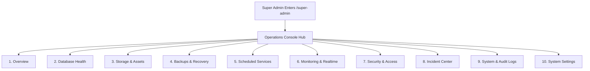

# KUVENTORY — Super Admin Operations Console Runbook

```text
Document:               docs/11_SUPER_ADMIN_OPERATIONS_MANUAL.md
Audience:               Business Owners, System Administrators, DevOps Engineers, Technical Evaluators
Purpose:                Standard operating procedures, input specifications, backend execution paths,
                        audit trails, and safety limitations across all 10 Super Admin Control Center tabs.
Verification Status:    Verified against src/features/admin/pages/SuperAdminPage.tsx and 10 tab components
Audit Date:             2026-10-19
Authoritative HEAD SHA: 135f10b807fedec368383c9e34895566da3d69fc
Primary References:     src/features/admin/components/super/*.tsx, superAdminService.ts
```

---

## 1. Operations Console Navigation & Access Control

The Super Admin Operations Console is hosted at `/super-admin`. Access is strictly restricted by the route guard [RequireSuperAdmin](file:///c:/Users/Nuero/OneDrive/Desktop/KUVENTORY-FINAL/src/features/auth/components/RequireAuth.tsx#L61-L89), which permits only accounts with `role IN ('SUPER_ADMIN', 'MASTER_ADMIN')`. The link is hidden from standard staff and managers in the navigation sidebar.



*(See full source diagram: [docs/diagrams/super_admin_operations_flow.mmd](file:///c:/Users/Nuero/OneDrive/Desktop/KUVENTORY-FINAL/docs/diagrams/super_admin_operations_flow.mmd))*

---

## 2. Comprehensive 10-Tab Operations Catalog

### Tab 1: Overview (`SuperOverviewTab.tsx`)

* **Purpose:** High-level dashboard presenting live system health, ping latency area chart, verified telemetry, active session counts, and latest recovery checkpoints.
* **Key Metrics Displayed:** Application Status (`Healthy` / `Degraded`), Active Sessions count, PostgreSQL Ping Latency, Storage Gateway state, Active Schedulers count.
* **Release Notice:** Replaced retired client-side deployment triggers with an authoritative, neutral link to GitHub Actions CI/CD workflows for production build tracking.
* **Latency Chart:** SVG Area Chart plotting measured round-trip response times across 24h, 7d, and 30d timeframes.
* **Backend Path:** Aggregates via `getSystemTelemetry()` and queries `public.recovery_points`.
* **Verification Status:** **Verified in current source**.

### Tab 2: Database Health (`SuperDatabaseTab.tsx`)

* **Purpose:** Analyzes database synchronization, verifies foreign key integrity, and detects drift between physical batches and catalog item quantities.
* **Controls:**
  1. **"Run Stock Drift Analysis":** Invokes RPC `execute_inventory_drift_analysis` to compare `SUM(stock_batches.quantity)` against `inventory_items.current_qty`.
  2. **"Preview Repairs":** Generates an in-memory diff of items requiring synchronization without committing changes.
  3. **"Apply Repairs":** Atomically reconciles catalog quantities to match verified batch totals, logging the repair in `audit_logs`.
* **Verification Status:** **Verified in current source & tests**.

### Tab 3: Storage & Assets (`SuperStorageTab.tsx`)

* **Purpose:** Inspects Supabase Object Storage bucket health, item photo asset delivery, and broken link diagnostics.
* **Controls:**
  * "Run Asset Health Check": Probes image URLs stored in `inventory_items.image_path`, reporting missing, unresolvable, or oversized image files.
* **Backend Path:** Supabase Storage API (`supabase.storage.from('item-images')`).
* **Verification Status:** **Verified in current source**.

### Tab 4: Backups & Recovery (`SuperRecoveryTab.tsx`)

* **Purpose:** Manages verified system recovery checkpoints ("Save States"), read-only state inspection, and app-level data exports.
* **Operational Controls:**
  1. **"Create Recovery Checkpoint":**
     * *Inputs:* Checkpoint Name and Scope (`FULL_SYSTEM`, `INVENTORY_ONLY`, `DAILY_SHEETS`).
     * *Effect:* Inserts a verified metadata manifest record into `public.recovery_points` with a unique point code (e.g., `RP-20261019-XXXX`).
  2. **"Preview State (Read-Only)":**
     * *Effect:* Opens the Save State Read-Only Inspection Modal with Zero-Production-Write Guarantee. Inspects manifest row counts and metadata without modifying live tables.
  3. **"Export System Data (JSON)":**
     * *Effect:* Generates a downloadable client-side JSON export of all core tables.
  4. **"Restore from Checkpoint" (Safety Status):**
     * *Status:* **Held in safe disabled mode**. Browser-side multi-table insertion lacks transactional guarantees. Production database restores must be executed via Supabase Point-in-Time Recovery (PITR) or `pg_dump` SQL restores.
* **Verification Status:** **Verified in current source & tests**.

### Tab 5: Scheduled Services (`SuperAutomationsTab.tsx`)

* **Purpose:** Truthful, read-only monitor of recurring background jobs, database cleanup tasks, and keepalive services.
* **Design Rationale:** Unbacked client toggle switches have been excised. The UI truthfully reflects scheduled execution parameters without simulating non-existent browser-triggered daemon controls.
* **Monitored Services:**
  * Supabase Free-Tier Keepalive (GitHub Actions cron / keepalive ping).
  * Expiry Warning Notifier (`pg_cron` / database background trigger).
  * Stock Ledger Integrity Auditor (scheduled verification routines).
* **Backend Path:** Reads from `public.system_automations` synchronized via Supabase Realtime channel.
* **Verification Status:** **Verified in current source**.

### Tab 6: Monitoring & Realtime (`SuperRealtimeTab.tsx`)

* **Purpose:** Live WebSocket telemetry and event stream observer.
* **Telemetry Displayed:** Supabase Realtime WebSocket connection state, heartbeat round-trip ping latency (ms), and recent inbound Postgres replication events.
* **Verification Status:** **Verified in current source**.

### Tab 7: Security & Access (`SuperSecurityTab.tsx`)

* **Purpose:** Centralized session governance, single-session lease enforcement (First Session Wins), and emergency maintenance lockdown control.
* **Operational Controls:**
  1. **Active Session Leases Table:**
     * Displays human-readable client identities (browser, operating system, person display name, lease creation time, and remaining lease TTL).
     * Technical UUIDs and raw client identifiers are accessible on demand via an expandable Diagnostics drawer with 1-click clipboard copy.
     * Accessible inline banners replace native browser `alert()` popups for revoking or inspecting leases.
  2. **Revoke Session Action:**
     * Allows Super Admins to manually terminate an active lease, releasing the device lock and forcing the target client to eject on next heartbeat.
  3. **Emergency Maintenance Lockdown Toggle:**
     * Sets `maintenance_mode = 'true'` in `public.system_settings`. Immediately locks out all `USER` and `ADMIN` accounts to `EmergencyMaintenanceScreen`.
* **Backend Path:** Atomic RPCs `claim_user_session`, `heartbeat_user_session`, `release_user_session`, querying `public.user_session_leases`.
* **Verification Status:** **Verified in current source & tests**.

### Tab 8: Incident Center (`SuperIncidentsTab.tsx`)

* **Purpose:** Records and tracks unexpected operational outages, stock discrepancies, and infrastructure incidents.
* **Inputs:** "Log Incident" modal requiring Title, Severity (`LOW`, `MEDIUM`, `HIGH`, `CRITICAL`), Affected Subsystem (`DATABASE`, `STORAGE`, `AUTH`, `NETWORK`), and Root Cause Description.
* **Lifecycle:** Incidents transition across `OPEN` $\rightarrow$ `INVESTIGATING` $\rightarrow$ `RESOLVED`.
* **Backend Path:** CRUD on `public.system_incidents`.
* **Verification Status:** **Verified in current source**.

### Tab 9: System & Audit Logs (`SuperLogsTab.tsx`)

* **Purpose:** Searchable, filterable audit ledger of all security, administrative, and inventory operations.
* **Inputs & Filters:** Text search (filters by action, actor, or entity), date range filter, action type selector (`AUTH`, `INVENTORY`, `SECURITY`, `SYSTEM`).
* **Table Columns:** Timestamp (PHT), Actor ID / Name, Action Name, Entity Target, Status Badge (`SUCCESS` / `FAILED`), JSON Metadata Inspect modal.
* **Backend Path:** Direct PostgREST query on `public.audit_logs` ordered by `created_at DESC`.
* **Immutability:** `UPDATE` and `DELETE` on `audit_logs` are strictly disabled by PostgreSQL RLS.
* **Verification Status:** **Verified in current source**.

### Tab 10: System Settings (`SuperSettingsTab.tsx`)

* **Purpose:** Configures global operational thresholds, retention periods, and restaurant parameters.
* **Settings Controlled:**
  * `backup_retention_days`: Retention period for database dumps (default: `30`).
  * `low_stock_default_threshold`: Default reorder threshold for newly created catalog items.
  * `session_lease_timeout_minutes`: Inactivity window before abandoned leases expire (default: `2`).
  * `business_timezone`: Standard operating timezone (locked to `Asia/Manila`).
* **Backend Path:** `UPSERT` on `public.system_settings`.
* **Verification Status:** **Verified in current source**.

---

## 3. Retired Legacy Sub-Tab: Deployments & Releases

* **Status:** **RETIRED FROM CLIENT RUNTIME**.
* **Rationale:** In accordance with production security standards, all client-side Netlify deployment webhook triggers (`VITE_NETLIFY_DEPLOY_HOOK_URL`) and simulated rollbacks have been excised from the UI. Production build and deployment operations are executed strictly via automated GitHub Actions CI/CD workflows and CLI tooling, leaving zero client-side attack surface. A neutral link to repository GitHub Actions is maintained in the Overview tab.
