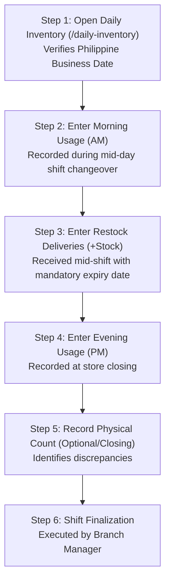

# KUVENTORY — Staff & Manager Operations Manual

```
Document:               docs/12_USER_AND_ADMIN_OPERATIONS_MANUAL.md
Audience:               Bistro Staff, Baristas, Kitchen Supervisors, Branch Managers, Shift Leads
Purpose:                Standard operating procedures, step-by-step workflow instructions, exact screen labels,
                        shift routines, and error handling for daily operational use.
Verification Status:    Verified against current UI screens and route components
Audit Date:             2026-10-19
Authoritative HEAD SHA: 135f10b807fedec368383c9e34895566da3d69fc
Primary References:     src/features/daily-inventory/, src/features/inventory/, src/features/admin/
```

---

## 1. Authentication & Shift Sign-In

### 1.1 Logging In
1. Open the browser and navigate to the application URL (`/login`).
2. Enter your registered bistro email address and password.
3. Click **"Sign In"**.
4. Upon successful authentication:
   * **Staff (`USER`):** Automatically routed to the Dashboard (`/inventory`) or Daily Inventory (`/daily-inventory`).
   * **Managers (`ADMIN`):** Gain access to management controls in the top bar and sidebar.
   * **System Administrators (`SUPER_ADMIN`):** Sidebar includes the dedicated "Super Admin" console.

### 1.2 Session Conflicts & Device Takeover
* If you log in on a second device (e.g., your mobile phone after using the counter tablet), your session on the previous device will be **automatically terminated**.
* If a session termination banner appears stating *"Logged in from another device"*, re-authenticate if you intend to take over the session on the current terminal.

### 1.3 Emergency Maintenance Lockdown Notice
* If the screen displays a dark banner stating **"Emergency Maintenance In Progress"**, all normal inventory editing is temporarily locked by management. Do not attempt to force changes; wait until the banner disappears or contact your shift supervisor.

---

## 2. Daily Shift Inventory Routine (Step-by-Step)

The daily inventory worksheet is the central operational tool for recording raw material usage across shifts.



### Step 1: Opening the Worksheet
1. Click **"Daily Inventory"** in the sidebar navigation.
2. The system automatically selects today's **Philippine Business Date** (e.g., `2026-10-19`).
3. If no sheet exists for today, the system automatically initializes a **DRAFT** worksheet, carrying forward yesterday's ending balances as today's opening stock.

### Step 2: Entering AM Usage (Mid-Day Handover)
1. Locate your station table (e.g., **Coffee Bar**, **Kitchen**, or **Pastry**).
2. For each item consumed or sold during the morning shift, click the **AM Usage** input box.
3. Type the quantity used (e.g., `12.5`).
4. The system calculates the new ending balance immediately and automatically **autosaves** the row to the database.

### Step 3: Receiving Mid-Shift Stock Additions
1. If a supplier delivers stock during your shift, click the **"+ Stock"** button on the item's row.
2. Enter the delivered quantity.
3. Select or verify the **Expiration Date** (mandatory).
4. Click **"Add Stock"**. The delivered quantity is immediately added to the item's **Added Stock** column, and a new physical batch is created.

### Step 4: Entering PM Usage (Closing Shift)
1. At closing, click the **PM Usage** input box for each consumed item.
2. Type the evening consumption.
3. Observe the calculated **Ending Stock**:
   $$\text{Ending Stock} = \max\left(0, (\text{Beginning} + \text{Added}) - (\text{AM} + \text{PM})\right)$$

### Step 5: Recording Physical End-of-Day Counts
1. Enter the actual count into the **Physical Count** column.
2. The system immediately calculates and displays the **Discrepancy**:
   * A green `0` indicates perfect balance.
   * A red negative number indicates a shortage requiring explanation.

### Step 6: Worksheet Finalization (Manager Only)
1. The Store Manager reviews all station rows.
2. Click the blue button labeled **"Finalize Inventory"**.
3. Confirm the finalization prompt.
4. The worksheet transitions to **FINALIZED** (read-only), consumed stock is deducted from physical batches via FEFO, and an immutable report snapshot is archived.

---

## 3. Audited Correction Workflow for Finalized Worksheets

If an accidental counting error is discovered after a worksheet has been finalized, do not attempt to delete the sheet. Follow the audited correction process:

1. Open the finalized sheet on `/daily-inventory`.
2. Click the orange button labeled **"Correct Sheet"**.
3. The **Daily Correction Modal** opens.
4. Modify the incorrect AM or PM usage numbers to reflect the true shift consumption.
5. In the **Reason for Correction** field, type a mandatory detailed explanation (e.g., *"Accidental typo on Whole Milk PM usage; entered 50 instead of 5"*).
6. Click **"Submit Audited Correction"**.
7. The system:
   * Recalculates stock balances.
   * Deducts or restores the exact delta quantity to batches via FEFO.
   * Increments the worksheet's revision counter (e.g., `Rev 1`).
   * Permanently logs the correction reason and actor ID in `public.daily_inventory_revisions`.

---

## 4. Master Catalog Management (Manager Operations)

### 4.1 Adding a New Catalog Item
1. Navigate to **"Items"** (`/items`) in the sidebar.
2. Click the **"+ New Item"** button in the top right.
3. Complete the required fields:
   * **Item Name:** Unique name (e.g., "Caramel Syrup 750ml").
   * **Station Category:** Select the appropriate station (Coffee Bar, Kitchen, etc.).
   * **Unit of Measure:** Measurement unit (bottles, grams, liters, pcs).
   * **Unit Cost (PHP):** Acquisition cost.
   * **Minimum Threshold:** Reorder trigger level (default: `5`).
   * **Primary Supplier:** Preferred vendor.
   * **Product Image:** Optional photo upload or URL.
4. Click **"Save Item"**.

### 4.2 Archiving an Item
* To discontinue an item, open its edit modal and check **"Archive Item"**.
* Archived items no longer appear on daily inventory sheets but remain visible in historical reports and stock movement ledgers.

---

## 5. Viewing Reports & Exporting Documents

1. Click **"Reports"** (`/reports`) in the sidebar.
2. Select your desired report tab:
   * **Daily Summaries:** View and print historical shift worksheets.
   * **Catalog Valuation:** View current financial valuation by category.
   * **Movement Ledger:** Review every receipt and consumption transaction.
   * **Low Stock / Expiry:** View items requiring reordering or nearing expiration.
3. Click the export buttons in the top right:
   * **Export PDF:** Generates a formatted multi-page printable document.
   * **Export Excel:** Downloads a native `.xlsx` workbook.
   * **Export CSV:** Downloads a raw tabular file sanitized against formula injection.
