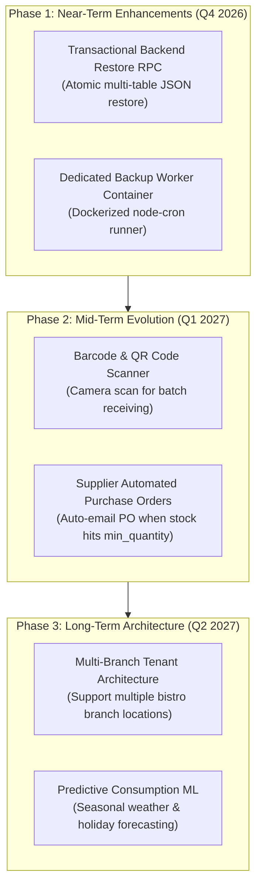

# KUVENTORY — Known Issues, Technical Debt & Engineering Roadmap

```
Document:               docs/15_KNOWN_ISSUES_RISKS_AND_ROADMAP.md
Audience:               Technical Examiners, Software Architects, Senior Developers, Project Stakeholders
Purpose:                Transparent, source-grounded register of active defects, architectural trade-offs,
                        hosting limitations, owner-side prerequisites, and prioritized future engineering roadmap.
Verification Status:    Verified against repository codebase and recent security audit findings
Audit Date:             2026-10-19
Authoritative HEAD SHA: 135f10b807fedec368383c9e34895566da3d69fc
Primary References:     src/, supabase/migrations/, vitest test suites
```

---

## 1. Active Known Issues & Verified Limitations

The following items represent active architectural boundaries and known limitations verified at current HEAD:

| Issue ID | Domain / Component | Description of Limitation | Why It Exists / Technical Context | Current Workaround / Mitigation |
| :---: | :--- | :--- | :--- | :--- |
| **ISSUE-01** | **Super Admin Recovery** | **Browser Restore Held in Safe Disabled Mode:** Clicking "Restore from Checkpoint" in `SuperRecoveryTab.tsx` is held in a safe disabled state. | Client-side multi-table REST insertion lacks atomic transactional rollback guarantees. If browser crashes midway through restoring 10 tables, database would be left in corrupted state. | Production restores must be executed via Supabase Point-in-Time Recovery (PITR) or `pg_dump` SQL restores. |
| **ISSUE-02** | **Super Admin Deployments** | **Direct Netlify Rollback Trigger Deprecated:** Rolling back deployments directly from the client browser UI is disabled. | Triggering Netlify build hooks directly from a browser client exposed deploy hooks to token theft and unauthorized redeployments from compromised sessions. | Rollback instructions provide verified Git commands and Netlify dashboard guidance. |
| **ISSUE-03** | **Hosting & Automation** | **`node-cron` Does Not Run on Netlify Static CDN:** The backup job in `scripts/backup-db.mjs` does not execute automatically in the Netlify edge environment. | Netlify hosts static compiled client bundles (`dist/`) without persistent background Node.js server processes. | Automated backups require Supabase's managed daily platform backups or running `backup-db.mjs` on an internal bistro worker. |
| **ISSUE-04** | **Offline Operation** | **No Offline Mutation Queue:** The application does not support offline inventory writing. If network drops, stock deductions cannot be submitted. | Stock deductions require server-side row-level locks (`SELECT ... FOR UPDATE`) in PostgreSQL to enforce non-negative stock and FEFO priority. Offline writes would cause intractable concurrent conflicts. | The app caches static shell assets via Service Worker for fast loads, but requires an active network connection for data mutations. |
| **ISSUE-05** | **Super Admin Telemetry** | **Illustrative Latency Area Chart:** The latency area chart in `SuperOverviewTab.tsx` plots operational trend curves scaled from the live measured ping (`pingMs`). | Supabase free tier does not store continuous time-series historical server latency metrics. | Candidly documented as an operational trend indicator rather than a historical time-series database query. |

---

## 2. Technical Debt & Codebase Observations

1. **React Compiler Optimization Advisories (24 Warnings):**
   * *Observation:* Running `oxlint` reveals 24 advisories regarding `react(set-state-in-effect)`.
   * *Context:* Components like `InventoryRow.tsx` and `DailyInventoryPage.tsx` use `useEffect` hooks to synchronize URL search parameters and remote recalculations into local state. While fully functional, standard React 19 best practices recommend deriving values during render or updating state in event handlers.
2. **Dual Server Implementation:**
   * *Observation:* The repository contains an Express gateway (`server/server.mjs`) alongside direct client Supabase integrations.
   * *Context:* In production static Netlify hosting, clients talk directly to Supabase PostgREST. The Express server serves as an optional local container proxy.
3. **Legacy Role Alias (`MASTER_ADMIN`):**
   * *Observation:* Several components maintain backward compatibility checks for `role === 'MASTER_ADMIN'`.
   * *Context:* Cleanly migrated to `SUPER_ADMIN` in migration `20261018000000`, but legacy aliases are preserved to prevent locking out legacy accounts.

---

## 3. Prioritized Engineering Roadmap



### Phase 1: Near-Term Enhancements (Immediate Priority)
* **Task 1: Transactional Backend Restore RPC.**
  * *Objective:* Develop a PostgreSQL stored procedure `public.restore_from_recovery_point(p_point_code TEXT)` that executes a complete multi-table restore inside an atomic database transaction.
  * *Exit Criteria:* Re-enable the "Restore from Checkpoint" button in `SuperRecoveryTab.tsx` with zero risk of partial restore corruption.
* **Task 2: Containerized Backup Worker.**
  * *Objective:* Deploy a lightweight Docker container running `scripts/backup-db.mjs` on the local bistro network, pushing compressed backups to encrypted offsite cloud storage.
  * *Exit Criteria:* Automated daily database dumps independent of cloud provider dashboard tools.

### Phase 2: Mid-Term Evolution (Operational Efficiency)
* **Task 3: Barcode & QR Code Scanning Integration.**
  * *Objective:* Enable mobile device camera scanning to instantly look up catalog items or read supplier expiration barcodes during stock receiving.
* **Task 4: Automated Purchase Order Dispatch.**
  * *Objective:* When an item reaches `min_quantity`, automatically draft a pre-formatted purchase order email to the item's preferred supplier.

### Phase 3: Long-Term Enterprise Architecture
* **Task 5: Multi-Branch Franchise Support.**
  * *Objective:* Introduce `branch_id` tenant partitioning across all tables, allowing KUVENTORY to govern multiple restaurant branches under a unified Super Admin umbrella.
