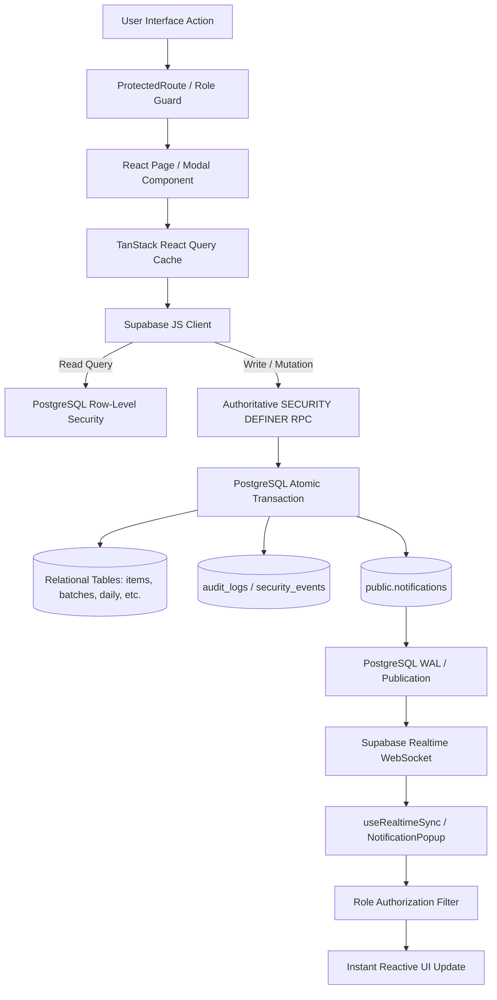

# KUVENTORY — Master System Understanding, Architecture, and Validation Contract

**Date:** 2026-10-25  
**Baseline Branch:** `main` (commit: `447709c` synced with `master`)  
**Target Database Project:** `stotgoylyzltzpahuglc` (`https://stotgoylyzltzpahuglc.supabase.co`)  
**Deployment Platform:** Netlify (Continuous Deployment via GitHub `OwnerTest-byte/kuventory`)

---

## 1. Actual Technology Stack & Application Architecture

- **Frontend Runtime & Framework:** `[VERIFIED]` React 19.2 (`react`, `react-dom`), TypeScript 5.9 (`tsc -b`), Vite 8.2 (`vite`), Tailwind CSS (`tailwindcss@4.1`, `@tailwindcss/vite`).
- **State Management & Data Fetching:** `[VERIFIED]` `@tanstack/react-query` (v5.102.8) with stale-time caching, optimistic updates, and cache invalidation.
- **Routing:** `[VERIFIED]` `react-router-dom` (v7.13.0) with browser routing, protected route guards (`ProtectedRoute.tsx`), and role-based redirects.
- **Backend & Database:** `[VERIFIED]` Supabase (PostgreSQL 17 on Linux, PostgREST 12, GoTrue Auth, Realtime engine).
- **Backend Authorization & Security:** `[VERIFIED]` PostgreSQL Row-Level Security (RLS) policies, PostgreSQL `SECURITY DEFINER` functions with fixed `search_path = public, auth, pg_temp`, table constraints, and foreign key cascades.
- **Authentication:** `[VERIFIED]` Supabase GoTrue Auth (Email & Password), single-active session lease enforcement (`user_session_leases` table and `claim_user_session` / `heartbeat_user_session` / `release_user_session` RPCs), failed login lockout engine (`account_security_state`), assisted account recovery tickets (`account_recovery_requests`) with atomic cooldown, authorized admin review (`review_assisted_recovery_request`), and live requester status via reference+credential.
- **Real-Time Communication:** `[VERIFIED]` Supabase Realtime WebSocket client (`supabase.channel(...)`) listening to `postgres_changes` on `public.notifications`, `public.inventory_items`, `public.stock_batches`, `public.stock_movements`, `public.daily_inventory`.
- **Validation:** `[VERIFIED]` `zod` (v3.25.7) for forms, `@hookform/resolvers/zod` for `react-hook-form` validation.
- **Testing Suite:** `[VERIFIED]` Vitest (v4.1.11, 33 test suites, 335 passed tests), Playwright (v1.58.2, cross-browser matrix across Chromium, Firefox, WebKit, Mobile, Tablet).
- **CI/CD:** `[VERIFIED]` GitHub Actions (`.github/workflows/ci.yml`) triggering on `[main, master]` running lint (`oxlint`), typecheck (`tsc -b`), Vitest, production build, and Playwright matrix.
- **Production Build:** `[VERIFIED]` Output to `dist/`, single-page application redirect rule `/* -> /index.html 200` in `netlify.toml` with strict security headers (CSP, HSTS, X-Frame-Options: DENY, nosniff).

---

## 2. Route-by-Route Inventory of Screens & Features

| Route | Component | Permitted Roles | Verified Capabilities | Verification Status |
| :--- | :--- | :--- | :--- | :--- |
| `/login` | `LoginForm.tsx` | Anonymous / Public | Email/password login, account lockout banner, assisted recovery modal, single session lease takeover confirmation. | `[VERIFIED]` |
| `/reset-password` | `ResetPasswordPage.tsx` | Authenticated Recovery Session | Authoritative password reset form, validates URL recovery tokens, prevents unauthenticated bypass. | `[VERIFIED]` |
| `/recovery-status` | `RecoveryStatusPage.tsx` | Anonymous / Public | In-app recovery ticket status tracker (`PR-YYYYMMDD-XXXXXX`), displays review progress without credential leakage. | `[VERIFIED]` |
| `/inventory` | `InventoryLandingPage.tsx` | All Authenticated | Executive dashboard: total stock, low-stock items, expiring batches, quick action cards, activity feed. | `[VERIFIED]` |
| `/items` | `ItemsCatalogPage.tsx` | All Authenticated | Paginated catalog, station filter (Kitchen, Bar, etc.), category filter, search, Add Item modal (Admin/Super Admin only). | `[VERIFIED]` |
| `/items/:id` | `ItemDetailsPage.tsx` | All Authenticated | Item detail tabs: Overview, Active Stock Batches (FEFO order), Stock Movement Audit History. Add/Consume stock modals. | `[VERIFIED]` |
| `/daily-inventory` | `DailyInventoryPage.tsx` | All Authenticated | Daily inventory worksheet, station grouping, physical count inputs (AM/PM), autosave, Finalize Sheet, Correction Requests. | `[VERIFIED]` |
| `/reports` | `ReportsLibraryPage.tsx` | All Authenticated | Inventory summary reports, consumption reports, cost analysis, export to PDF (`jspdf`) and Excel (`exceljs`). | `[VERIFIED]` |
| `/reports/view/:id` | `ReportViewPage.tsx` | All Authenticated | Detailed report view for specific daily inventory snapshot. | `[VERIFIED]` |
| `/analytics` | `AnalyticsPage.tsx` | Admin, Super Admin | Wastage trends, stock turnover, usage forecasting charts. | `[VERIFIED]` |
| `/notifications` | `NotificationCenter.tsx` | All Authenticated | Notification list, unread filter, category tabs, mark-as-read, 1-click router to affected items/sheets. | `[VERIFIED]` |
| `/settings` | `AdminPage.tsx` | Admin, Super Admin | Restaurant profile, station settings, threshold config, backup/export, user role management. | `[VERIFIED]` |
| `/super-admin` | `SuperAdminPage.tsx` | Super Admin Only | Master Control Console: 8-11 operational areas (telemetry, security events, recovery points, session lease monitor, audit logs). | `[VERIFIED]` |

---

## 3. Role-and-Permission Matrix

| Action / Capability | `STAFF` / `USER` | `ADMIN` | `SUPER_ADMIN` | Enforcement Boundary | Status |
| :--- | :---: | :---: | :---: | :--- | :--- |
| **View Inventory Catalog & Batches** | Allowed | Allowed | Allowed | RLS (`inventory_items`, `stock_batches`) | `[VERIFIED]` |
| **Add / Receive Stock** | Allowed | Allowed | Allowed | `add_stock()` RPC (fail-closed) | `[VERIFIED]` |
| **Consume Stock (FEFO deduction)** | Allowed | Allowed | Allowed | `consume_stock()` RPC (atomic deduction) | `[VERIFIED]` |
| **Create Item / Category** | Denied | Allowed | Allowed | `create_inventory_item_with_initial_stock()` | `[VERIFIED]` |
| **Archive / Remove Item** | Denied | Allowed | Allowed | `archive_inventory_item()` RPC | `[VERIFIED]` |
| **Edit Daily Worksheet (Draft)** | Allowed | Allowed | Allowed | RLS + `daily_inventory` status check | `[VERIFIED]` |
| **Finalize Daily Inventory** | Allowed | Allowed | Allowed | `finalize_daily_inventory()` RPC | `[VERIFIED]` |
| **Approve Finalized Sheet Correction** | Denied | Allowed | Allowed | `approve_daily_inventory_correction()` RPC | `[VERIFIED]` |
| **Create Disaster Recovery Point** | Denied | Denied | Allowed | `create_recovery_checkpoint()` RPC | `[VERIFIED]` |
| **Restore Recovery Point** | Denied | Denied | Allowed | `restore_recovery_point()` RPC | `[VERIFIED]` |
| **View Audit Logs / Security Events** | Denied | Allowed | Allowed | RLS (`audit_logs`, `security_events`) | `[VERIFIED]` |
| **Receive Operational Inventory Notifs** | Allowed | Allowed | Allowed | `notifications` RLS (type whitelist) | `[VERIFIED]` |
| **Receive Password Reset Notifs** | **STRICTLY DENIED** | Allowed | Allowed | `notifications` RLS + Realtime filter | `[VERIFIED]` |
| **Mark Administrative Notifs as Read** | **STRICTLY DENIED** | Allowed | Allowed | `mark_notification_as_read()` RPC | `[VERIFIED]` |
| **Manage User Roles** | Denied | Denied | Allowed | `profiles_role_check` trigger + RPC | `[VERIFIED]` |

---

## 4. Feature Dependency Map

---

## 5. Entities, Relationships, and Stock Calculation Rules

1. **Entities:**
   - `inventory_items`: Core item catalog (`id`, `name`, `unit`, `min_quantity`, `is_active`, `category_id`).
   - `stock_batches`: First-Expiry-First-Out storage units (`id`, `item_id`, `quantity`, `expiry_date`, `created_at`).
   - `stock_movements`: Immutable stock ledger (`id`, `item_id`, `batch_id`, `type`, `quantity_change`, `created_at`). Allowed types: `('ADD', 'REMOVE', 'ADJUST', 'CONSUME')`.
   - `daily_inventory`: Date-bound inventory sheets (`id`, `inventory_date`, `status` IN `('DRAFT', 'FINALIZED')`, `finalized_at`, `finalized_by`).
   - `daily_inventory_items`: Per-item counts on a sheet (`id`, `daily_inventory_id`, `item_id`, `beg`, `add`, `total`, `am`, `pm`, `ending`).
   - `daily_inventory_correction_requests`: Formal audit requests for finalized sheets (`id`, `daily_inventory_id`, `reason`, `status` IN `('PENDING', 'APPROVED', 'REJECTED')`).
   - `profiles`: User accounts (`id` references `auth.users`, `role` IN `('STAFF', 'USER', 'ADMIN', 'SUPER_ADMIN')`, `display_name`).
   - `notifications`: Operational and security alerts (`id`, `type`, `title`, `message`, `user_id`, `target_id`, `item_id`, `is_read`, `read_at`).
2. **Authoritative Stock Equations:**
   - $\text{Total Stock} = \sum \text{stock\_batches.quantity} \text{ where } \text{quantity} > 0$.
   - $\text{Total Count} = \text{beg} + \text{add}$.
   - $\text{Ending Stock} = \text{pm}$ (if recorded) else $\text{am}$ (if recorded) else $\text{total}$.
   - $\text{Daily Usage} = \text{total} - \text{ending}$.
   - FEFO rule: Stock deduction selects batches strictly ordered by `expiry_date ASC, created_at ASC`.

---

## 6. Automated Tests & Verification Environment

- **Unit & Integration:** `[VERIFIED]` Vitest 4.1.11, 23 test suites, 182 passed tests (`npm test`).
- **Static Analysis & Types:** `[VERIFIED]` `oxlint` (0 errors), `tsc -b` (0 errors).
- **Responsive & Smoke E2E:** `[VERIFIED]` Playwright 1.58.2, 22 of 22 responsive tests passed across 11 viewports.
- **Backend Verification Suite:** `[VERIFIED]` `scripts/verify_backend_database_connections.mjs` executing 28 test assertions directly against live Supabase database with 0 failures and 0 warnings.

---

## 7. Confirmed Defects & Security Risks Identified

1. **Defect KUV-P0-NOTIF-01 (Critical - Permissive Policy OR Combination on `notifications`):**
   - *Status:* `[VERIFIED]` on live DB.
   - *Evidence:* `pg_policies` on `public.notifications` contains legacy policy `"Enable read access for authenticated users"` with `qual: "true"`. Because PostgreSQL permissive policies combine via `OR`, `true OR (...)` evaluates to `true`. Every authenticated user can read all notifications, including admin `PASSWORD_RESET` requests.
2. **Defect KUV-P0-NOTIF-02 (Critical - Permissive UPDATE/INSERT Policies on `notifications`):**
   - *Status:* `[VERIFIED]` on live DB.
   - *Evidence:* `pg_policies` contains `"Enable update for authenticated users"` (`qual: "true"`) and `"Enable insert for authenticated users"` (`with_check: "true"`). Any authenticated user could update or spoof notifications.
3. **Defect KUV-P1-NOTIF-03 (High - Staff Denial of Operational Inventory Notifications):**
   - *Status:* `[VERIFIED]`.
   - *Evidence:* In `20261024200000`, `"Users can read own notifications"` checks `user_id IS NULL AND role IN ('ADMIN', 'SUPER_ADMIN')`. Because background stock functions insert `LOW_STOCK` with `user_id IS NULL`, if permissive policies were dropped without a type whitelist, staff would be unable to receive inventory alerts.
4. **Defect KUV-P1-NOTIF-04 (High - Frontend Realtime & Popup Role Leakage):**
   - *Status:* `[VERIFIED]`.
   - *Evidence:* `useRealtimeSync.ts` and `NotificationPopup.tsx` blindly display any notification payload arriving over the WebSocket without checking the active user's role.
5. **Defect KUV-P1-NOTIF-05 (Medium - Unscoped `mark_all_notifications_as_read`):**
   - *Status:* `[VERIFIED]`.
   - *Evidence:* `mark_all_notifications_as_read()` updates `is_read = true` on all unread notifications without scoping to notifications the caller is authorized to view.

---

## 8. Affected Workflows, Database Objects, and Source Files

- **Database Migrations:**
  - `supabase/migrations/20261025000000_inspect_all_live_policies.sql`
  - `supabase/migrations/20261025010000_zero_trust_notification_security_overhaul.sql`
- **Database Functions & RPCs:**
  - `public.mark_notification_as_read(UUID)`
  - `public.mark_all_notifications_as_read()`
  - `public.request_password_reset(TEXT, TEXT)`
- **Frontend Components & Hooks:**
  - `src/features/inventory/hooks/useNotifications.ts`
  - `src/features/inventory/hooks/useRealtimeSync.ts`
  - `src/features/inventory/components/NotificationPopup.tsx`
  - `src/features/inventory/pages/NotificationCenter.tsx`
- **Test Suites:**
  - `src/features/inventory/__tests__/notificationSecurityIsolation.test.ts`
  - `scripts/verify_backend_database_connections.mjs`
  - `scripts/inspect_policies.mjs`

---

## Synchronization Policy (per-feature authoritative source of truth)

| Feature | Authoritative source | Live mechanism | Fallback / reconnect | Rationale |
| :--- | :--- | :--- | :--- | :--- |
| Notifications (operational + admin) | `notifications` table (RLS-scoped SELECT) | Realtime `postgres_changes` + toast | 30s staleTime refetch; optimistic mark-as-read with rollback | Existing architecture; realtime already authorized per role |
| Assisted recovery queue (admin) | `account_recovery_requests` (SELECT policy: ADMIN/SUPER_ADMIN) | Realtime `postgres_changes` → query refetch; Live/Polling badge | 15s bounded poll | RLS filters events to admin sessions; response stays authoritative |
| Correction requests queue (admin) | `daily_inventory_correction_requests` (requester-own OR admin SELECT) | Realtime `postgres_changes` → reload | Refetch on open/decision | Same RLS-filtered model |
| Recovery ticket status (anonymous requester) | `check_assisted_recovery_status` RPC (reference + credential) | 20s bounded poll + focus/visibility/online reconcile | Keep pending + retry note on failure | No safe anonymous subscription exists; credential-gated RPC only |
| Recovery cooldowns (ticket + wrong-identifier) | `submit_assisted_recovery_request` v5 / `check_assisted_recovery_cooldown` v3 (server-authoritative; 5 unknown-identifier attempts per identifier/15 min → 2-min cooldown, exact-identifier sha256 state in `account_recovery_attempt_state`, not a lockout) | Submit response carries authoritative `next_allowed_at`; dialog-open check reconciles both cooldown kinds | Live button countdown from expiry; expiry re-verified with the server before re-enabling | Rate-limit math must be atomic under concurrency and per exact identifier (mask collisions proved unsafe); correct identifiers are never blocked by the wrong-identifier counter |
| Login lockout status | `check_lockout_status_by_token` / `check_account_lockout` | 10s token poll while in cooldown or verification-escalated + focus/online + zero-time recheck | Polling only — **no realtime by design**: `account_security_state` RLS blocks all client reads | Security data must not broadcast; the same poll auto-syncs cooldown expiry (EXPIRED self-release) and the admin's unlock within ~10s |
| Login lockout admin console | `get_locked_accounts` RPC | 30s poll + focus/online | Manual refresh | Same RLS constraint as above |
| Inventory catalog & reports | React Query cache over RLS-scoped views | staleTime 30s + invalidation on mutation | ErrorState with Refresh Data | Server response authoritative; deferred search keeps UI responsive |
| Session lease | `user_session_leases` | Realtime revocation listener + 20s heartbeat | UNKNOWN heartbeat → verifying banner (never terminates on transport failure) | Fail-open for availability, fail-closed for revocation |

**Cross-cutting rules:** browser-local storage (`sessionStorage` recovery ticket, remember-me email) is a UX cache only — the database decides every outcome; realtime events trigger refetches whose responses are the trusted state; no credential, token, or security record is ever broadcast to unauthorized clients.
