# KUVENTORY™ Complete System Flowcharts Specification
## Comprehensive Architectural & Functional Process Engineering Manual

```
====================================================================================================
               KUVENTORY: COMMERCIAL RESTAURANT INVENTORY & FEFO ENGINE
                             SYSTEM FLOWCHARTS SPECIFICATION
                                     FOR KAPE UNO BISTRO
====================================================================================================
```

**Document Code:** `SPEC-FLOWCHART-MASTER-v2.5`  
**Classification:** Technical Documentation · Process Architecture & System Engineering  
**Target System:** KUVENTORY Cloud-Native Restaurant Inventory Management Platform  
**Target Environment:** Production (`https://kuventory.netlify.app`)  
**Core Technologies:** React 18, TypeScript, Vite, Tailwind CSS v4, Supabase (PostgreSQL 17), Netlify CDN  

---

## TABLE OF CONTENTS

1. [MASTER FLOWCHART INVENTORY (INDEX)](#1-master-flowchart-inventory-index)
2. [SECTION A: GENERAL SYSTEM-WIDE FLOWCHARTS](#2-section-a-general-system-wide-flowcharts)
   - [G-01: End-to-End Operational Daily Lifecycle Flowchart](#g-01-end-to-end-operational-daily-lifecycle-flowchart)
   - [G-02: Cloud Architecture & Multi-Tier Data Flow Diagram](#g-02-cloud-architecture--multi-tier-data-flow-diagram)
   - [G-03: System Role Authority & Route Guard Navigation Flowchart](#g-03-system-role-authority--route-guard-navigation-flowchart)
3. [SECTION B: SPECIFIC FUNCTIONAL SUBSYSTEM FLOWCHARTS](#3-section-b-specific-functional-subsystem-flowcharts)
   - [F-01: Authentication & Single-Session Lease Engine ("First Session Wins")](#f-01-authentication--single-session-lease-engine-first-session-wins)
   - [F-02: Session Heartbeat, Grace Period & Beacon Teardown Lifecycle](#f-02-session-heartbeat-grace-period--beacon-teardown-lifecycle)
   - [F-03: Remote Session Revocation & Realtime Account Deactivation](#f-03-remote-session-revocation--realtime-account-deactivation)
   - [F-04: Master Catalog Item Creation & Resilient Image Ingestion](#f-04-master-catalog-item-creation--resilient-image-ingestion)
   - [F-05: Delivery Restocking & Batch Invariance Ingestion Engine](#f-05-delivery-restocking--batch-invariance-ingestion-engine)
   - [F-06: Shift-Based Daily Inventory Reconciliation Workflow](#f-06-shift-based-daily-inventory-reconciliation-workflow)
   - [F-07: Reactive Stock Arithmetic, Non-Negative Invariant & Deficit Handling](#f-07-reactive-stock-arithmetic-non-negative-invariant--deficit-handling)
   - [F-08: Shift Finalization & Database-Authoritative FEFO Depletion Engine](#f-08-shift-finalization--database-authoritative-fefo-depletion-engine)
   - [F-09: Concurrent Stock Deduction Race & Row-Level Lock Serialization](#f-09-concurrent-stock-deduction-race--row-level-lock-serialization)
   - [F-10: Automated Threshold & Expiration Monitoring Alert Engine](#f-10-automated-threshold--expiration-monitoring-alert-engine)
   - [F-11: Real-Time Floating Notification Toast & Contextual Navigation](#f-11-real-time-floating-notification-toast--contextual-navigation)
   - [F-12: Immutable Report Snapshot Creation & Multi-Format Export Engine](#f-12-immutable-report-snapshot-creation--multi-format-export-engine)
   - [F-13: Tier-0 Master Admin Governance Barrier (Zero-Trust 403 Shield)](#f-13-tier-0-master-admin-governance-barrier-zero-trust-403-shield)
   - [F-14: Disaster Recovery Point-in-Time Checkpoint & 8-Step Restoration](#f-14-disaster-recovery-point-in-time-checkpoint--8-step-restoration)
   - [F-15: Inventory Stock Drift Detection & Auto-Healing Engine](#f-15-inventory-stock-drift-detection--auto-healing-engine)
   - [F-16: Clean-Slate Catalog Reset Guard (Strict "DELETE" Confirmation)](#f-16-clean-slate-catalog-reset-guard-strict-delete-confirmation)
   - [F-17: Client-Side Background Keepalive & Database Sleep Prevention Daemon](#f-17-client-side-background-keepalive--database-sleep-prevention-daemon)
4. [SYSTEM INVARIANTS & INTEGRITY RULES SUMMARY](#4-system-invariants--integrity-rules-summary)

---

## 1. MASTER FLOWCHART INVENTORY (INDEX)

The following matrix indexes all functional and architectural flowcharts defined for the KUVENTORY system. Each diagram models an authoritative, active process within the codebase:

| ID | Flowchart Title | Scope / Level | Primary Components Involved |
| :--- | :--- | :--- | :--- |
| **G-01** | End-to-End Operational Daily Lifecycle | General (System) | Browser UI, Shift Routine, PostgreSQL Engine, Cron |
| **G-02** | Cloud Architecture & Multi-Tier Data Flow | General (Technical) | React 18 SPA, Netlify Edge CDN, Supabase Services, Postgres 17 |
| **G-03** | System Role Authority & Route Navigation | General (Security) | `RequireAuth`, `AppLayout`, RLS Policies, Profile Roles |
| **F-01** | Authentication & Single-Session Lease Claim | Specific (Auth) | `claim_user_session`, `user_session_leases`, GoTrue Auth |
| **F-02** | Heartbeat, Grace Period & Fast Beacon Teardown | Specific (Auth) | `heartbeat_user_session`, `release_user_session`, `keepalive` beacon |
| **F-03** | Remote Session Revocation & Realtime Kick | Specific (Security) | `revoke_user_session_by_admin`, Supabase Realtime Channels |
| **F-04** | Master Catalog Creation & Image Ingestion | Specific (Catalog) | `inventory_items`, Resilient Image Proxy (`images.weserv.nl`) |
| **F-05** | Delivery Restocking & Batch Invariance | Specific (Intake) | `add_stock` RPC, `stock_batches`, `stock_movements` |
| **F-06** | Shift-Based Daily Inventory Reconciliation | Specific (Worksheet) | `create_daily_inventory_draft`, Station Tables, Autosave |
| **F-07** | Reactive Math & Non-Negative Invariant | Specific (Worksheet) | Auto-zeroing engine, `STOCK_DISCREPANCY` alert, Sanitizer |
| **F-08** | Shift Finalization & Authoritative FEFO Depletion | Specific (Engine) | `finalize_daily_inventory`, `consume_stock` (`FOR UPDATE`) |
| **F-09** | Concurrency Race & Row Lock Serialization | Specific (Engine) | Pessimistic Locking, OCC version checks, Rollback traps |
| **F-10** | Automated Expiry & Threshold Monitoring | Specific (Alerts) | PostgreSQL triggers, `check_stock_thresholds`, Expiry Cron |
| **F-11** | Floating Notification Toast & Direct Routing | Specific (UI/UX) | `NotificationPopup.tsx`, Realtime WAL subscription, Context routing |
| **F-12** | Immutable Report Snapshot & Multi-Format Export | Specific (Reports) | `reports`, `report_items`, `jsPDF`, `ExcelJS`, CSV Parser |
| **F-13** | Tier-0 Master Admin Governance Boundary | Specific (Security) | 403 Clearance Shield, `is_master_admin()` Security Definer |
| **F-14** | Disaster Recovery Point-in-Time Restoration | Specific (Disaster) | `recovery_points`, Read-Only Preview, Safety Snapshot |
| **F-15** | Stock Drift Auto-Healing & Reconciliation | Specific (Audit) | Batch sum aggregator vs Item balance difference resolver |
| **F-16** | Clean-Slate Catalog Reset Guard | Specific (Admin) | Destructive action shield, Strict `"DELETE"` case-sensitive modal |
| **F-17** | Background Keepalive Heartbeat Daemon | Specific (Infra) | `initKeepaliveHeartbeat`, Free-tier inactivity ping |

---

## 2. SECTION A: GENERAL SYSTEM-WIDE FLOWCHARTS

### G-01: End-to-End Operational Daily Lifecycle Flowchart

This macro flowchart outlines the continuous 24-hour operational lifecycle of KUVENTORY across all user tiers at Kape Uno Bistro—from morning kitchen opening through afternoon handovers, evening shift closing, automated FEFO allocation, immutable archiving, and off-hours administration.

```mermaid
flowchart TD
    Start([System Wakeup / Crew Arrival]) --> Auth[Worker Login via Credentials]
    Auth --> LeaseCheck{Single-Session Lease Valid?}
    LeaseCheck -- Account In Use --> Denied[Display 'ACCOUNT IN USE' Notice & Stop]
    LeaseCheck -- Lease Granted --> RoleRoute{User Role?}

    %% ROLE ROUTING
    RoleRoute -- STAFF --> OpenWorksheet[Navigate to /daily-inventory]
    RoleRoute -- ADMIN --> AdminPortal[Navigate to /inventory or /settings]
    RoleRoute -- MASTER_ADMIN --> MasterConsole[Access Control Center /settings?tab=master]

    %% MORNING SHIFT
    OpenWorksheet --> FetchSession[Fetch or Initialize Today's Session via RPC]
    FetchSession --> InheritBeg[Auto-Inherit Beginning Stock from Previous Day's Ending]
    InheritBeg --> MorningCount[Staff Verifies Physical Chiller Stock vs BEG]
    MorningCount --> RestockCheck{Morning Deliveries Received?}
    RestockCheck -- Yes --> LogIntake[Log Batch Intake: Quantity + Expiry + Lot]
    LogIntake --> UpdateAdd[ADD Column Updated in Daily Worksheet]
    RestockCheck -- No --> MiddayOps[Begin AM Service 08:00 AM - 02:00 PM]

    %% MID-DAY HANDOVER
    UpdateAdd --> MiddayOps
    MiddayOps --> AMHandover[Mid-Day Handover at 02:00 PM]
    AMHandover --> InputAM[Enter Consumed Portions into AM OUT]
    InputAM --> AutoTotalEnding1[Reactive Math Recalculation: Beg + Add - AM]
    AutoTotalEnding1 --> Autosave1[Debounced Optimistic Autosave to Supabase DB]

    %% EVENING SHIFT & CLOSING
    Autosave1 --> PMShift[PM Shift Operations 02:00 PM - 10:30 PM]
    PMShift --> ClosingCount[Closing Physical Inventory at 10:30 PM]
    ClosingCount --> InputPM[Enter Consumed Portions into PM OUT]
    InputPM --> AutoTotalEnding2[Reactive Math Recalculation: Total - AM - PM]
    AutoTotalEnding2 --> DeficitCheck{Did Sales Exceed Available Stock?}
    DeficitCheck -- Yes --> AutoZeroDeficit[Zero Ending Stock to 0 & Dispatch STOCK_DISCREPANCY Alert]
    DeficitCheck -- No --> SupervisorReview[Supervisor Reviews Tallies & Variances]
    AutoZeroDeficit --> SupervisorReview

    %% FINALIZATION
    SupervisorReview --> FinalizeTrigger{Supervisor Clicks 'Finalize Inventory'}
    FinalizeTrigger -- Save as Draft --> DraftSaved([Session Remains DRAFT & Editable])
    FinalizeTrigger -- Confirm Finalization --> ExecFinalizeRPC[Execute finalize_daily_inventory RPC in PostgreSQL]

    %% ATOMIC ENGINE EXECUTION
    ExecFinalizeRPC --> RowLock[Pessimistic Row Lock 'FOR UPDATE' on Items & Batches]
    RowLock --> FEFODeplete[Run FEFO Deduction: Consume Earliest Expiry First]
    FEFODeplete --> LogMovements[Append 'REMOVE' Entries in stock_movements Ledger]
    LogMovements --> FreezeSnapshot[Serialize Daily Counts into Immutable public.reports]
    FreezeSnapshot --> LockSession[Update Session State = 'FINALIZED']
    LockSession --> ReleaseLocks[Release Database Row Locks & Emit Realtime Event]

    %% POST-SHIFT & REPORTING
    ReleaseLocks --> ExportReports[Generate Audit-Ready PDF / Excel / CSV Reports]
    ExportReports --> DayComplete([Daily Shift Complete & Securely Locked])

    %% BACKGROUND MONITORING
    AdminPortal -.-> MonitorAlerts[Continuous Low Stock & Expiry Telemetry]
    MasterConsole -.-> TelemetryPing[Continuous Database Health & Recovery Checkpoints]
```

---

### G-02: Cloud Architecture & Multi-Tier Data Flow Diagram

This architectural flowchart illustrates the end-to-end multi-tier data flow across client browser runtimes, Netlify edge CDN services, Supabase cloud microservices, and PostgreSQL database internals.

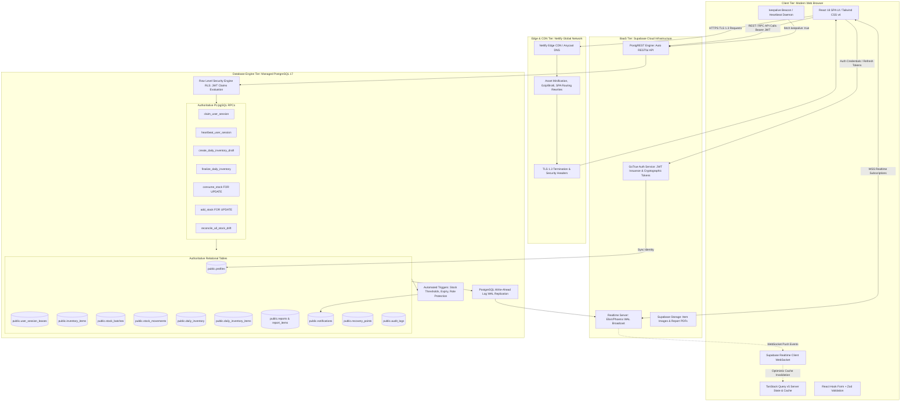

---

### G-03: System Role Authority & Route Guard Navigation Flowchart

This flowchart models the client-side and database-side security routing matrix across the three defined user roles: `STAFF` (Floor Staff), `ADMIN` (Store Admin), and `MASTER_ADMIN` (Tier 0 Master Admin).

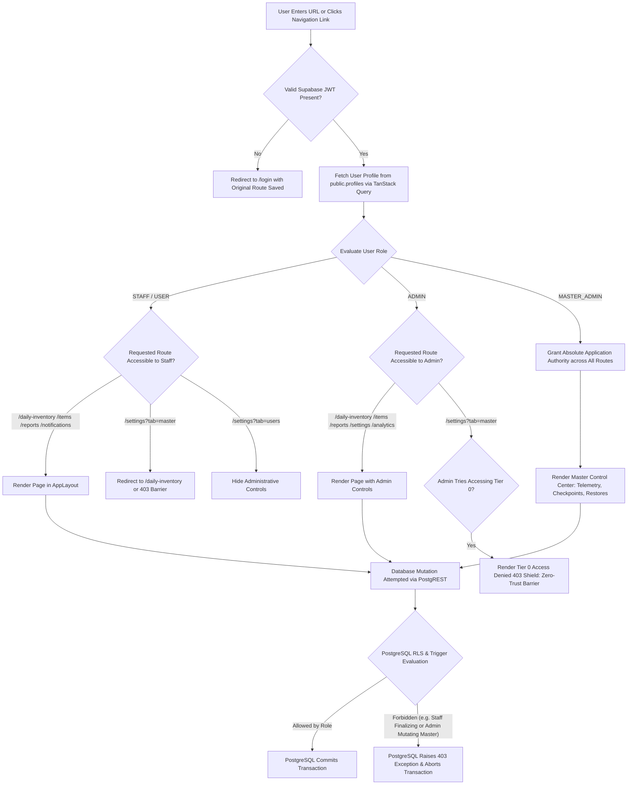

---

## 3. SECTION B: SPECIFIC FUNCTIONAL SUBSYSTEM FLOWCHARTS

### F-01: Authentication & Single-Session Lease Engine ("First Session Wins")

This flowchart models the single-session leasing engine defined in `user_session_leases` and executed via the `claim_user_session` RPC, enforcing that only one active human session is permitted per account.

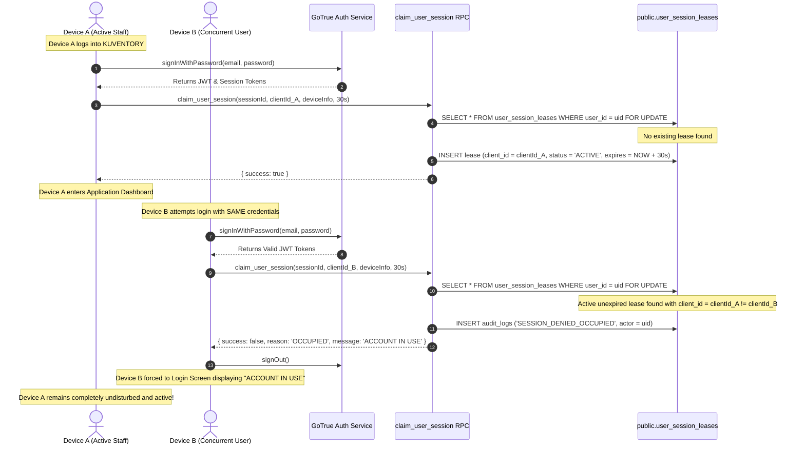

---

### F-02: Session Heartbeat, Grace Period & Beacon Teardown Lifecycle

This flowchart describes the client-side background timer and unload beacon that maintains, extends, or terminates the single active session lease.

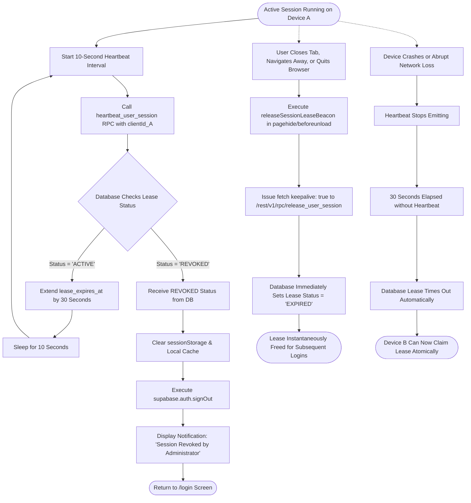

---

### F-03: Remote Session Revocation & Realtime Account Deactivation

This flowchart details how a Master Administrator inspects active leases and instantly revokes compromised or orphaned sessions with zero-millisecond WebSocket propagation.

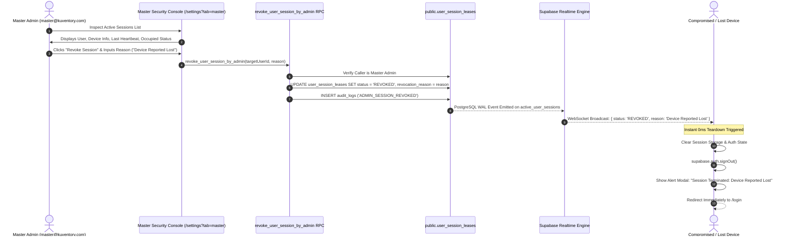

---

### F-04: Master Catalog Item Creation & Resilient Image Ingestion

This flowchart illustrates the catalog onboarding workflow, including validation of reorder thresholds and resilient image handling that normalizes Google Drive, Imgur, and Dropbox links with automated CDN fallbacks.

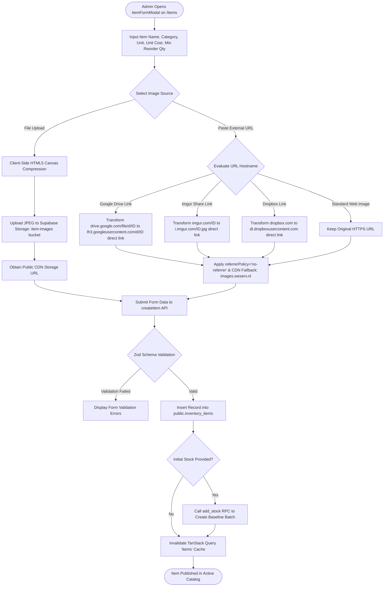

---

### F-05: Delivery Restocking & Batch Invariance Ingestion Engine

This flowchart models delivery intake and verifies the **Principle of Batch Invariance** (Rule 18–22): restocking with differing expiration dates *always* creates a new discrete batch lot and never overwrites existing batches.

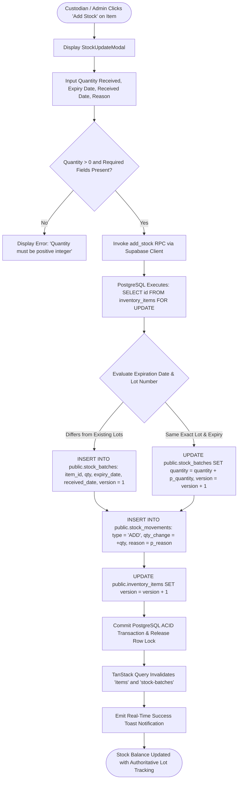

---

### F-06: Shift-Based Daily Inventory Reconciliation Workflow

This flowchart outlines the shift-based daily inventory counting lifecycle, station-based category grouping, debounced autosaving, and worker coordination.

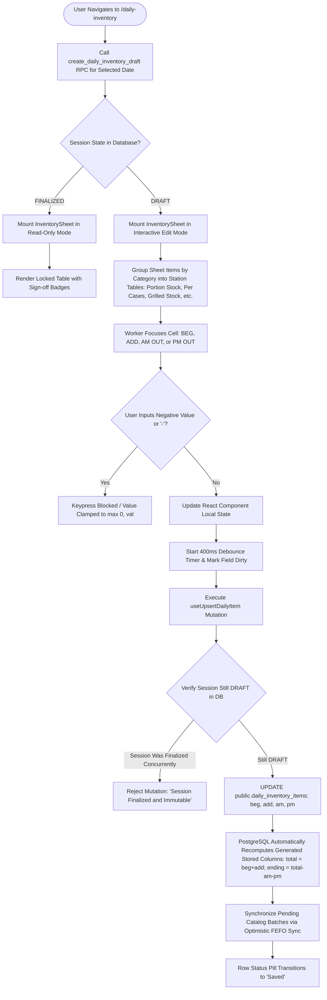

---

### F-07: Reactive Stock Arithmetic, Non-Negative Invariant & Deficit Handling

This flowchart models the strict physical non-negative stock invariant ($\text{Ending} \ge 0$) and the automatic deficit handling engine that intercepts negative inputs, auto-zeroes ending balances, and dispatches discrepancy alerts.

```mermaid
flowchart TD
    CellChange([Worker Enters AM or PM Sales Deduction]) --> CalculateTotal[Compute Total = Beg + Add]
    CalculateTotal --> CalculateSales[Compute Total Sales = AM OUT + PM OUT]
    CalculateSales --> CheckDeficit{Evaluate: Total - Total Sales < 0?}
    
    %% VALID CASE
    CheckDeficit -- No (Sufficient Stock) --> NormalEnding[Ending Balance = Total - Total Sales]
    NormalEnding --> RenderEndingPill[Render Clean JetBrains Mono Ending Number]
    
    %% DEFICIT CASE
    CheckDeficit -- Yes (Sales Exceed Total Stock) --> InterceptDeficit[Trigger Non-Negative Stock Invariant Safeguard]
    InterceptDeficit --> AutoZero[Clamp Ending Stock Balance: Ending = 0]
    AutoZero --> CalculateDeficitQty[Compute Shortage Deficit = Total Sales - Total]
    
    %% INLINE WARNINGS
    CalculateDeficitQty --> RenderWarningBadge[Render 'DEFICIT ZEROED (X pcs)' Warning Badge Below Item]
    RenderWarningBadge --> RenderDeficitCell[Render Ending Cell with Alert Pill: '⚠️ 0']
    
    %% REALTIME NOTIFICATION DISPATCH
    RenderDeficitCell --> GenDedupKey[Generate Deterministic Dedup Key: DEFICIT_itemId_today]
    GenDedupKey --> UpsertDiscrepancyNotif[UPSERT INTO public.notifications: type = 'STOCK_DISCREPANCY', title = 'Invalid Stock Shortage', dedup_key]
    UpsertDiscrepancyNotif --> PushToast[Realtime Broadcast: Floating Toast Pops Up on Supervisor Screens]
    PushToast --> PersistClean[Persist Clamped Values to Database Preventing Data Corruption]
```

---

### F-08: Shift Finalization & Database-Authoritative FEFO Depletion Engine

This flowchart details the atomic shift finalization routine executed inside PostgreSQL via `finalize_daily_inventory`, locking records with `FOR UPDATE` and consuming batches in strict FEFO sequence.

```mermaid
flowchart TD
    SupervisorClick([Store Administrator Clicks 'Finalize Inventory']) --> ShowConfirmModal[Open Finalization Confirmation Modal]
    ShowConfirmModal --> ConfirmAction{User Confirms Shift Closure?}
    ConfirmAction -- Cancel --> AbortFinalize([Operation Cancelled: Worksheet Remains DRAFT])
    
    ConfirmAction -- Confirm --> CallFinalizeRPC[Invoke finalize_daily_inventory RPC with Session ID]
    CallFinalizeRPC --> CheckAuth{Verify Caller is Authenticated & Admin?}
    CheckAuth -- Unauthorized --> RaiseAuthErr[RAISE EXCEPTION 'Not authenticated / Unauthorized']
    
    CheckAuth -- Authorized --> LockSessionRow[SELECT * FROM daily_inventory WHERE id = sessionId FOR UPDATE]
    LockSessionRow --> VerifyDraftState{Session state == 'DRAFT'?}
    VerifyDraftState -- Not Draft --> RaiseDraftErr[RAISE EXCEPTION 'Daily inventory is not in DRAFT state']
    
    %% STATE TRANSITION & REPORT CREATION
    VerifyDraftState -- Is Draft --> SetFinalizedState[UPDATE daily_inventory SET state = 'FINALIZED', finalized_by = uid, finalized_at = NOW]
    SetFinalizedState --> InsertReportHeader[INSERT INTO public.reports: daily_inventory_id, report_date, generated_by]
    
    %% ITEM CONSUMPTION LOOP
    InsertReportHeader --> LoopItems[Iterate Through All Items in daily_inventory_items]
    LoopItems --> CopyReportItem[INSERT INTO public.report_items: Freeze Exact Historical Snapshot]
    CopyReportItem --> CalcConsumption[Calculate Consumption = am + pm]
    
    CalcConsumption --> HasConsumption{Consumption > 0?}
    HasConsumption -- No --> NextItem[Advance to Next Worksheet Item]
    HasConsumption -- Yes --> CallConsumeStock[PERFORM public.consume_stock: item_id, consumption, 'Daily Finalization']
    
    %% CONSUME STOCK INTERNALS (FEFO)
    CallConsumeStock --> LockItem[SELECT id FROM inventory_items WHERE id = itemId FOR UPDATE]
    LockItem --> QueryFEFOBatches[SELECT * FROM stock_batches WHERE item_id = itemId AND quantity > 0 AND (expiry_date IS NULL OR expiry_date >= CURRENT_DATE) ORDER BY expiry_date ASC NULLS LAST, received_date ASC FOR UPDATE]
    QueryFEFOBatches --> DepleteLoop[Deduct Consumption from Batches in Order]
    DepleteLoop --> RecordOutMovement[INSERT stock_movements: type = 'REMOVE', qty = -deducted, reason = 'FEFO Finalization']
    RecordOutMovement --> NextItem
    
    NextItem --> MoreItems{More Items in Worksheet?}
    MoreItems -- Yes --> LoopItems
    MoreItems -- No --> CommitFinalize[Commit Atomic Transaction: Release Row Locks]
    CommitFinalize --> EmitRealtimeFinalized[Supabase Realtime Broadcasts Session Lock Event]
    EmitRealtimeFinalized --> FinalizeSuccess([Worksheet Locked as Immutable Historical Report])
```

---

### F-09: Concurrent Stock Deduction Race & Row-Level Lock Serialization

This sequence diagram illustrates the concurrency control model during a simultaneous stock deduction race where two staff members attempt to deduct items at the same millisecond.

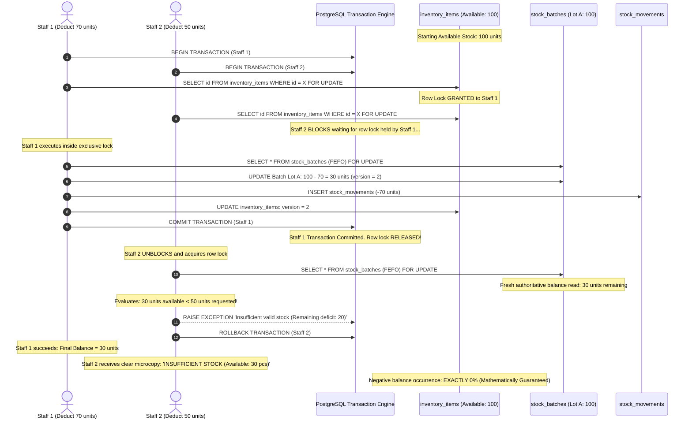

---

### F-10: Automated Threshold & Expiration Monitoring Alert Engine

This flowchart outlines the automated real-time threshold and shelf-life expiration monitoring triggers operating within the PostgreSQL engine.

```mermaid
flowchart TD
    DBTrigger([Database Mutation or Scheduled Keepalive Ping]) --> TriggerType{Event Type}
    
    %% THRESHOLD MONITORING
    TriggerType -- Stock Balance Mutated --> CheckThresholdRPC[Execute check_stock_thresholds Trigger]
    CheckThresholdRPC --> ReadStockBalance[Query Total Active Batches for Item]
    ReadStockBalance --> EvaluateMinQty{Compare Balance vs min_quantity}
    
    EvaluateMinQty -- Balance == 0 --> GenOOSKey[Dedup Key: OOS_itemId_date]
    GenOOSKey --> UpsertOOSNotif[UPSERT INTO notifications: type = 'OUT_OF_STOCK', priority = HIGH]
    
    EvaluateMinQty -- 0 < Balance <= min_quantity --> GenLowKey[Dedup Key: LOW_itemId_date]
    GenLowKey --> UpsertLowNotif[UPSERT INTO notifications: type = 'LOW_STOCK', priority = MEDIUM]
    
    EvaluateMinQty -- Balance > min_quantity --> AutoResolve[UPDATE notifications SET is_read = true WHERE item_id = itemId AND type IN ('LOW_STOCK', 'OUT_OF_STOCK')]

    %% EXPIRATION MONITORING
    TriggerType -- Daily Expiry Cron / Keepalive Check --> RunExpiryScan[Query Active Batches with quantity > 0 and expiry_date NOT NULL]
    RunExpiryScan --> EvalExpiryDate{Evaluate: expiry_date - CURRENT_DATE}
    
    EvalExpiryDate -- Diff < 0 Days (Past Expiry) --> GenExpiredKey[Dedup Key: EXPIRED_batchId]
    GenExpiredKey --> UpsertExpiredNotif[UPSERT INTO notifications: type = 'EXPIRED', priority = CRITICAL]
    
    EvalExpiryDate -- 0 <= Diff <= 7 Days --> GenSoonKey[Dedup Key: SOON_batchId]
    GenSoonKey --> UpsertSoonNotif[UPSERT INTO notifications: type = 'EXPIRING_SOON', priority = HIGH]
    
    EvalExpiryDate -- Diff > 7 Days --> ExpiryOK[Batch Healthy: No Alert Needed]
    
    %% DEPLETED BATCH EXCLUSION (RULE 24 & 25)
    TriggerType -- Batch Balance Reaches 0 --> ZeroQtyCheck[Batch quantity <= 0]
    ZeroQtyCheck --> RemoveExpiryAlerts[Exclude Batch from Active Expiry Views & Resolve Open Expiry Alerts]

    UpsertOOSNotif & UpsertLowNotif & UpsertExpiredNotif & UpsertSoonNotif --> WALEvent[PostgreSQL Emits WAL Insert to Realtime Engine]
```

---

### F-11: Real-Time Floating Notification Toast & Contextual Navigation

This flowchart models the client-side floating notification engine (`NotificationPopup.tsx`), WebSocket ingestion, and 1-click entity routing.

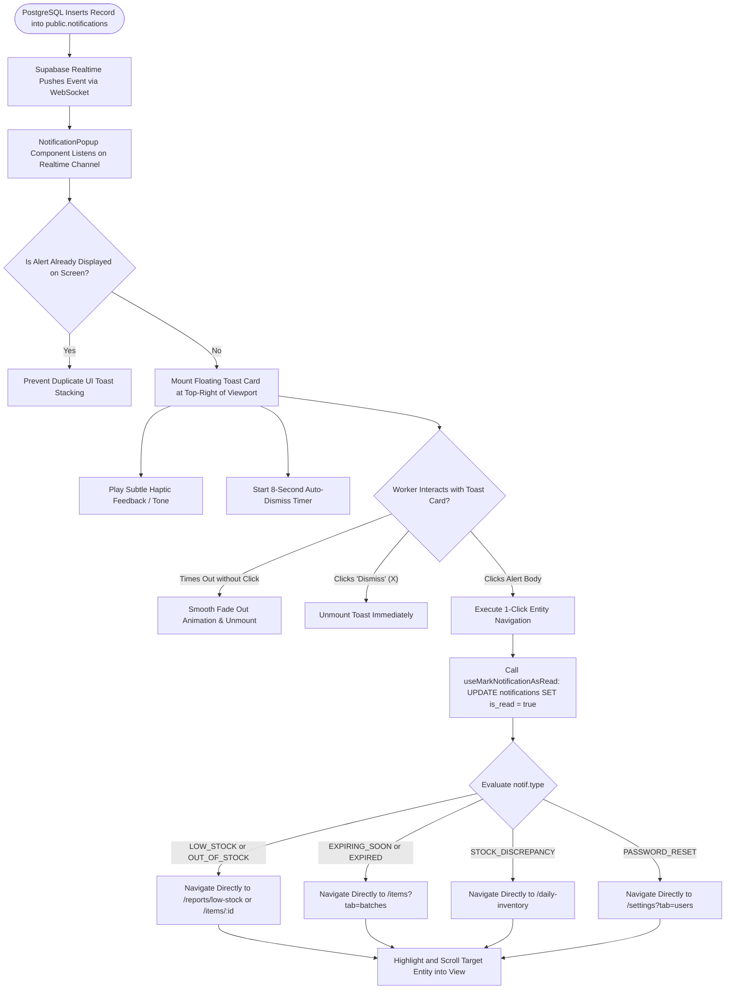

---

### F-12: Immutable Report Snapshot Creation & Multi-Format Export Engine

This flowchart models how finalized inventory sessions are retrieved from immutable report tables and rendered into high-fidelity PDF, Excel, and CSV documents.

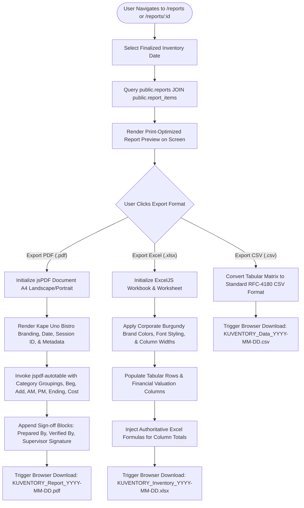

---

### F-13: Tier-0 Master Admin Governance Barrier (Zero-Trust 403 Shield)

This flowchart details the Zero-Trust boundary enforced between standard administrators (`ADMIN`) and the Tier 0 Master Administrator (`MASTER_ADMIN`), guaranteeing zero leakage of critical recovery controls.

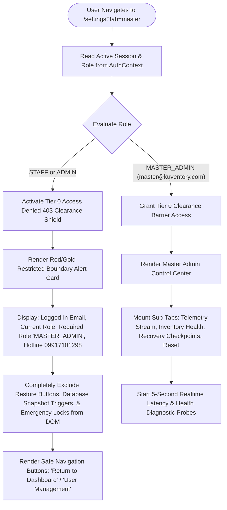

---

### F-14: Disaster Recovery Point-in-Time Checkpoint & 8-Step Restoration

This flowchart details the strict 8-step sequential Disaster Recovery protocol (Rules 100–128) required before applying any historical checkpoint over live production data.

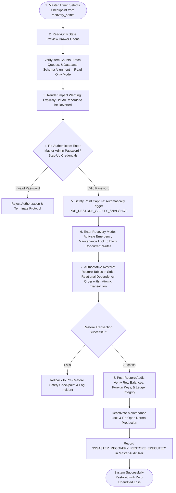

---

### F-15: Inventory Stock Drift Detection & Auto-Healing Engine

This flowchart models the inventory reconciliation engine that detects and resolves mathematical drift between catalog totals and the sum of discrete active batches.

```mermaid
flowchart TD
    StartDriftCheck([Master Admin Opens Inventory Health Tab]) --> QueryBalances[Execute Stock Audit Query]
    QueryBalances --> SumBatches[Compute Sum of quantity in public.stock_batches WHERE item_id = X]
    QueryBalances --> ReadCatalogStock[Read current_stock / ending_stock in public.inventory_items]
    
    SumBatches & ReadCatalogStock --> CompareBalances{Evaluate: Batch Sum == Catalog Stock?}
    CompareBalances -- Identical (Delta = 0) --> MarkHealthy[Mark Item Status: 'HEALTHY' (Green Badge)]
    
    CompareBalances -- Discrepancy Found (Delta != 0) --> FlagDrift[Flag Item Status: 'DRIFT DETECTED' (Amber Badge)]
    FlagDrift --> DisplayDeltaTable[Render Drift Table: Item Name, Batch Total, Recorded Total, Variance Delta]
    
    DisplayDeltaTable --> AdminAction{Master Admin Clicks 'Reconcile All Drift'}
    AdminAction -- Cancel --> RetainStatus([Discrepancy Retained for Manual Review])
    
    AdminAction -- Confirm --> ExecReconcileRPC[Execute reconcile_all_stock_drift RPC in PostgreSQL]
    ExecReconcileRPC --> AcquireItemLocks[Acquire Row Locks 'FOR UPDATE' on Affected Items]
    AcquireItemLocks --> AutoAdjustBatches[Create Balancing Adjustment Lot or Synchronize Catalog Balance]
    AutoAdjustBatches --> AppendAuditMovements[Insert Balancing Entry into stock_movements with Reason: 'Drift Auto-Heal']
    AppendAuditMovements --> CommitReconcile[Commit Transaction & Invalidate Queries]
    CommitReconcile --> EmitDriftSuccessToast[Display Success Toast: 'All Stock Drift Reconciled Successfully']
```

---

### F-16: Clean-Slate Catalog Reset Guard (Strict "DELETE" Confirmation)

This flowchart illustrates the safety barriers guarding the Clean-Slate Catalog Reset function, preventing accidental wipes during staging-to-production transitions.

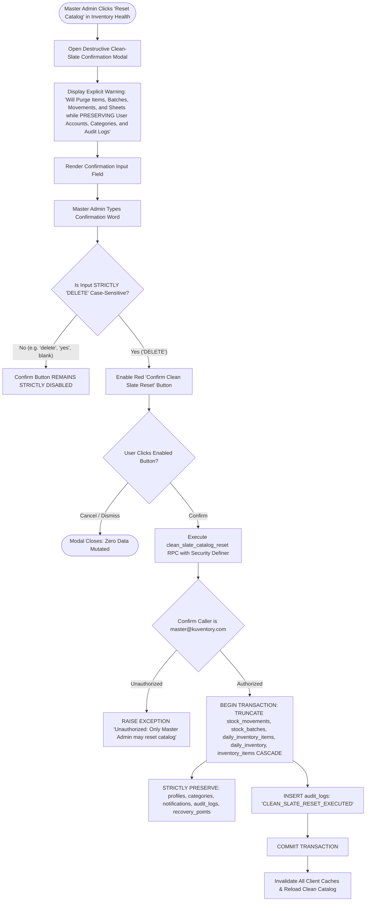

---

### F-17: Client-Side Background Keepalive & Database Sleep Prevention Daemon

This flowchart models the keepalive daemon (`initKeepaliveHeartbeat`) that protects free-tier Supabase managed PostgreSQL instances from 7-day inactivity pausing.

```mermaid
flowchart TD
    AppMount([App.tsx Mounts in Browser]) --> InitKeepalive[Call initKeepaliveHeartbeat Function]
    InitKeepalive --> CheckWindow{Is Window Object Defined?}
    CheckWindow -- No (SSR / Testing) --> TerminateKeepalive([Terminate: No Execution Needed])
    
    CheckWindow -- Yes --> SetTimer[Initialize 4-Hour Background Interval Timer]
    SetTimer --> TriggerInitialPing[Execute Initial Ping 3 Seconds After Mount]
    
    TriggerInitialPing & SetTimer --> ExecPing[Execute Lightweight Supabase Query: select id from profiles limit 1]
    ExecPing --> EvaluateResponse{Query Response Status}
    
    EvaluateResponse -- 200 OK Success --> LogKeepaliveSuccess[Log to Debug Console: '[Keepalive] Heartbeat ping successful']
    LogKeepaliveSuccess --> ResetTimer[Wait for Next 4-Hour Scheduled Interval]
    
    EvaluateResponse -- Network Failure / Error --> LogKeepaliveWarning[Log Warning: '[Keepalive] Heartbeat failed, will retry next interval']
    LogKeepaliveWarning --> ResetTimer
    
    ResetTimer --> KeepaliveLoop([PostgreSQL Database Remains Continuously Active & Awake])
```

---

## 4. SYSTEM INVARIANTS & INTEGRITY RULES SUMMARY

Every flowchart in this specification is designed to enforce the following core architectural invariants:

1. **Principle of Single Active Human Session (First Session Wins):**  
   Only one device may maintain an active lease for any user account at any moment. Secondary logins are rejected with `ACCOUNT IN USE`. Active leases are extended via heartbeats every 10–15 seconds with a 30–45 second expiration window, and released instantly on tab close via `fetch keepalive: true`.

2. **Principle of Batch Invariance:**  
   Items represent catalog products; batches represent distinct receipt lots. Incoming stock with differing expiration dates *must always* spawn a new batch in `stock_batches`. Batches with zero remaining balance are closed for allocation but permanently preserved in historical ledgers.

3. **Database-Authoritative FEFO Allocation:**  
   Stock deductions are sorted by `expiry_date ASC NULLS LAST, received_date ASC, id ASC` and executed inside PostgreSQL with row-level locks (`FOR UPDATE`), ensuring zero negative stock and serializing concurrent operations.

4. **Strict Mathematical Non-Negative Invariant:**  
   In physical inventory, balances cannot fall below zero ($\text{Ending} \ge 0$). Entering deductions greater than total available stock automatically zeroes ending stock to `0` and broadcasts a `STOCK_DISCREPANCY` alert. Negative keypresses are sanitized in real time.

5. **Immutable Historical Report Snapshots:**  
   Finalizing a shift freezes all counts and financial values into read-only records in `reports` and `report_items`. Finalized worksheets can never be altered post-hoc.

6. **Tier-0 Zero-Trust Governance:**  
   Critical recovery tools (point-in-time restoration, database snapshots, stock drift healing, catalog resets) are restricted exclusively to `master@kuventory.com` behind a strict 403 clearance shield. Restorations require mandatory step-up authentication, impact verification, and pre-restore safety checkpoint capture.

---
*End of KUVENTORY™ System Flowcharts Specification (v2.5 Production Release)*
